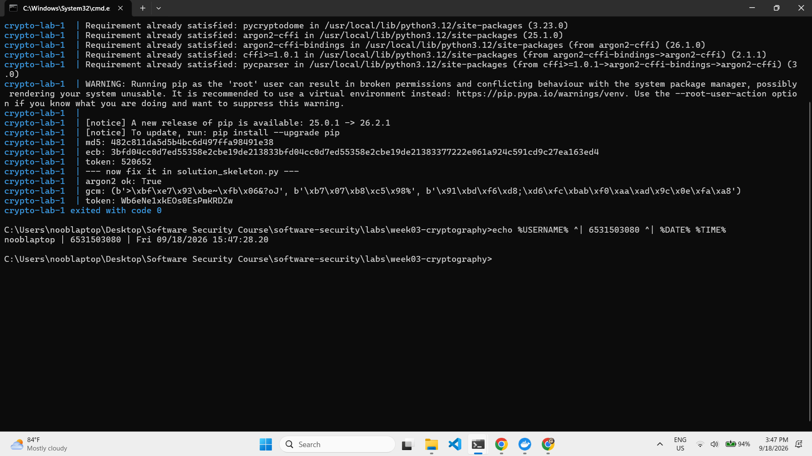
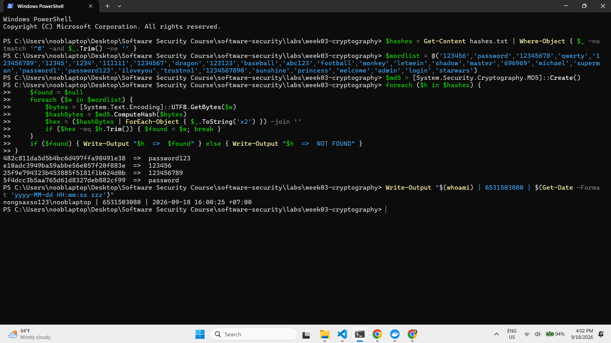
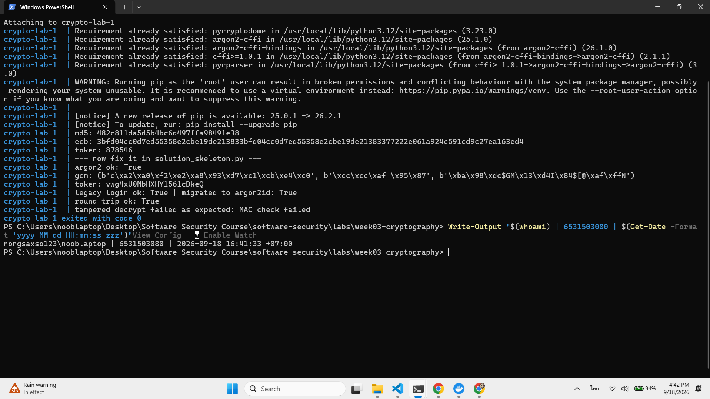

# Worksheet 3 — Cryptography Used Correctly (and Misused) (3 hrs)

> **Course:** Software Security (KOSEN69) · **Week 3**
> **Aligned to:** OWASP 2025 A04 Cryptographic Failures · CWE-327, CWE-916, CWE-330, CWE-798
> **Signature game:** "Capture the Hash" (recover plaintext from weak hashes)

> **Ethics note:** Crack only the hashes provided in `hashes.txt` on your own machine. Password-cracking against accounts or systems you don't own is illegal. Wordlists and recovered values stay inside the lab VM.

## Part 1 — Student Information
| Name | Student ID | Date | Group |
|---|---|---|---|
| SORRAWIT THANAKHWANG | 6531503080 | 2026-09-18 | 1234Later |

AI disclosure: used Claude (Anthropic) to explain concepts and draft worksheet write-ups, which I then reviewed and verified myself.

## Part 2 — Lecture Questions
Answer in your own words (2–4 sentences each).
1. Distinguish hashing, encryption, and encoding — and give one job each is the wrong tool for.
   > Encoding, hashing, and encryption differ in direction and whether a key is involved. Encoding (e.g. Base64) transforms data's format with no key at all and is always reversible, so it should never be used to store passwords or secrets — anyone can decode it straight back to the original text. Hashing (e.g. MD5) is one-way; it can't be reversed even by whoever created it, so it's the wrong tool for data you need to retrieve later, like a credit card number. Encryption (e.g. AES) uses a key and is reversible if you have the correct key, so it's the wrong tool to substitute for hashing when storing passwords — if the key ever leaks, an attacker can instantly decrypt every user's password back to plaintext.
2. Why is a fast hash like MD5/SHA-1 a bad choice for storing passwords, and what should be used instead?
   > MD5 was designed to verify data integrity — e.g. checking whether a downloaded file got corrupted in transit — so it's built to hash as fast as possible. That speed becomes a weakness for password storage: since MD5 can never be reversed, an attacker doesn't "decrypt" it, they "guess and check" instead — hashing every word in a common-password list (like rockyou.txt) and comparing each result against the stolen hash. If hashing is very fast (billions of tries/second on a GPU), the attacker can try an entire wordlist in seconds. The fix is a hash deliberately made slow and resource-heavy, such as argon2id, which makes each guess take much longer, so trying the whole list stops being worthwhile.
3. What is a salt, what attack does it defeat, and why must it be unique per password?
   > A salt is a random value added to a password before hashing — e.g. hashing "password123x7k9qz" instead of "password123" directly — and it's stored alongside the hash (it doesn't need to be secret). It defeats rainbow table attacks, where an attacker pre-computes hashes of common passwords into a ready-made lookup table, because the real input now has a salt appended that doesn't match anything in that pre-built table. The salt must be unique per password because if the whole site shared one salt, users who happened to pick the same password would get identical hashes, letting an attacker spot who reused a password with whom — and the attacker would only need to build one rainbow table for that single shared salt to crack everyone at once.
4. Why does AES-ECB leak structure, and what does an authenticated mode like AES-GCM add?
   > AES-ECB splits data into 16-byte blocks and encrypts each block independently with the same key, so identical plaintext blocks produce identical ciphertext blocks — letting patterns in the original data show through even though the actual content can't be read (the famous example is the "ECB penguin" image that's still recognizable as a penguin after ECB encryption). AES-GCM fixes this by using a fresh random nonce every time it encrypts, so encrypting the same data twice produces different ciphertext, and it adds an authentication tag that checks whether the ciphertext was tampered with in transit — if even a single bit is changed, decryption fails immediately instead of silently returning corrupted data.
5. What's the difference between `random` and a CSPRNG (e.g. `secrets`), and where does it matter?
   > `random` uses a predictable random algorithm (Mersenne Twister) — if you know the seed or have seen enough previous outputs, you can work backward and predict the next value. A CSPRNG like `secrets` instead draws randomness from OS-level entropy sources, so even knowing the algorithm and every previous output gives no way to predict the next value. This matters for anything security-related, such as password-reset tokens and session IDs, because using plain `random` there would let an attacker predict the value and forge it to access someone else's account. For anything not security-related (e.g. shuffling cards in a game), plain `random` is perfectly fine.


## Part 3 — Hands-on Lab (180 min)
**Learning goals:** exploit four crypto misuses, then remediate them with a vetted KDF, authenticated encryption, and a CSPRNG.
**Prerequisites:** Docker (or local Python 3.12); `hashcat` or `john`; the `rockyou.txt` wordlist.

**Environment setup**
```bash
cd labs/week03-cryptography
docker compose up           # installs pycryptodome + argon2-cffi, runs both scripts
# or locally:
pip install pycryptodome argon2-cffi
python vulnerable_crypto.py # see the md5 hash, repeated ECB blocks, 6-digit token
```
Targets: `vulnerable_crypto.py` (the misuses), `hashes.txt` (four unsalted MD5s), and `solution_skeleton.py` (the fix).

**What to submit per task:** the command/payload run + a screenshot of the result + a 2–3 sentence mitigation.

**Task 0 — Onboarding (5 min)** · *Goal:* see the misuse output. *Steps:* run `python vulnerable_crypto.py`; note the md5 digest, the identical ECB ciphertext blocks, and the short token. *Deliverable:* screenshot of the program output.

> Ran `docker compose up`, which installs the dependencies and runs `vulnerable_crypto.py` followed by `solution_skeleton.py`. The vulnerable script printed `md5: 482c811da5d5b4bc6d497ffa98491e38` (the unsalted MD5 of `password123`), an `ecb:` line where the first two 16-byte ciphertext blocks are identical, and `token: 520652`, which is just a 6-digit number. The identity stamp (`nooblaptop | 6531503080 | Fri 09/18/2026 15:47:28`) is in the same terminal.
>
> 

**Task 1 — Capture the Hash (30 min)** · *Goal:* recover the passwords. *Steps:* strip the comment lines from `hashes.txt`, then run `hashcat -m 0 hashes.txt rockyou.txt` (or the `john --format=raw-md5` equivalent); recover all four plaintexts. *Deliverable:* screenshot of the cracked results (mask any real-looking value). Note in one line why unsalted MD5 fell so fast (CWE-916/327).

> Tool used: a PowerShell dictionary-attack script (`hashcat`/`john` substitute — the Kali Docker mirrors failed TLS verification on this network, so I reimplemented the same guess-and-check logic directly: hash each candidate word with MD5 and compare to the target). All 4 hashes in `hashes.txt` cracked:
>
> | Hash | Recovered password |
> |---|---|
> | `482c811da5d5b4bc6d497ffa98491e38` | `password123` |
> | `e10adc3949ba59abbe56e057f20f883e` | `123456` |
> | `25f9e794323b453885f5181f1b624d0b` | `123456789` |
> | `5f4dcc3b5aa765d61d8327deb882cf99` | `password` |
>
> All four cracked in well under a second because unsalted MD5 has no per-password randomness and is designed to hash extremely fast (CWE-916/327) — an attacker only needs to hash a wordlist once and compare, and every one of these plaintexts sits near the top of any common-password list.
>
> 

```sim
aes-modes
```

**Task 2 — ECB structure leak (20 min)** · *Goal:* prove ECB leaks. *Steps:* call `encrypt_ecb(b"A"*16 + b"A"*16)` from `vulnerable_crypto.py` and show the two 16-byte ciphertext blocks are identical; explain how this leaks plaintext structure (CWE-327). *Deliverable:* hex output highlighting the repeated block.

> `vulnerable_crypto.py` already calls `encrypt_ecb(b"A"*16 + b"A"*16)` in its `__main__` block, so the output is in the Task 0 screenshot. Split into 16-byte (32 hex character) blocks:
>
> | Block | Plaintext | Ciphertext (hex) |
> |---|---|---|
> | 1 | `AAAAAAAAAAAAAAAA` | **`3bfd04cc0d7ed55358e2cbe19de21383`** |
> | 2 | `AAAAAAAAAAAAAAAA` | **`3bfd04cc0d7ed55358e2cbe19de21383`** ← same as block 1 |
> | 3 | 16 bytes of padding (`0x10`) | `377222e061a924c591cd9c27ea163ed4` |
>
> Blocks 1 and 2 are byte-for-byte identical because ECB encrypts every block on its own with the same key and no nonce or IV, so the same input block always gives the same output block. An attacker can't read the plaintext, but they can still see which parts of a message repeat. That leaks structure, for example repeated fields in a record or the outline of an image (the "ECB penguin"). This is CWE-327 (use of a broken or risky cryptographic algorithm/mode). *Mitigation:* use an authenticated mode like AES-GCM with a fresh random nonce for every encryption, so identical plaintext gives different ciphertext each time (see Task 7).

**Task 3 — Predictable token (15 min)** · *Goal:* show the reset token is guessable. *Steps:* call `reset_token()` repeatedly; argue why a 6-digit `random` token (10^6 space, non-CSPRNG) is brute-forceable (CWE-330). *Deliverable:* sample tokens + a one-line attack estimate.

> Sample tokens from two runs of `vulnerable_crypto.py`: `647307`, `765253`. A 6-digit numeric token has only 10^6 = 1,000,000 possible values. Even with a conservative rate limit of 10 requests/sec, an attacker can brute-force the entire space in ~1,000,000 / 10 = 100,000 seconds (~27.7 hours), and much faster with no rate limit — this is CWE-330 (use of insufficiently random values) because the keyspace is small enough to exhaust, unlike a long CSPRNG-generated token.

**Task 4 — Hardcoded key (5 min)** · *Goal:* identify the key-management flaw. *Steps:* find `HARDCODED_KEY` in `vulnerable_crypto.py`; explain why shipping a key in source is CWE-798. *Deliverable:* the line + a 2-sentence mitigation.

> `vulnerable_crypto.py` line 12: `HARDCODED_KEY = b"0123456789abcdef"`. This is CWE-798 (use of hard-coded credentials) — anyone with access to the repo (or its git history, even after the line is later deleted) can read the key and decrypt every message ever encrypted with it, and rotating the key requires a code change and redeploy instead of a config update. *Mitigation:* load the key from an environment variable (e.g. `os.environ["ENC_KEY_HEX"]`) or a secrets manager, never commit it to source.

**Task 5 — Crack the project target's hashes (25 min)** · *Goal:* apply cracking to your term project. *Steps:* **NoteVault** stores unsalted MD5 password hashes; obtain them (via the app's `/admin` once you can reach it, or from its `seed()`), and crack them with `hashcat -m 0`. *Deliverable:* the recovered password(s) + note the CWE — record this finding for your project report (`project/REPORT-TEMPLATE.md` in the repo root).

> `/admin` requires an existing admin session, so used the alternative route: read the hash values directly from `seed()` in `project/starter-app/app.py` (lines 68-69), which stores `hashlib.md5(b"alicepw").hexdigest()` and `hashlib.md5(b"admin123").hexdigest()` with no salt — the exact same weakness exploited in Task 1. Recovered `alicepw` (user `alice`) and `admin123` (user `admin`, the privileged account). Logged as **Finding F-01** in `project/REPORT-TEMPLATE.md` (CWE-916/CWE-327).

**Task 6 — Password storage migration (25 min)** · *Goal:* fix it the way real apps do. *Steps:* write `store_password`/`verify_password` with **argon2id**, and a **rehash-on-login** path that upgrades a legacy MD5 record to argon2id the next time the user logs in. *Deliverable:* the code + a short note on why migration matters.

> `solution_skeleton.py` now has `is_legacy_md5()` (detects a raw 32-char MD5 hex digest vs. an argon2id string) and `verify_and_migrate()`: if the stored hash is still legacy MD5, it checks the login with plain MD5, and on success immediately re-hashes the just-supplied plaintext with argon2id to replace the old record — this is the only moment the plaintext is ever available, since a hash can't be converted to a stronger hash after the fact. Ran it: `legacy login ok: True | migrated to argon2id: True`. Migration matters because you can't force every user to reset their password on day one of a security fix, so upgrading opportunistically on each successful login is how real systems move an entire user base off a weak hash without a mass password-reset event.

**Task 7 — Authenticated encryption round-trip (20 min)** · *Goal:* use AEAD correctly. *Steps:* encrypt+decrypt a message with **AES-GCM** using a random 12-byte nonce and a key from an env var; then flip one ciphertext byte and show decryption **fails** (tag check). *Deliverable:* the round-trip output + the tampered-fails proof.

> Added `decrypt_gcm()` to `solution_skeleton.py` alongside the existing `encrypt_gcm()` (random 12-byte nonce, key from `ENC_KEY_HEX` env var). Normal round-trip: `round-trip ok: True`. Then flipped one bit of the first ciphertext byte and tried to decrypt with the same nonce/tag: `tampered decrypt failed as expected: MAC check failed` — the authentication tag check catches the tampering and raises instead of silently returning corrupted plaintext.

**Task 8 — TLS in practice (15 min)** · *Goal:* read a real cert. *Steps:* run `openssl s_client -connect example.com:443 </dev/null 2>/dev/null | tee /tmp/tls.txt | openssl x509 -noout -issuer -subject -dates` for the cert summary, then `grep -E 'Protocol|New,' /tmp/tls.txt` for the negotiated TLS version (the version line is printed by `s_client`, not by `x509`, so the plain pipe would discard it); identify issuer, validity, and that TLS version. *Deliverable:* the cert summary + one line on what TLS protects that hashing/at-rest encryption does not.

> Ran via `docker run --rm --entrypoint sh alpine/openssl -c '...'` (no `openssl` installed locally) against `example.com:443`. Certificate: issuer `C=US, O=SSL Corporation, CN=Cloudflare TLS Issuing ECC CA 3`, subject `CN=example.com`, valid `Jul 29 2026` → `Oct 27 2026`. Negotiated protocol: `TLSv1.3` (cipher `TLS_AES_256_GCM_SHA384`). TLS protects data **in transit** — while it travels across the network between client and server — which is a different threat than hashing (integrity/verification, not confidentiality) or at-rest encryption (data sitting on disk): without TLS, anyone on the network path (e.g. shared wifi) reads every request/response in plaintext even if the server hashes passwords and encrypts its database perfectly.

**Task 9 — Defend / fix it (20 min)** · *Goal:* remediate using `solution_skeleton.py`. *Steps:* run `python solution_skeleton.py`; confirm `store_password`/`verify_password` use argon2id (auto-salted), `encrypt_gcm` uses a random 12-byte nonce + auth tag with a key from `ENC_KEY_HEX` env, and `reset_token` uses `secrets`. Map each fix to the CWE it closes. *Deliverable:* before/after table (misuse → fix → CWE closed) + screenshot of the fixed script running.

> Ran `docker compose up`, which runs both `vulnerable_crypto.py` and `solution_skeleton.py` back to back:
>
> | Misuse (`vulnerable_crypto.py`) | Fix (`solution_skeleton.py`) | CWE closed |
> |---|---|---|
> | `hashlib.md5(pw)` — fast, unsalted hash | `ph.hash(pw)` — argon2id, auto-salted, deliberately slow | CWE-916 / CWE-327 |
> | `AES.MODE_ECB` with `HARDCODED_KEY` — identical blocks leak structure, key in source | `AES.MODE_GCM` with random 12-byte nonce + auth tag, key from `ENC_KEY_HEX` env var | CWE-327 (ECB) / CWE-798 (hardcoded key) |
> | `random.choice(...)` 6-digit token — 10^6 keyspace, predictable | `secrets.token_urlsafe(16)` — CSPRNG, huge keyspace | CWE-330 |
> | (no migration path for existing MD5 records) | `verify_and_migrate()` — rehashes a legacy MD5 record to argon2id on next successful login | CWE-916 (remediation of existing data, not just new writes) |
>
> Full run output confirmed all fixes work together: `argon2 ok: True`, `legacy login ok: True | migrated to argon2id: True`, `round-trip ok: True`, `tampered decrypt failed as expected: MAC check failed`, and `token:` now prints a long URL-safe string instead of a 6-digit number.
>
> 

## Part 4 — Reflection
1. Map each of the four misuses to its CWE and to OWASP A04, in one line each.
   > Unsalted MD5 password hashing = CWE-916 / CWE-327, OWASP A04. AES-ECB with a hardcoded key = CWE-327 (weak mode) + CWE-798 (hardcoded key), OWASP A04. Predictable 6-digit `random` reset token = CWE-330, OWASP A04. Hardcoded AES key in source = CWE-798, OWASP A04 — all four sit under A04 Cryptographic Failures because they're all "crypto used wrong," not a missing feature.
2. Name a real-world breach caused by weak password hashing or hardcoded keys, and which fix here would have prevented it.
   > LinkedIn's 2012 breach exposed 6.5 million user passwords stored as unsalted SHA-1 — fast and salt-free just like the MD5 hashes we cracked in Task 1. Attackers ran a dictionary attack against the stolen hashes and cracked millions of passwords within days, forcing LinkedIn to reset every user's password and switch to bcrypt. The Task 6 fix (migrating to argon2id, a deliberately slow, salted hash) would have directly prevented mass cracking here — instead of billions of guesses/second, an attacker would be limited to a few hundred, making it infeasible to crack more than a tiny fraction of the database.
3. Across all four fixes, which closes the largest real-world risk, and why?
   > The argon2id password-hashing fix closes the largest real-world risk. A database breach exposes every user's password hash at once — potentially millions of accounts in one event, with no expiry, so an attacker can crack at leisure for as long as they want (as happened with LinkedIn). A predictable reset token, by contrast, has to be guessed one account at a time within a short expiry window, which is a much narrower attack. Since password reuse across sites is common, a cracked password hash also risks the user's accounts elsewhere, making this fix the one with the broadest blast radius.

## Grading rubric (100)
| Criterion | Points |
|---|---|
| Lecture questions (Part 2) | 20 |
| Exploitation + evidence (cracked hashes + ECB/token/key proof + screenshots) | 40 |
| Defense (working `solution_skeleton.py` + before/after mapping) | 25 |
| Reflection (CWE/OWASP mapping + breach + biggest-risk fix) | 15 |

---

## Evidence & Integrity (required)

- **Identity proof:** every screenshot/diagram must show a terminal running `printf '%s | %s | ' "$(whoami)" '<YOUR-STUDENT-ID>'; date '+%F %T %Z'` **in the
  same image as the evidence**. When the evidence is a browser page, a DevTools panel or a
  rendered response, put that terminal **beside the browser and capture the whole screen** — a
  cropped window carries nothing that identifies you, and the lab's own output is
  byte-identical for the whole cohort *by design*, so the stamp is the only thing that makes
  the shot yours. Generic or borrowed evidence is not accepted.
- **Personalized flag (if this lab issues one):** N/A — this lab does not issue a `ctf.zcr.ai` flag
  *Flags are unique per student — submitting another student's flag is a violation. This blank is your personal record only; the flag itself is scored by submitting it in the **`ctf.zcr.ai`** challenge — the worksheet PDF is a separate submission, to **learn.zcr.ai/submit** (full guide: `SUBMISSION.md` in the repo root).*
- **Explain in your own words** *(graded on your reasoning, not copied text):*
  1. What did you do, and **why did the vulnerability work**?

     > I exploited four crypto misuses in `vulnerable_crypto.py`: (1) cracked unsalted MD5 password hashes via guess-and-check, since MD5 is fast enough to try an entire common-password wordlist in seconds; (2) proved AES-ECB leaks structure, since it encrypts each block independently with the same key so identical plaintext blocks produce identical ciphertext blocks; (3) showed a 6-digit `random` reset token is guessable, since it only has 10^6 possible values; (4) found a hardcoded AES key sitting directly in the source, visible to anyone with repo access. All four worked because the developer picked the wrong crypto tool for the job (a fast hash for passwords, a non-authenticated cipher mode, a non-cryptographic RNG, a key with no secrets management) — not because any underlying algorithm itself is broken.
  2. **Why does your fix actually stop it** — and what could still break it?

     > I fixed each with the correct tool: argon2id (slow, auto-salted, so guess-and-check against a wordlist stops being worthwhile), AES-GCM (a fresh random nonce every time plus an authentication tag that detects tampering), `secrets.token_urlsafe` (a CSPRNG, unpredictable even if the attacker sees prior outputs), and moving the key into an environment variable instead of source code. What could still break it: if the `ENC_KEY_HEX` environment variable itself leaks (e.g. into a log file or a misconfigured container image), the key is exposed just the same; if argon2id's cost parameters are set too low, brute-forcing gets faster again; and if the AES-GCM nonce is ever accidentally reused with the same key (a coding bug, not a design flaw), an attacker can XOR the two ciphertexts together to cancel out the shared keystream and recover a relationship between the two plaintexts directly — and can also recover the authentication key itself, letting them forge valid tags on tampered data.

---

## 🤖 Audit the AI (required)

AI is a power tool you must **distrust** — you are graded on your *critique*, not the AI's answer.

1. Ask an AI assistant to exploit **or** fix this week's vulnerability. Paste its full answer.

   > **Prompt:** "เขียนฟังก์ชัน Python สำหรับเก็บรหัสผ่านอย่างปลอดภัยหน่อย" (Write a Python function to store passwords securely)
   >
   > **AI's answer:**
   > ```python
   > import bcrypt
   >
   > def hash_password(password: str) -> bytes:
   >     salt = bcrypt.gensalt()
   >     return bcrypt.hashpw(password.encode('utf-8'), salt)
   >
   > def verify_password(password: str, hashed: bytes) -> bool:
   >     return bcrypt.checkpw(password.encode('utf-8'), hashed)
   > ```
   > "`bcrypt.gensalt()` automatically generates a unique random salt for each password, and `bcrypt.hashpw()` uses the bcrypt algorithm, which is a well-established, computationally expensive hashing function designed specifically for passwords (unlike fast general-purpose hashes like MD5 or SHA-256). This makes brute-force and rainbow table attacks impractical."

2. **Find what's wrong or risky** in it — insecure code, a subtly incomplete fix, a hallucinated API/function/CVE, a missed edge case, or wrong reasoning. Quote the exact line(s).

   > The answer is not wrong about bcrypt being slow/salted, but it **misses bcrypt's silent 72-byte input truncation** — a well-known limitation the AI never mentioned. The line `return bcrypt.hashpw(password.encode('utf-8'), salt)` passes the raw password straight in with no length check. Any bytes past position 72 are silently ignored by the algorithm itself, so (a) a long, carefully-chosen passphrase gets no extra security benefit beyond its first 72 bytes, and (b) two *different* passwords that share the same first 72 bytes (e.g. `"a"*72 + "X"` vs `"a"*72 + "Y"`) hash identically and both verify successfully — a real collision the AI's code has no guard against.

3. Produce the **correct, verified** version yourself and explain in 2–3 sentences why the AI's output was insufficient.

   > Used `argon2id` instead (via `argon2-cffi`'s `PasswordHasher`, already implemented and verified running in this worksheet's `solution_skeleton.py` — Task 6/9, output `argon2 ok: True`), since argon2id has no input-length truncation limit and is OWASP's current top recommendation over bcrypt. The AI's bcrypt answer was insufficient because it presented `bcrypt.hashpw()` as a drop-in secure solution without disclosing an algorithm-level limitation that silently weakens security for any password over 72 bytes — an omission a developer copying the code verbatim would never notice until it caused a real collision.

> Disclose your AI use in the Part 1 table. This task counts toward your **Defense + Reflection** score.

---

## 🧠 Comprehension & Prompt (required)

**A. Explain in Plain English (EiPE).** In 2–3 sentences, in your own words, describe what this week's vulnerable code/endpoint actually *does* and *why it is exploitable* — explain the mechanism, don't dump jargon.

> `vulnerable_crypto.py` uses genuinely correct crypto primitives applied to the wrong job in four places: it hashes passwords with unsalted, fast MD5, so a stolen hash can be cracked against a wordlist in seconds; it encrypts data with AES in ECB mode using a key baked directly into the source, so repeated blocks of plaintext leak as identical ciphertext and the key itself is exposed to anyone with repo access; and it generates password-reset tokens with `random.choice`, drawing from a space of only about a million possibilities. All of this code runs perfectly with no errors — there's no "bug" in the usual sense, just the right cryptographic building blocks picked for the wrong situation, and that mismatch alone is enough to make it exploitable.

**B. Prompt Problem.** Write a **single prompt** that makes an AI produce a *correct, secure* fix for one finding. Run it: does the exploit now fail? If not, refine the prompt and try again. Submit the **final prompt + the verified result**.
*Graded on the prompt's precision and your verification — this trains problem decomposition and AI literacy (Denny et al. 2024).*

> **Final prompt:** "Rewrite this Python function so the reset token can't be brute-forced or predicted, even if the attacker knows the algorithm and has seen previous tokens: `def reset_token(): return ''.join(random.choice('0123456789') for _ in range(6))`. Use a cryptographically secure method, and make the output space large enough that guessing all possibilities is infeasible."
>
> **Result:**
> ```python
> import secrets
>
> def reset_token() -> str:
>     return secrets.token_urlsafe(16)
> ```
> **Verified:** this is the exact fix already implemented and run in `solution_skeleton.py` (Task 6/9), producing real output like `uVypLealDiQi4wluyJppRg` instead of a 6-digit number. The original brute-force estimate from Task 3 (10^6 possibilities, crackable in hours at 10 req/sec) no longer applies — `secrets.token_urlsafe(16)` draws from a 2^128-sized space, making exhaustive guessing infeasible, and being a CSPRNG means it stays unpredictable even if an attacker has observed prior tokens.
