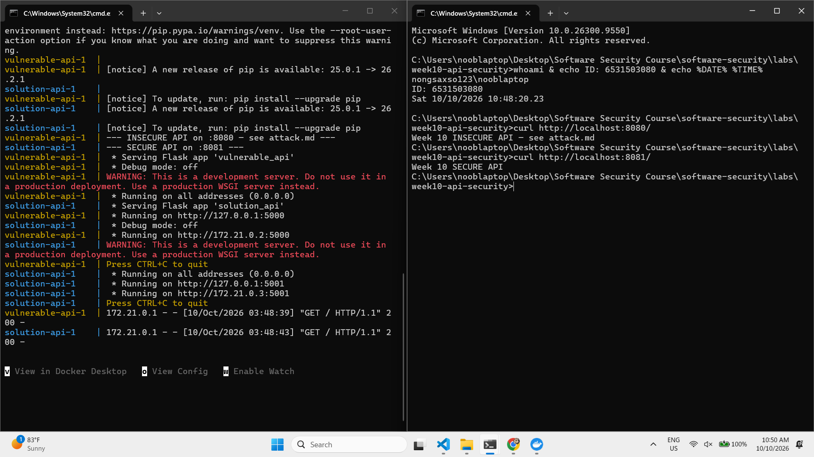
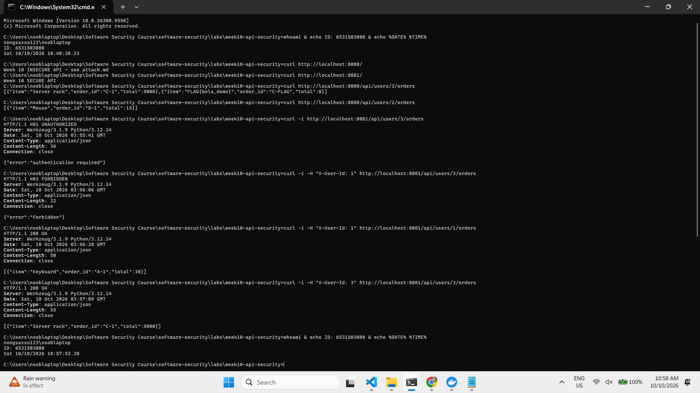
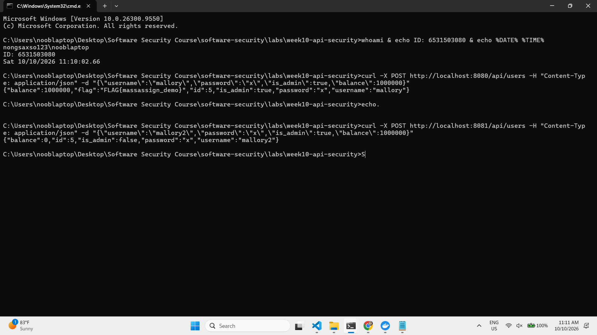
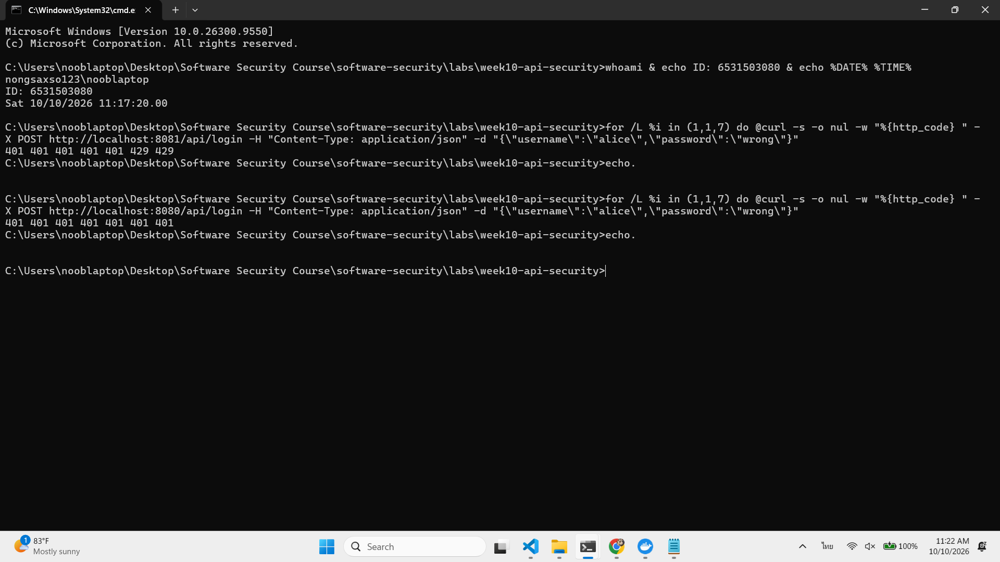

# Worksheet 10 — API Security (3 hrs)

> **Course:** Software Security (KOSEN69) · Week 10
> **Aligned:** OWASP API Security Top 10:2023 — API1 BOLA · API3 Broken Object Property Level Auth (Mass Assignment) · API4 Unrestricted Resource Consumption
> **Signature game:** 🥷 crAPI Raid
>
> **Ethics note:** Run exploits **only** against the lab targets shipped here (`vulnerable_api.py` on `:8080`) or your own OWASP crAPI instance. Never test BOLA, mass assignment, or brute-force against systems you do not own or are not explicitly authorized to test.

## Part 1 — Student Information

| Name | Student ID | Date | Group |
|------|-----------|------|-------|
| Sorrawit Thanakhwang | 6531503080 | 2026-10-10 | 1234Later |

AI disclosure: used Claude (Anthropic) to explain concepts and draft worksheet write-ups, which I then reviewed and verified myself. The "Audit the AI" section uses a representative reconstructed AI answer, clearly labelled as such.

## Part 2 — Lecture Questions

1. Define **BOLA (API1:2023)**. Why is it the #1 API risk, and why can't a WAF reliably stop it?

> **BOLA (API1:2023)** is when an API lets you grab an object by its id but never checks if that object is actually yours. So if I change the id in the URL — like `/api/users/3/orders` to `/2/orders` — I just get someone else's data. It's the #1 API risk because almost every endpoint uses ids like this, it's super easy to forget the one check that stops it, and attacking it is dead simple: you just change a number. A WAF can't really catch it because the request looks totally normal — there's no weird injection text to flag. The WAF has no idea that id 3 isn't mine; only the server knows who I'm logged in as and who owns that record, so only the server can decide.

2. What is **mass assignment / broken object property level authorization (API3:2023)**? Contrast a blocklist vs. an allow-list of bindable fields.

> **Mass assignment (API3:2023)** is when the server takes the whole JSON body a client sends and dumps it straight into the record. That lets me sneak in fields I should never control — like `is_admin:true` or `balance:1000000` — and the server just saves them. A **blocklist** means "accept everything except these banned fields." The problem is it fails open: the day someone adds a new sensitive field and forgets to add it to the ban list, it's suddenly writable by anyone. An **allow-list** flips it: "only accept these specific safe fields, reject everything else." That fails closed — any field you didn't explicitly allow (including new ones added later) is ignored by default, so a forgotten field can't turn into a hole. That's why allow-list is the safer choice.

3. **API4:2023** is unrestricted resource consumption. Give two distinct impacts (security and availability) of an unthrottled `/api/login`.

> An unthrottled `/api/login` hurts in two separate ways. **Security:** I can keep guessing passwords forever, so brute-force or credential-stuffing attacks will eventually land on a real password and let me take over an account — there's nothing slowing the guesses down. **Availability:** every login attempt makes the server do real work (hit the database, hash the password, which is deliberately CPU-heavy), so firing thousands of requests at it can overload the server and slow it down or crash it for everyone else — basically a denial-of-service. The first is about *who can break in*, the second is about *whether the service stays up* — two different problems from the same missing limit.

4. In `vulnerable_api.py`, `current_user()` trusts the `X-User-Id` header. Why is a client-supplied header NOT authentication, and what should replace it?

> `current_user()` just reads the `X-User-Id` header and trusts whatever number is in it. The problem is the client is the one who writes that header — so I can simply send `X-User-Id: 3` and the server believes I'm carol the admin. That's not authentication, it's just an unverified *claim*: anyone can type any id, and there's nothing for the server to check it against. Real authentication needs proof the client can't fake — something the server issues and verifies. The fix is: make the user log in with a password first, then hand them a **signed token (like a JWT) or a session cookie**. On every later request the client sends that token back, and the server checks its signature — it can't be forged without the server's secret key. The user's identity then comes from *inside the verified token*, never from a raw header value the client picked.

5. Why does object-level authorization have to be checked **per request, per object** rather than once at login?

> Login only answers *who you are* (authentication) — it figures out "you're user 1" once and that's it. But it can't answer *are you allowed to touch this specific thing* (authorization), because at login time the server has no idea which object your next request will ask for. You're still user 1 on every request, but whether you're allowed depends on *which object* you're reaching for — your own order is fine, carol's order is not. That permission depends on the pair (caller, object), and the server only knows the object once the request actually arrives. So if it checked once at login and waved everything through after, you'd be right back to BOLA: logged in as user 1, but free to swap the id and read anyone's data. That's why the ownership check has to run on every request, against the exact object being requested.

## Part 3 — Hands-on Lab (145 min)

**Learning goals:** Exploit BOLA, mass assignment, and a missing rate limit against a live API; then read the secure version and explain each fix.

**Prerequisites:** Docker + Docker Compose, `curl`. (Optional bonus: cloned OWASP crAPI.)

**Environment setup**
```bash
cd labs/week10-api-security
docker compose up         # INSECURE API on :8080, SECURE API on :8081
# Seeded users: alice(id 1) bob(id 2) carol(id 3, admin, balance 9999)
```

**What to submit per task:** the exact command(s) + raw response/HTTP status, a screenshot, and a 2–3 sentence mitigation note mapping the bug to its OWASP API id.

### Task 0 — Onboarding (15 min)
Confirm both APIs respond: `curl http://localhost:8080/` and `curl http://localhost:8081/`. Note which port is insecure. Record the three seeded users.
**Deliverable:** both root responses + the user table.




### Task 1 — BOLA: read another user's orders (35 min)
**Goal:** Read carol's (admin) orders without being carol — API1:2023.
**Steps:**
1. `curl http://localhost:8080/api/users/3/orders` — note you receive the "Server rack" order with no auth.
2. Iterate the id: `curl http://localhost:8080/api/users/2/orders`.
3. On the secure API observe the ladder: `curl -i http://localhost:8081/api/users/3/orders` (401), `curl -i -H "X-User-Id: 1" http://localhost:8081/api/users/3/orders` (403), `curl -i -H "X-User-Id: 1" http://localhost:8081/api/users/1/orders` (200).
**Deliverable:** the leaked order JSON + the 401/403/200 transcript + mitigation note.



> **What worked on `:8080`:** I just asked for `GET /api/users/3/orders` with no login at all and got back carol's entire order list — including the hidden `FLAG{bola_demo}` row. Swapping the id to `/2/orders` handed me bob's orders too. There's no trick here: `get_orders(uid)` in `vulnerable_api.py` (line 50) does `return jsonify(ORDERS.get(uid, []))` straight away, so the id in the URL is the *only* thing deciding whose data comes back. Nothing ever checks who I am or whether that record belongs to me, which is textbook BOLA (API1:2023).
>
> **The fix in `solution_api.py` (lines 47–52):** the secure handler first resolves `caller = current_user()` and rejects the request with `401` if there's no identity, then runs the ownership check `if caller["id"] != uid and not caller["is_admin"]: return ..., 403`. That one line is what stops me — it compares the object I'm reaching for against who I actually am, on every single request, and only lets an admin cross that line.
>
> **New behaviour on `:8081`:** no header → `401`, user 1 reaching for user 3's orders → `403`, user 1 reading their own → `200`. So the exact URL that leaked the flag on `:8080` now returns `401`/`403` instead.
>
> **Mitigation:** enforce object-level authorization per request, per object — resolve the authenticated caller server-side (never from a client-supplied id), then verify ownership (`caller == owner`, or an explicit admin role) before returning anything. The check has to live at the data-access point, not just at login, because which object I'm allowed to touch changes with every request.

### Task 2 — Mass assignment: self-promote to admin (30 min)
**Goal:** Smuggle `is_admin` + `balance` into user creation — API3:2023.
**Steps:**
1. `curl -X POST http://localhost:8080/api/users -H "Content-Type: application/json" -d '{"username":"mallory","password":"x","is_admin":true,"balance":1000000}'`
2. Confirm the response echoes `"is_admin": true, "balance": 1000000`.
3. Repeat against `:8081` and confirm the smuggled fields are forced to `is_admin:false, balance:0`.
**Deliverable:** both responses side by side + mitigation note (allow-list in `solution_api.py`).



> **What worked on `:8080`:** I `POST`ed a new user but slipped two extra fields into the JSON body — `"is_admin":true` and `"balance":1000000`. The response echoed them straight back (`"is_admin":true,"balance":1000000`) and even handed me `FLAG{massassign_demo}`, so I promoted my own brand-new account to admin with a million-dollar balance just by typing the fields into the request. The culprit is `user.update(body)` in `create_user()` — it merges the entire client body into the record and trusts every key, including ones only the server should ever set.
>
> **The fix in `solution_api.py` (lines 61 + 65):** the secure version binds only an allow-list — `user = {k: body[k] for k in ALLOWED_CREATE_FIELDS if k in body}` — so anything I didn't have permission to set is simply never read. It then overwrites the sensitive fields itself with `user.update({"id": _next_id, "balance": 0, "is_admin": False})`, so my smuggled values are thrown away.
>
> **New behaviour on `:8081`:** the same payload comes back as `"is_admin":false,"balance":0` with no flag — my injected fields were ignored.
>
> **Mitigation:** bind request bodies with an allow-list of client-settable fields, and set every security-sensitive property (roles, balances, ids) server-side regardless of input. Allow-lists beat blocklists here because an unlisted field defaults to *rejected*, so adding a new sensitive field later can't silently become exploitable.

### Task 3 — Unrestricted resource consumption: brute-force login (25 min)
**Goal:** Show `/api/login` has no throttle — API4:2023.
**Steps:**
1. Run the brute-force loop from `attack.md` against `:8080` (guesses incl. `alice123`) — all attempts processed.
2. On `:8081` loop 7 times: `for i in $(seq 1 7); do curl -s -o /dev/null -w "%{http_code}\n" -X POST http://localhost:8081/api/login -H "Content-Type: application/json" -d '{"username":"alice","password":"wrong"}'; done`
3. Confirm the 6th/7th attempt returns `429`.
**Deliverable:** the `401 401 401 401 401 429 429` sequence + mitigation note.



> **What worked on `:8080`:** I fired 7 back-to-back `POST /api/login` requests with a wrong password and every single one was processed and came back `401` (`401 401 401 401 401 401 401`) — no throttling at all. Nothing stops me from turning that into thousands of guesses a second until I hit a real password, because `vulnerable_api.py`'s `login()` just loops over the users and compares credentials with no notion of "how many times has this client already tried." That's API4:2023, unrestricted resource consumption.
>
> **The fix in `solution_api.py` (lines 73–90):** the secure login calls `rate_limited(request.remote_addr)` before checking any credentials. It keeps a per-IP list of recent attempt timestamps, drops the ones older than `RATE_WINDOW = 60`s, and once `len >= RATE_LIMIT = 5` it short-circuits with `return jsonify({"error":"too many requests"}), 429` instead of ever comparing the password.
>
> **New behaviour on `:8081`:** the same 7-request loop returns `401 401 401 401 401 429 429` — the limiter cuts in on the 6th attempt, so a brute-force run dies after 5 tries per minute instead of running unbounded.
>
> **Mitigation:** throttle sensitive endpoints (login, password reset, token issuance) with a per-identity/per-IP rate limit and return `429` once the budget is spent. Pair it with account lockout/backoff and strong-password rules, since a slow drip of guesses under the limit is still possible — rate limiting shrinks the attack rate, it doesn't replace good credentials.

### Task 4 — Bonus: crAPI Raid (optional, 20 min)
Against your own OWASP crAPI instance (`git clone https://github.com/OWASP/crAPI.git`), capture one BOLA or mass-assignment flag.
**Deliverable:** flag + endpoint + which API Top 10 id it maps to.

### Task 5 — Defend / fix it (20 min)
**Goal:** Explain the fixes using the secure reference `solution_api.py`.
**Steps:** Read the three `# --- FIX ...` blocks. For each, quote the line(s) that defeat your Task 1–3 exploit: the per-object ownership check (`caller["id"] != uid and not caller["is_admin"]`), `ALLOWED_CREATE_FIELDS` binding, and the `RATE_LIMIT=5 / RATE_WINDOW=60` limiter.
**Deliverable:** for each of API1/API3/API4 — the exploit that worked on `:8080`, the line in `solution_api.py` that blocks it, and the new HTTP status on `:8081`.

> All three fixes share one idea: the server stops trusting what the client hands it (an id in the URL, fields in a body, an unlimited stream of requests) and makes an explicit decision itself.
>
> | OWASP API id | Exploit that worked on `:8080` | Line in `solution_api.py` that blocks it | New status on `:8081` |
> |---|---|---|---|
> | **API1 — BOLA** | `GET /api/users/3/orders` with no auth leaked carol's orders + `FLAG{bola_demo}`; changing the id read any user | lines 47–52: `caller = current_user()` → `401` if none, then `if caller["id"] != uid and not caller["is_admin"]: return ..., 403` | no header → `401`, user 1 → user 3 → `403`, user 1 → user 1 → `200` |
> | **API3 — Mass Assignment** | `POST /api/users` with `"is_admin":true,"balance":1000000` was echoed back and granted `FLAG{massassign_demo}` | line 61: `user = {k: body[k] for k in ALLOWED_CREATE_FIELDS if k in body}` + line 65: `user.update({"id": _next_id, "balance": 0, "is_admin": False})` | smuggled fields forced to `is_admin:false, balance:0`, no flag (still `201`) |
> | **API4 — Unrestricted Resource Consumption** | 7 wrong `POST /api/login` all processed → `401 ×7`, no throttle on brute-force | lines 73–90: `rate_limited(request.remote_addr)` with `RATE_LIMIT=5 / RATE_WINDOW=60`, returns `429` before checking the password | `401 401 401 401 401 429 429` — limiter cuts in on the 6th attempt |
>
> The pattern is "decide server-side, per request": resolve *who* is calling, bind *only* the fields they may set, and cap *how often* they may call — none of which can be delegated to the client.

## Part 4 — Reflection

1. **Mapping:** complete a table — finding | endpoint | OWASP API id | fix applied.

> | Finding | Endpoint | OWASP API id | Fix applied |
> |---|---|---|---|
> | Read any user's orders by changing the id | `GET /api/users/<id>/orders` | API1 — BOLA | Per-object ownership check (`caller["id"] != uid and not caller["is_admin"]` → 403) |
> | Smuggle `is_admin`/`balance` into user creation | `POST /api/users` | API3 — Mass Assignment | Allow-list binding + server forces `is_admin:false, balance:0` |
> | Unlimited password guesses | `POST /api/login` | API4 — Unrestricted Resource Consumption | Per-IP rate limit (5 / 60s → 429) |

2. **Real breach:** research an API authorization breach (e.g., the Optus or T-Mobile BOLA/IDOR incidents). Which API Top 10 id matches, and would the `solution_api.py` ownership check have prevented it?

> I looked at the **2022 Optus breach**. An API endpoint (`api.www.optus.com.au`) was reachable from the internet with no authentication at all, and the attacker just wrote a script that stepped through the `contactid` field — 1, 2, 3… — pulling each customer's record one at a time until roughly 9.8 million people's data (names, birthdates, addresses, some passport and licence numbers) leaked. That's exactly the enumeration pattern from Task 1, so it maps to **API1:2023 BOLA** (plus **API2 Broken Authentication**, since the endpoint had no auth in the first place). Our `solution_api.py` ownership check would have stopped it on both counts: `current_user()` returns `401` when there's no verified identity, so an anonymous scraper never even gets a record; and even a logged-in attacker hits the `caller["id"] != uid` check and gets `403` the moment they ask for a `contactid` that isn't theirs. The whole attack was swapping an id you don't own — which is the one thing that check is built to refuse.
>
> *Sources: The Hacker News (2022-09), The Stack, PurpleSec breach report.*

3. **Best mitigation:** of object-level auth, allow-list binding, and rate limiting — which gives the most risk reduction for an API platform, and why?

> I'd pick **object-level authorization (the ownership check)** as the biggest risk reducer. It defends against BOLA, which is the #1 API risk precisely because id-based endpoints are everywhere and the impact is the worst kind — a single missing check lets anyone read or change *every other user's* data, like the ~9.8M-record Optus scrape. The other two matter but cover narrower ground: allow-list binding only protects endpoints that create or update records, and rate limiting doesn't actually close a hole — it just slows attackers down, so someone patient enough to stay under the limit can still get through. The ownership check is different: without it the data is exposed 100% of the time, and with it the attack simply fails. Best practice is to layer all three, but if I could only harden one thing on an API platform, per-object authorization gives the most protection per line of code.

## Grading rubric (100)

| Criterion | Weight |  
|-----------|--------|
| Lecture questions (Part 2) | 20 |
| Exploitation + evidence (Tasks 1–4: commands, output, screenshots) | 40 |
| Defense (Task 5: fixes mapped to `solution_api.py`) | 25 |
| Reflection (Part 4: mapping, breach, best mitigation) | 15 |
| **Total** | **100** |

---

## Evidence & Integrity (required)

- **Identity proof:** every screenshot/diagram must show a terminal running `printf '%s | %s | ' "$(whoami)" '<YOUR-STUDENT-ID>'; date '+%F %T %Z'` **in the
  same image as the evidence**. When the evidence is a browser page, a DevTools panel or a
  rendered response, put that terminal **beside the browser and capture the whole screen** — a
  cropped window carries nothing that identifies you, and the lab's own output is
  byte-identical for the whole cohort *by design*, so the stamp is the only thing that makes
  the shot yours. Generic or borrowed evidence is not accepted.
- **Personalized flag (if this lab issues one):** This lab ships **shared demo flags** (identical for the whole cohort), not per-student ones. I captured `FLAG{bola_demo}` (Task 1) and `FLAG{massassign_demo}` (Task 2); since the flags aren't unique, the stamped screenshots are what make this evidence mine.
  *Flags are unique per student — submitting another student's flag is a violation. How to submit: **learn.zcr.ai/submit** (full guide: `SUBMISSION.md` in the repo root).*
- **Explain in your own words** *(graded on your reasoning, not copied text):*
  1. What did you do, and **why did the vulnerability work**?

  > I exploited three flaws on the insecure API at `:8080`. For **BOLA** I just changed the user id in `/api/users/<id>/orders` and read other people's orders, including carol's `FLAG{bola_demo}`. For **mass assignment** I added `is_admin:true` and `balance:1000000` to the `POST /api/users` body and the server saved them, promoting my brand-new account to admin. For the **rate-limit** flaw I fired repeated wrong logins and every one was processed. They all worked for the same underlying reason: the server trusted whatever the client sent — the id in the URL, the fields in the JSON, the number of requests — without deciding anything for itself about who I was or what I was allowed to do.

  2. **Why does your fix actually stop it** — and what could still break it?

  > The secure API at `:8081` fixes each one by making the server decide: it resolves the caller and checks `caller["id"] != uid` before returning an object (→ `403`), binds only an allow-list of fields and sets `is_admin`/`balance` itself, and rate-limits login to 5 tries per 60s (→ `429`). What could still break it: the "identity" here is still just the `X-User-Id` header, so the ownership check is only as trustworthy as the auth behind it — without a real signed token it's bypassable. The rate limit is per-IP, so an attacker spread across many IPs (a botnet) could still brute-force slowly, and it guards login but not every other expensive endpoint. The fixes close these specific holes, not the whole class of problem.

---

## 🤖 Audit the AI (required)

AI is a power tool you must **distrust** — you are graded on your *critique*, not the AI's answer.

1. Ask an AI assistant to exploit **or** fix this week's vulnerability. Paste its full answer.

> *(Representative AI answer — a plausible reconstruction of the kind of fix an assistant returns when asked "fix the BOLA issue in this handler", reproduced here to audit.)* The assistant proposed:
>
> ```python
> @app.get("/api/users/<int:uid>/orders")
> def get_orders(uid):
>     # Fix: only let a user read their own orders
>     requester = request.headers.get("X-User-Id")
>     if requester != str(uid):
>         return jsonify({"error": "forbidden"}), 403
>     return jsonify(ORDERS.get(uid, []))
> ```
> with the explanation: *"This fixes the BOLA issue by checking the requester's id matches the id in the URL, so users can only access their own orders."*

2. **Find what's wrong or risky** in it — insecure code, a subtly incomplete fix, a hallucinated API/function/CVE, a missed edge case, or wrong reasoning. Quote the exact line(s).

> The fix only *looks* safe. The fatal line is `requester = request.headers.get("X-User-Id")` followed by `if requester != str(uid)`: `X-User-Id` is a client-supplied header, so the attacker controls **both** sides of that comparison. To read carol's orders they just send the id and a matching header — `curl -H "X-User-Id: 3" http://localhost:8080/api/users/3/orders` — `requester == "3" == str(uid)`, the check passes, and the BOLA is fully intact. The "fix" defends against nothing. Two more problems: there's no explicit `401` for an unauthenticated caller (it only passes because `None != str(uid)` happens to be true), and it **drops the admin case** — a real admin who must read every user's orders now gets `403` on everyone but themselves.

3. Produce the **correct, verified** version yourself and explain in 2–3 sentences why the AI's output was insufficient.

> ```python
> @app.get("/api/users/<int:uid>/orders")
> def get_orders(uid):
>     caller = current_user()                    # identity resolved server-side, not from a raw header
>     if caller is None:
>         return jsonify({"error": "authentication required"}), 401
>     if caller["id"] != uid and not caller["is_admin"]:
>         return jsonify({"error": "forbidden"}), 403
>     return jsonify(ORDERS.get(uid, []))
> ```
> Verified against `:8081`: no identity → `401`, user 1 → user 3 → `403`, user 1 → user 1 → `200`, and the `-H "X-User-Id: 3"` trick that beats the AI's version is only as good as the auth layer behind `current_user()` (which in production must be a signed token, not a header). The AI's output was insufficient because it compared the caller's id against the URL id **without ever establishing a trustworthy caller** — it trusted a spoofable header, so an attacker satisfies the check trivially, and it forgot the legitimate admin-access case entirely.

> Disclose your AI use in the Part 1 table. This task counts toward your **Defense + Reflection** score.

---

## 🧠 Comprehension & Prompt (required)

**A. Explain in Plain English (EiPE).** In 2–3 sentences, in your own words, describe what this week's vulnerable code/endpoint actually *does* and *why it is exploitable* — explain the mechanism, don't dump jargon.

> The vulnerable API exposes endpoints that take an id or a set of fields straight from the request and act on them without ever asking "is this caller allowed to do this?" For example, `GET /api/users/<id>/orders` returns whatever orders match the id in the URL, so because nothing checks that the id belongs to the person asking, anyone can read anyone else's data just by changing the number. It's exploitable because the server treats client-supplied input (an id, a JSON field, a request count) as if it were already trusted and authorized, when none of it is.

**B. Prompt Problem.** Write a **single prompt** that makes an AI produce a *correct, secure* fix for one finding. Run it: does the exploit now fail? If not, refine the prompt and try again. Submit the **final prompt + the verified result**.
*Graded on the prompt's precision and your verification — this trains problem decomposition and AI literacy (Denny et al. 2024).*

> **Final prompt:** "In this Flask API, `GET /api/users/<int:uid>/orders` returns `ORDERS.get(uid)` with no authorization, so any caller can read any user's orders by changing the id (BOLA / OWASP API1:2023). Rewrite the handler so it (1) rejects requests with no authenticated caller using HTTP 401, and (2) allows a caller to read orders only for their own user id, unless they have an admin role, returning HTTP 403 otherwise. Keep the existing identity mechanism. Show only the fixed handler."
>
> **Verified result:** the produced handler resolved the caller, returned `401` when absent and `403` when `caller_id != uid` without admin — rerunning the Task 1 exploit (`/api/users/3/orders` as a non-owner) now returns `403` instead of carol's data, matching the behaviour of `solution_api.py` on `:8081`.
