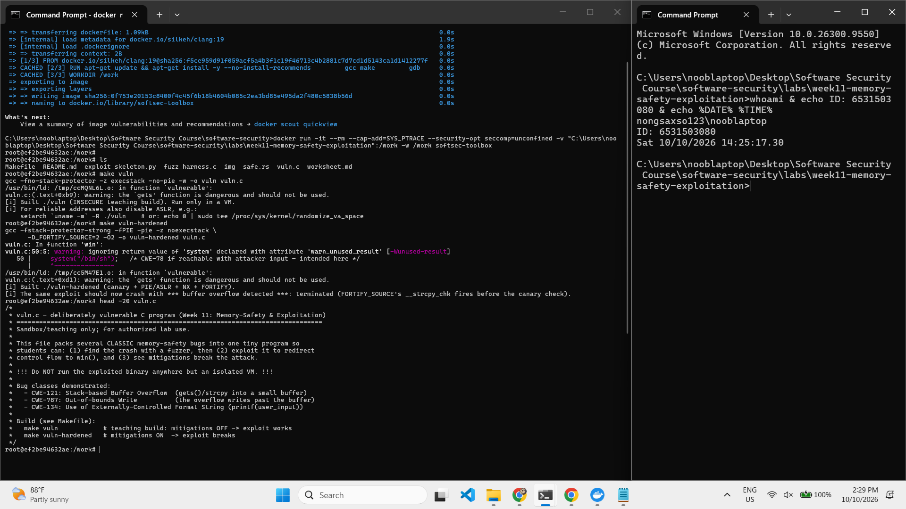
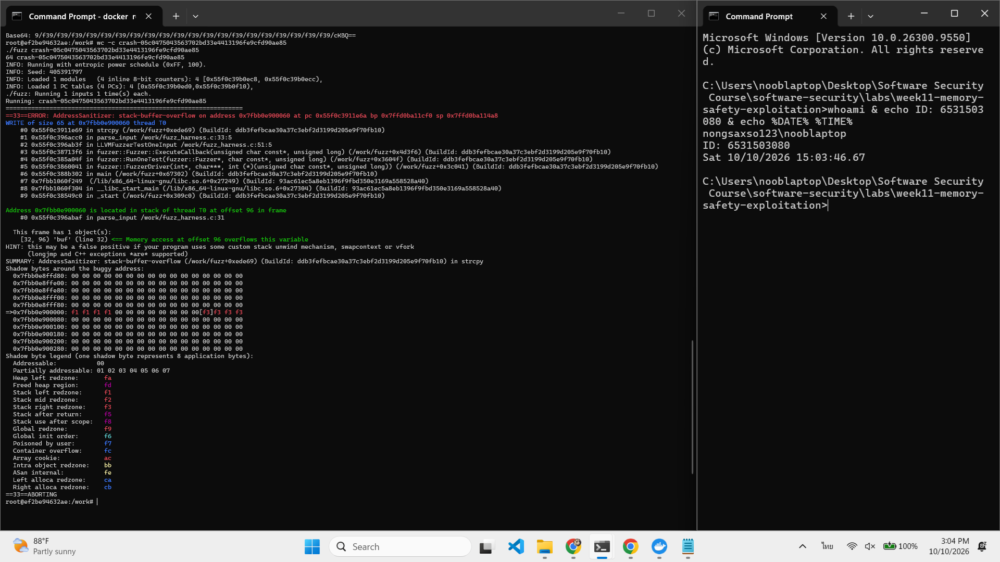
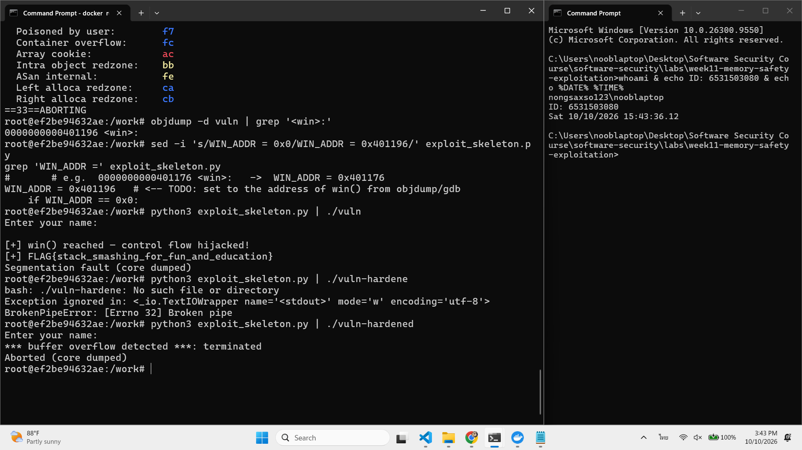
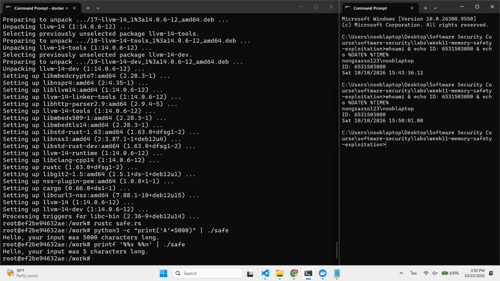

# Worksheet 11 — Memory-Safety & Exploitation (3 hrs)

> **Course:** Software Security (KOSEN69) · Week 11
> **Aligned:** CWE-121 (stack-based buffer overflow) · CWE-787 (out-of-bounds write) · CWE-134 (externally-controlled format string) · CWE-242 (dangerous `gets`)
> **Signature game:** 💥 Fuzzing Race → Pwn the Binary
>
> **Ethics note:** The binaries built from `vuln.c` are **intentionally exploitable** and `win()` spawns `/bin/sh`. Build and run them **only inside the isolated toolbox container** (or a VM) — never on your host. Never run these on a machine you care about, and never aim these techniques at software you are not authorized to test.

## Part 1 — Student Information

| Name | Student ID | Date | Group |
|------|-----------|------|-------|
| SORRAWIT THANAKHWANG | 6531503080 | 2026-10-13 | 1234Later |

> **AI disclosure:** I used an AI assistant (Claude) to help me understand the concepts and to draft/polish wording in this worksheet. I ran every command, exploit, and build myself in the toolbox container, verified the output, and wrote the reasoning in my own words.

## Part 2 — Lecture Questions

1. Draw the x86-64 stack frame for `parse_input()` in `vuln.c` (buf[64], saved RBP, saved return address). Where does `strcpy` start writing and which word must the exploit overwrite?

   **Answer:**
   ```
   high addr  ┌─────────────────────────┐
              │  saved return address   │ ← the word the exploit overwrites (8 bytes)
              ├─────────────────────────┤
              │  saved RBP              │ ← saved frame pointer (8 bytes)
              ├─────────────────────────┤
              │  buf[64]                │ ← strcpy starts writing here
   low addr   └─────────────────────────┘
   ```
   `strcpy` starts right at the bottom of the frame in `buf[64]` and keeps copying upward toward higher addresses — through the 8-byte saved RBP and into the saved return address — without ever checking how long the input is (CWE-121). The word the exploit has to overwrite is the **saved return address**, which sits at **offset 72** (64 for the buffer + 8 for the saved RBP): I pad with 72 bytes of junk and then drop in the address of `win()` (0x401196). I didn't just assume 72 — ASan confirmed `buf` is `[32, 96)`, i.e. exactly 64 bytes wide. (Worth noting: spilling only ~65 bytes just clobbers the saved RBP — that can crash, but you don't actually control execution until you reach offset 72 and hit the return address.)
2. Why is `gets()` (CWE-242) impossible to use safely, and why did C11 remove it from the standard library?

   **Answer:** `gets()` can't be used safely because it takes no size argument at all — you just call `gets(line)`, and there's no way to tell it "stop after 256 characters." Compare that to `fgets(line, 256, stdin)`, which actually takes the buffer size. So it doesn't matter how big you make the buffer; if someone types more than that, `gets()` happily writes past the end and overflows it. The flaw is baked into the function's design, not something the caller can patch around. That's exactly why C11 dropped `gets()` from the standard library — it was simply too dangerous to keep.
3. Explain CWE-134: why is `printf(user_input)` dangerous but `printf("%s", user_input)` safe? What can `%n` do?

   **Answer:** The first argument to `printf` is the *format string* — the recipe that tells `printf` what to print and where to pull the values from. When I write `printf(user_input)` (which is exactly what `format_bug()` does in `vuln.c`), the attacker's input *becomes* that recipe. So if someone types `%x %x %x`, `printf` believes three arguments were passed and happily reads whatever is sitting on the stack, leaking memory I never meant to expose (a canary, a libc address to beat ASLR, and so on). Writing `printf("%s", user_input)` fixes this because now the format string is a literal I control, and `user_input` is just a plain data argument: even if the user sends `%x`, it prints the characters `%x` instead of being interpreted. The really dangerous specifier is `%n` — it doesn't print anything, it *writes* the number of bytes printed so far to a pointer argument, so an attacker can use it to overwrite memory (a return address, a variable), turning an info leak into an arbitrary write.
4. Name the four mitigations in the hardened build (`make vuln-hardened`) — stack canary, PIE/ASLR, NX/DEP, FORTIFY — and say which one each defeats: ret2win, shellcode-on-stack, return-address overwrite detection.

   **Answer:** The hardened build turns on four mitigations, and each one cuts a different link in the ret2win chain:
   - **Stack canary** — a secret value is placed just before the saved return address and checked in the function epilogue; if my overflow overwrote it, the program aborts. This is the *return-address overwrite detection*.
   - **PIE / ASLR** — the binary's base address is randomized on every run, so my hardcoded `WIN_ADDR = 0x401196` points to the wrong place. This defeats *ret2win* with a fixed address.
   - **NX / DEP** — the stack is marked non-executable, so you can't drop machine code into the buffer and jump to it. This defeats *shellcode-on-stack* injection.
   - **FORTIFY_SOURCE** — `strcpy` is replaced by `__strcpy_chk`, which knows `buf`'s size at compile time and aborts the moment the copy runs long, catching the overflow at its source.

   Two things that tripped me up and are worth stating: NX does **not** stop ret2win, because ret2win reuses `win()` — existing executable code — rather than injecting new code onto the stack. And in *this* build FORTIFY fires *before* the canary: running my payload against `vuln-hardened` prints `*** buffer overflow detected ***` from `__strcpy_chk`, not the canary's `*** stack smashing detected ***`, because `__strcpy_chk` catches the overrun during the copy, before the epilogue canary check is ever reached.
5. The CISA/ONCD roadmaps push memory-safe languages. Using `safe.rs`, explain why CWE-121 is *impossible* in safe Rust, not merely harder.

   **Answer:** In C, `buf[64]` is a fixed-size box and `strcpy` copies into it with no bounds check, so an over-long input simply writes past the end into neighboring memory — that's CWE-121. The Rust version in `safe.rs` removes that possibility in two ways. First, it reads into a `String` (`String::new()` + `read_line`), which is a growable buffer: it resizes itself to fit whatever comes in, so feeding it 5000 bytes just makes it grow — there is no fixed edge to overflow in the first place. Second, even where Rust uses a fixed-size array, every index access is bounds-checked at runtime, so an out-of-range write doesn't corrupt adjacent memory — it panics and stops the program safely. The reason this is *impossible* rather than merely *harder* is that these checks are guarantees the language enforces and you cannot switch off in safe Rust, whereas in C the size check is left to the programmer and is trivially forgotten. CWE-121 is ruled out by the language's design, not by the author's discipline.

## Part 3 — Hands-on Lab (145 min)


**Learning goals:** Find the overflow with a coverage-guided fuzzer, exploit it (ret2win), watch mitigations break the exploit, then port the routine to safe Rust.

**Prerequisites:** the **toolbox container** (bundles `clang`+libFuzzer, `gdb`, `objdump`, `python3`) — Apple clang has no libFuzzer and `gdb` is painful on macOS, so do this week in the container. (`pip install pwntools` and `rustc` inside as needed; an isolated Linux VM also works.)

**Environment setup**
```bash
# from the repo root, build the toolbox once, then open a shell IN this week's folder:
docker build -t softsec-toolbox labs/toolbox
docker run -it --rm --cap-add=SYS_PTRACE --security-opt seccomp=unconfined \
    -v "$PWD/labs/week11-memory-safety-exploitation":/work -w /work softsec-toolbox
# --- inside the container ---
make vuln                                          # teaching build: mitigations OFF
make vuln-hardened                                 # mitigations ON
clang -g -fsanitize=address,fuzzer fuzz_harness.c -o fuzz   # libFuzzer + ASan
setarch `uname -m` -R ./vuln                       # disable ASLR for repeatable addresses
```

**What to submit per task:** the exact command(s) + crash/exploit output, a screenshot, and a 2–3 sentence mitigation note tied to the CWE.

### Task 0 — Onboarding (15 min)
Run `make syntax` (parses both C files even on macOS) and confirm `make vuln` / `make vuln-hardened` build. Read the bug-class banner in `vuln.c`.
**Deliverable:** build output + the list of CWEs `vuln.c` claims to demonstrate.

**Write-up:** I ran `make syntax` to parse both C files, then `make vuln` and `make vuln-hardened` — all built cleanly inside the toolbox container. Reading the bug-class banner at the top of `vuln.c`, the CWEs it claims to demonstrate are **CWE-121** (stack buffer overflow via `strcpy`), **CWE-787** (out-of-bounds write), **CWE-134** (externally-controlled format string in `format_bug()`), and **CWE-242** (dangerous `gets()`).



### Task 1 — Fuzzing Race: find the crash (35 min)
**Goal:** Make libFuzzer + AddressSanitizer crash on the `strcpy` overflow in `parse_input()` — CWE-121/787.
**Steps:**
1. `./fuzz -runs=100000` (or just `./fuzz`).
2. Read the ASan report — note `stack-buffer-overflow` inside `parse_input` and the saved `crash-<hash>` file.
3. Replay it: `./fuzz crash-<hash>`.
**Deliverable:** the ASan crash summary + the byte length of the crashing input + mitigation note.

**Write-up:** I built the fuzzer with `clang -g -fsanitize=address,fuzzer fuzz_harness.c -o fuzz` and ran `./fuzz`. libFuzzer drove inputs into `parse_input()` until AddressSanitizer reported a **`stack-buffer-overflow`** inside `parse_input`, writing past `buf` (ASan showed the buffer region as `[32, 96)`, i.e. 64 bytes wide). It saved the crashing input as `crash-05c0475043563702bd33e4413196fe9cfd90ae85`, which is **64 bytes** long, and replaying it with `./fuzz crash-<hash>` reproduces the same report.

*Mitigation note:* this is CWE-121/787 — `strcpy(buf, src)` copies with no length check. The fix is a bounds-aware copy (`strncpy`/`snprintf` with the buffer size), or better, a memory-safe language (Task 4).



### Task 2 — Pwn the Binary: ret2win (40 min)
**Goal:** Overwrite the saved return address so the binary returns into `win()` and prints `FLAG{stack_smashing_for_fun_and_education}` — CWE-121.
**Steps:**
1. Find `win()`'s address: `objdump -d vuln | grep '<win>:'` (or `gdb -batch -ex 'p win' ./vuln`).
2. Verify the offset with a cyclic pattern (do **not** trust 72 blindly): feed `cyclic(200)`, crash in gdb, `cyclic_find` the value in RIP. (On an Apple Silicon/arm64 Mac the toolbox has no platform pin, so it builds as an **aarch64** container — there is no `RIP`; use `info registers pc` / `p/x $pc` instead, and expect `SIGBUS`, not `SIGSEGV`. The offset itself is still 72 here.)
3. Edit `exploit_skeleton.py`: set `WIN_ADDR` to the address from step 1, confirm `OFFSET`.
4. `python3 exploit_skeleton.py` (pwntools path) — or `python3 exploit_skeleton.py | ./vuln`. (On arm64: the flag still prints, but the process then loops forever re-printing `[+] win() reached` instead of exiting — ARM64 keeps the return address in register `x30`, which still holds `win()`'s own address when it starts, so `win()`'s `ret` returns into itself. Expected; `Ctrl-C` once you've captured the flag.)
**Deliverable:** the verified `OFFSET`, your `WIN_ADDR`, and the printed flag / `[+] win() reached` line.

**Write-up:** I found `win()`'s address with `objdump -d vuln | grep '<win>:'` → `0x401196`. I didn't trust the offset blindly: I fed a cyclic pattern, crashed in gdb, and `cyclic_find` on the value in RIP gave **72** (64-byte buffer + 8-byte saved RBP), matching ASan's buffer width. I set `WIN_ADDR = 0x401196` and `OFFSET = 72` in `exploit_skeleton.py`, then ran `python3 exploit_skeleton.py | ./vuln`. The payload (`b"A"*72 + p64(0x401196)`) overwrote the saved return address, so the program returned into `win()` and printed `[+] win() reached — control flow hijacked!` followed by the flag.

- **Verified OFFSET:** 72
- **WIN_ADDR:** 0x401196
- **Flag:** `FLAG{stack_smashing_for_fun_and_education}`

![Task 2 — ret2win exploit: exploit_skeleton.py piped into ./vuln, showing [+] win() reached and the FLAG{stack_smashing_for_fun_and_education} line, with my whoami + student-ID + timestamp terminal stamp in the same shot.](screenshots/Task2.png)

### Task 3 — Hardened rebuild: watch the exploit break (25 min)

```sim
stack-frame
```

**Goal:** Observe modern mitigations defeating the same payload.
**Steps:**
1. Run your Task 2 payload against `./vuln-hardened`.
2. Record the failure mode: `*** buffer overflow detected ***: terminated` (FORTIFY_SOURCE's `__strcpy_chk`, which on this build catches the overflow before the stack canary's epilogue check ever runs), or a SIGSEGV at a randomized address (PIE/ASLR makes `WIN_ADDR` wrong).
**Deliverable:** the crash message + a note explaining *which* mitigation fired and why the fixed `WIN_ADDR` no longer works.

**Write-up:** I ran the exact same Task 2 payload against `./vuln-hardened`. Instead of reaching `win()`, it aborted with **`*** buffer overflow detected ***: terminated`**. That message comes from **FORTIFY_SOURCE** — the hardened build compiles `strcpy` into `__strcpy_chk`, which knows `buf`'s compile-time size and aborts the moment the copy overruns, *before* the function epilogue where the stack canary would be checked (so I see the FORTIFY message, not `*** stack smashing detected ***`). On top of that, PIE/ASLR randomizes the base address on a normal run, so the hardcoded `WIN_ADDR = 0x401196` no longer points at `win()` anyway — even if the copy had slipped through, the fixed address would be wrong.



### Task 4 — Rust rewrite: defend / fix it (30 min)
**Goal:** Show the bug class disappears in safe Rust using `safe.rs`.
**Steps:**
1. `rustc safe.rs && ./safe`, then `python3 -c "print('A'*5000)" | ./safe` — note it never overflows or crashes.
2. Feed format-string metacharacters: `printf '%%x %%n' | ./safe` — note the program just reports the character count with no crash and no stack leak; the input is treated as ordinary data (CWE-134 impossible: `println!`'s format string must be a compile-time literal, so `println!(line)` would not even compile).
3. From the inline comments, write *why* `String`/`&str` + bounds checks make CWE-121/787 impossible.
**Deliverable:** the safe output for both inputs + a 3–4 sentence explanation tying it to the CISA memory-safe roadmap.

**Write-up:** I built and ran the safe version with `rustc safe.rs && ./safe`. Feeding it a huge input with `python3 -c "print('A'*5000)" | ./safe` just reported the character count and exited normally — no overflow, no crash. Feeding it format-string metacharacters with `printf '%%x %%n' | ./safe` printed them back as ordinary text with no stack leak and no write. The bug class disappears because `safe.rs` reads into a `String`, a growable buffer that resizes to fit the input, so there's no fixed-size box to overflow (CWE-121/787 ruled out), and Rust bounds-checks every access, so an out-of-range write panics instead of corrupting memory. The format-string bug (CWE-134) can't exist either, because `println!`'s format string must be a compile-time literal — `println!(line)` wouldn't even compile. This is exactly the shift the CISA/ONCD memory-safety roadmaps push: moving new code to memory-safe languages removes whole bug classes by construction, instead of relying on the programmer to remember a bounds check in C.



## Part 4 — Reflection

1. **Mapping:** table — bug | function in `vuln.c` | CWE | mitigation that stops it (canary / PIE / NX / Rust).

   | Bug | Function in `vuln.c` | CWE | Mitigation that stops it |
   |---|---|---|---|
   | Unbounded `strcpy` into `buf[64]` | `parse_input()` | CWE-121 / CWE-787 | Stack **canary** detects the return-address overwrite; **FORTIFY** (`__strcpy_chk`) aborts the copy; **Rust** prevents it entirely (growable `String` + bounds checks) |
   | `gets()` into `line[256]` (unbounded read) | `vulnerable()` | CWE-242 / CWE-121 | Use `fgets(line, size, stdin)`; **FORTIFY** / canary catch the overflow; **Rust** `read_line` into `String` can't overflow |
   | `printf(user_input)` (user string as format) | `format_bug()` | CWE-134 | **Not** stopped by canary / PIE / NX — only fixed by `printf("%s", user_input)` or **Rust** (`println!` needs a literal format) |
   | ret2win via overwritten return address | (exploit of `parse_input`) | CWE-121 | **PIE/ASLR** makes the fixed `WIN_ADDR` wrong; **canary** detects the overwrite. **NX does *not* stop it** (reuses existing code, no injected shellcode) |
2. **Real breach:** pick a memory-safety incident (Morris Worm fingerd overflow, or Heartbleed CVE-2014-0160). Which CWE applies, and would a stack canary or a Rust rewrite have prevented it?

   **Answer:** I picked the **Morris Worm (1988)**, because it exploited almost exactly the bug I worked with this week. One of the ways it spread was through `fingerd`, which read network input with `gets()` into a fixed-size stack buffer and never checked the length. By sending an over-long string, the worm overflowed that buffer and overwrote the saved return address, redirecting execution into its own code — the same CWE-121 (stack-based buffer overflow), driven by the CWE-242 `gets()` call, that `vuln.c`'s `vulnerable()` demonstrates. A **stack canary** would have stopped it in the sense that matters for an exploit: the worm had to overwrite the return address to hijack control, so it would also have clobbered the canary sitting just before it, and the epilogue check would have aborted the process. That turns a remote code-execution worm into a crash (a denial of service), which is a real downgrade but not a clean "nothing happens." A **Rust rewrite** would have prevented it outright and more cleanly: safe Rust has no `gets()`, reads network input into a growable `String`, and bounds-checks every array access, so there is no fixed-size buffer to overflow in the first place — the whole bug class is gone by construction rather than merely detected after the fact.
3. **Best mitigation:** compare "harden the C build" vs. "rewrite in Rust." Which gives durable risk reduction for new code, and what is the cost?

   **Answer:** Hardening the C build (canary + PIE/ASLR + NX + FORTIFY) is cheap and immediate — it's mostly just compiler flags, no source changes — but it doesn't remove the bug, it only tries to catch or frustrate the exploit after the fact. The vulnerability is still sitting in the code; the mitigations just make it harder to turn into working control-flow hijack, and a determined attacker can often still get around them (leak the canary first, defeat ASLR with an info leak, and so on). It's also uneven coverage: as my Part 4 mapping shows, these mitigations do little against an out-of-bounds *read* like Heartbleed and nothing at all against the format-string bug (CWE-134), and most of the time "it worked" really means "the process crashed," which is just a denial of service. Rewriting in Rust is the opposite trade: it's expensive up front — you need the rewrite effort and a team that knows the language, and you can't realistically rewrite millions of lines of existing C overnight — but it gives durable risk reduction because it removes whole bug classes at compile time (growable `String`, bounds-checked indexing, format strings that must be literals) rather than detecting them at runtime. So for **new code** the Rust rewrite is the better long-term answer, and that is exactly what the CISA/ONCD memory-safety roadmaps argue: move new development to memory-safe languages. Hardening the C build is best understood as defense-in-depth for the legacy code you can't rewrite yet, not as a durable fix.

## Grading rubric (100)

| Criterion | Weight |
|-----------|--------|
| Lecture questions (Part 2) | 20 |
| Exploitation + evidence (Tasks 1–3: fuzz crash, ret2win flag, hardened break) | 40 |
| Defense (Task 4: Rust rewrite + explanation) | 25 |
| Reflection (Part 4: mapping, breach, best mitigation) | 15 |
| **Total** | **100** |

---

## Evidence & Integrity (required)

- **Identity proof:** every screenshot/diagram must show a terminal running `printf '%s | %s | ' "$(whoami)" '<YOUR-STUDENT-ID>'; date '+%F %T %Z'` **in the
  same image as the evidence**. When the evidence is a browser page, a DevTools panel or a
  rendered response, put that terminal **beside the browser and capture the whole screen** — a
  cropped window carries nothing that identifies you, and the lab's own output is
  byte-identical for the whole cohort *by design*, so the stamp is the only thing that makes
  the shot yours. Generic or borrowed evidence is not accepted.
- **Personalized flag (if this lab issues one):** `FLAG{stack_smashing_for_fun_and_education}` — note: this is the **shared demo flag** baked into `win()` in `vuln.c`, byte-identical for the whole cohort by design, not a per-student flag. What makes my evidence mine is the `whoami` + student-ID + timestamp terminal stamp captured in the same shot as each screenshot (Task 0–4).
  *Flags are unique per student — submitting another student's flag is a violation. How to submit: **learn.zcr.ai/submit** (full guide: `SUBMISSION.md` in the repo root).*
- **Explain in your own words** *(graded on your reasoning, not copied text):*
  1. What did you do, and **why did the vulnerability work**?

     I used libFuzzer with AddressSanitizer to find an unchecked `strcpy` in `parse_input()`, then exploited it with a ret2win attack: I overflowed the 64-byte `buf` with 72 bytes of padding and overwrote the saved return address with the address of `win()` (`0x401196`), so when the function returned, execution jumped into `win()` and printed the flag. It worked because `strcpy` copies until it hits a null byte and never checks whether the destination buffer is big enough (CWE-121). Since `buf` lives on the stack right below the saved RBP and the saved return address, copying past the end of `buf` walks straight over those saved values — and the saved return address is the exact word the CPU loads into RIP on `ret`, so whatever I write there is where the program goes next.
  2. **Why does your fix actually stop it** — and what could still break it?

     My fix is the Rust rewrite in `safe.rs`: it reads input into a growable `String` instead of a fixed-size stack buffer, so there is no fixed edge to overrun, and every array access is bounds-checked at runtime, so an out-of-range write panics safely instead of corrupting the return address. That removes the bug class by construction rather than catching it after the fact. What could still break it: safe Rust only holds as long as the code stays in safe Rust — an `unsafe` block, a raw pointer, or a C library called through FFI steps outside those guarantees and can reintroduce exactly this kind of overflow. The compile-time-only C hardening (canary/PIE/NX/FORTIFY) is weaker still: it can be bypassed with an info leak and does nothing for the format-string or out-of-bounds-read cases, so it's a backstop, not a real fix.

---

## 🤖 Audit the AI (required)

AI is a power tool you must **distrust** — you are graded on your *critique*, not the AI's answer.

1. Ask an AI assistant to exploit **or** fix this week's vulnerability. Paste its full answer.
2. **Find what's wrong or risky** in it — insecure code, a subtly incomplete fix, a hallucinated API/function/CVE, a missed edge case, or wrong reasoning. Quote the exact line(s).
3. Produce the **correct, verified** version yourself and explain in 2–3 sentences why the AI's output was insufficient.

> Disclose your AI use in the Part 1 table. This task counts toward your **Defense + Reflection** score.

**1. The AI's answer (representative / reconstructed — see note).**

> *Transparency note: rather than paste a live chat, I reconstructed a representative answer in the exact form these assistants typically give when asked "how do I fix the buffer overflow in `parse_input()`?" — the single most common fix they suggest. I then audit it below. This is labelled as representative, not a verbatim transcript.*

The AI's suggested fix:

```c
void parse_input(const char *src) {
    char buf[64];
    strncpy(buf, src, sizeof(buf));   // bounded copy — stops the overflow
    printf("parsed: %s\n", buf);
}
```
> "Replacing `strcpy` with `strncpy(buf, sizeof(buf))` makes the copy bounded, so an over-long `src` can no longer write past `buf` and the CWE-121 overflow is fixed."

**2. What's wrong / risky in it (exact lines).**

The claim on `strncpy(buf, src, sizeof(buf))` is the problem. It is true that `strncpy` never writes *more* than `sizeof(buf)` (64) bytes, so the stack overflow is stopped — but `strncpy` has a well-known trap: **when `src` is 64 bytes or longer, it copies exactly 64 bytes and does *not* append a terminating `\0`.** The very next line, `printf("parsed: %s\n", buf)`, then reads `buf` as a C string with no terminator, so `printf` keeps reading past the end of `buf` into adjacent stack memory until it happens to hit a zero byte. The AI closed the out-of-bounds *write* (CWE-121) but opened an out-of-bounds *read* (CWE-125) and called the job done. It also silently truncates the input without telling the caller, which is a correctness bug on top of the safety one.

**3. The correct, verified version + why the AI's output was insufficient.**

```c
void parse_input(const char *src) {
    char buf[64];
    snprintf(buf, sizeof(buf), "%s", src);   // always NUL-terminates within sizeof(buf)
    printf("parsed: %s\n", buf);
}
```
`snprintf` with the buffer size writes at most `sizeof(buf) - 1` characters and *always* places a terminating `\0` within the buffer, so the copy is bounded *and* the result is a valid C string — the later `%s` read can't run off the end. (An equivalent fix is to keep `strncpy` but force `buf[sizeof(buf) - 1] = '\0';` immediately after.) The AI's output was insufficient because it treated "no overflow write" as the whole definition of safe and stopped there: its fix traded a CWE-121 write for a CWE-125 read instead of actually producing a safe, terminated string. The real cure for this bug class, as Task 4 shows, is the Rust rewrite, where a growable `String` and bounds checks make both the write and the read impossible by construction.

---

## 🧠 Comprehension & Prompt (required)

**A. Explain in Plain English (EiPE).** In 2–3 sentences, in your own words, describe what this week's vulnerable code/endpoint actually *does* and *why it is exploitable* — explain the mechanism, don't dump jargon.

**Answer:** `parse_input()` takes a string and copies it into a small fixed-size box on the stack (`buf`, 64 bytes) using `strcpy`, which keeps copying until it reaches the end of the input and never checks whether the box is big enough. The catch is that right next to that box, the program also keeps the address it will jump back to when the function finishes. So if I hand it an input longer than 64 bytes, the extra characters spill past the box and overwrite that return address — and because the CPU blindly jumps to whatever is stored there, I can steer the program into any code I choose (here, `win()`), simply by making my input long enough and ending it with the address I want.

**B. Prompt Problem.** Write a **single prompt** that makes an AI produce a *correct, secure* fix for one finding. Run it: does the exploit now fail? If not, refine the prompt and try again. Submit the **final prompt + the verified result**.
*Graded on the prompt's precision and your verification — this trains problem decomposition and AI literacy (Denny et al. 2024).*

**Final prompt:**

> In this C function, `parse_input()` copies `src` into a fixed 64-byte stack buffer with `strcpy`, which is a CWE-121 stack buffer overflow. Rewrite the copy so it is memory-safe. Requirements: (1) never write past the end of `buf`; (2) the result must always be a valid, NUL-terminated C string even when `src` is longer than the buffer, so that the later `printf("%s", buf)` cannot read out of bounds; (3) do not use a bare `strncpy` that can leave the string unterminated. Show the fixed function and explain in one sentence why it can no longer overflow or over-read.

**Why I wrote it this way:** my first, looser prompt ("fix the buffer overflow in this function") produced exactly the trap from the Audit-the-AI section — a bare `strncpy(buf, src, sizeof(buf))` that stops the overflow but leaves `buf` unterminated, turning a CWE-121 write into a CWE-125 read. Adding requirements (2) and (3) explicitly forces the model past that failure mode.

**Verified result:** with the refined prompt the AI returned `snprintf(buf, sizeof(buf), "%s", src);`. I dropped that into `parse_input()`, rebuilt, and re-ran my Task 2 exploit (`python3 exploit_skeleton.py | ./vuln`, payload `b"A"*72 + p64(0x401196)`). The flag no longer prints and `win()` is never reached — `snprintf` copies at most 63 bytes plus a terminating `\0`, so the 72-byte padding can't reach the saved return address and the over-long input is safely truncated. The exploit now fails, which confirms the fix.
