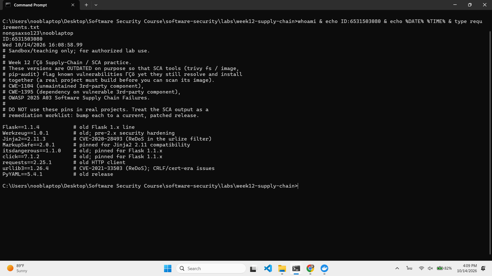
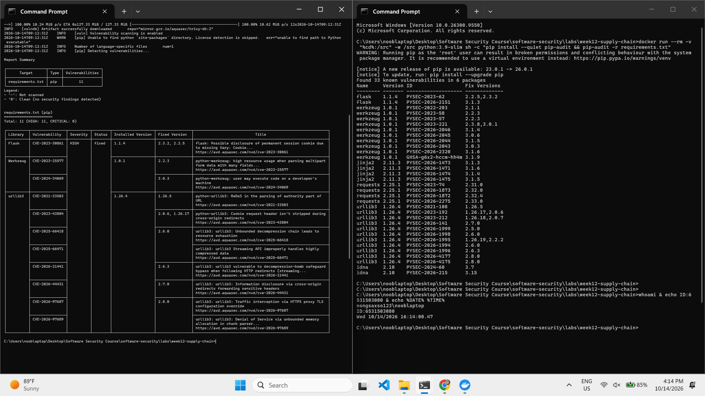
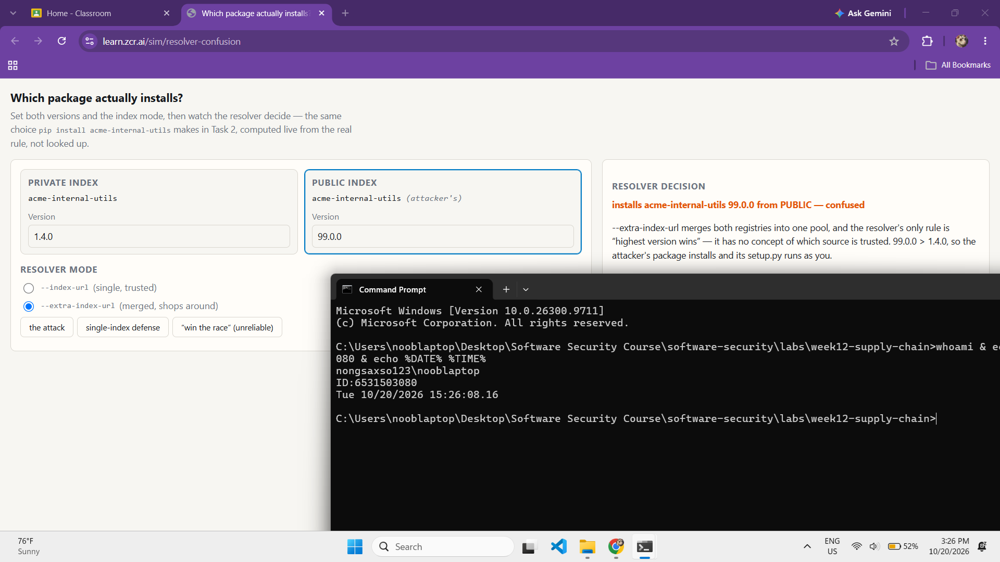
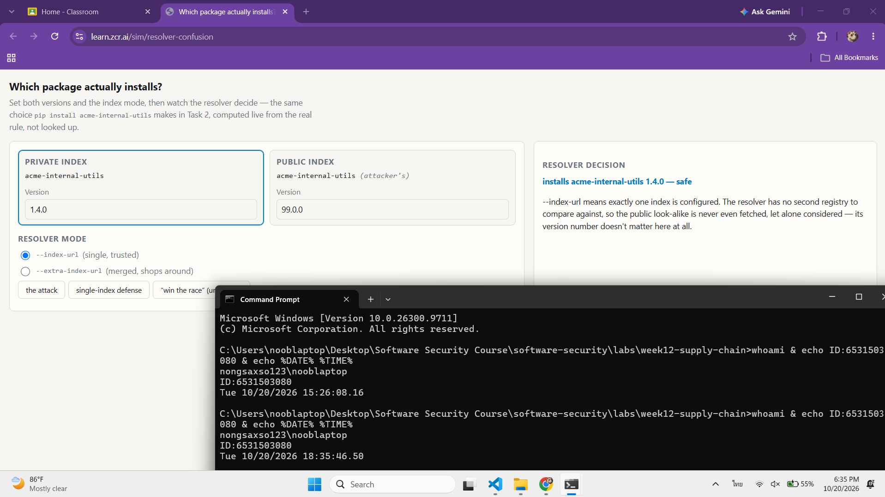
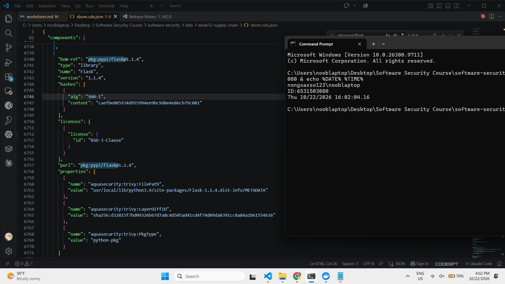
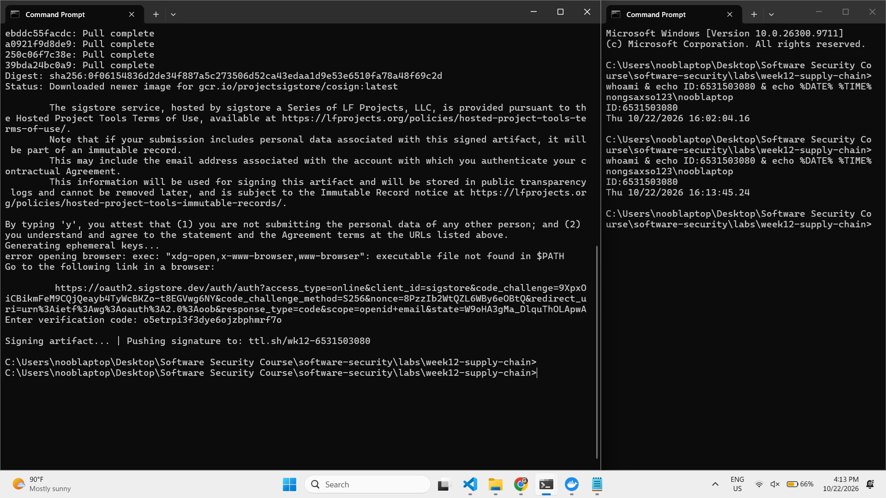
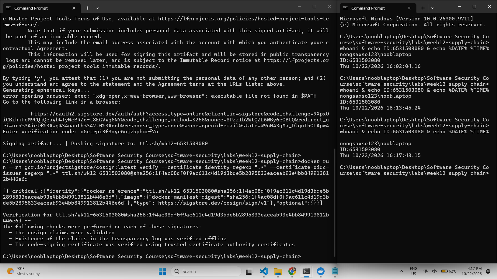
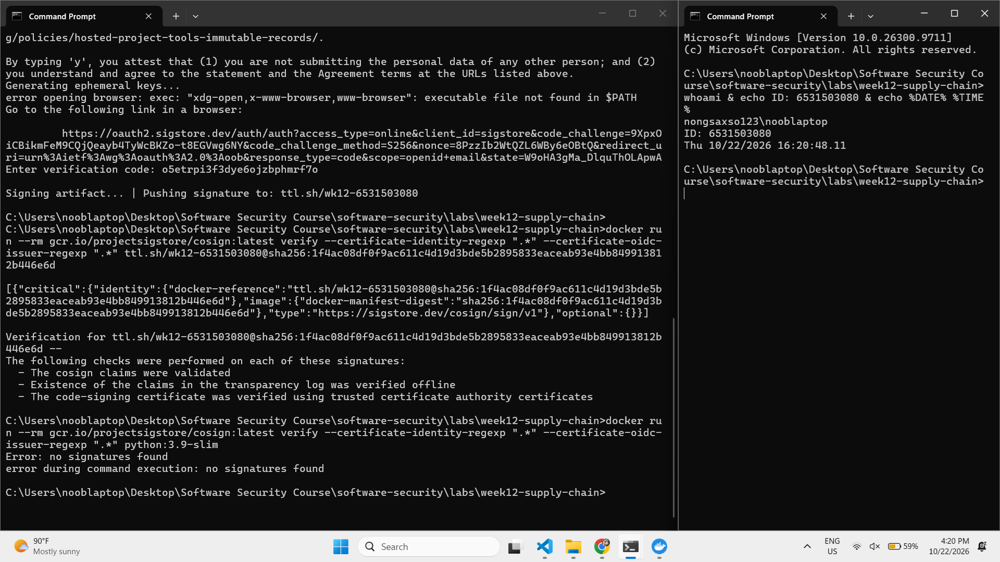
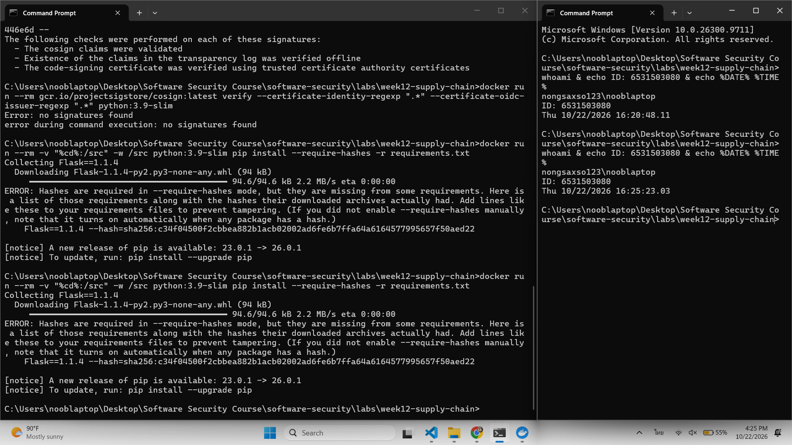

# Worksheet 12 — Software Supply-Chain Security (3 hrs)

> **Course:** Software Security (KOSEN69) · Week 12
> **Aligned:** OWASP 2025 — A03 Software Supply Chain Failures · A08 Software or Data Integrity Failures · **CWE:** CWE-1104, CWE-829, CWE-1357, CWE-1395
> **Signature game:** 📦 Dependency Confusion Heist
>
> **Ethics note:** This lab has **no live private/public registry to attack** — the dependency-confusion exercise is a controlled walkthrough (`dependency-confusion.md`) plus the interactive resolver simulation in Task 2, not a real package pull. **Never** plant or publish look-alike packages on the real PyPI or npm — that is an attack on every downstream user, and nothing in this lab requires it.

## Part 1 — Student Information

| Name | Student ID | Date | Group |
|------|-----------|------|-------|
| SORRAWIT THANAKHWANG | 6531503080 | 2026-10-14 | 1234Later |

> **AI disclosure:** I used an AI assistant (Claude) to help me understand the concepts and to draft/polish wording in this worksheet. I ran every command myself, verified the output, and wrote the reasoning in my own words.

## Part 2 — Lecture Questions

1. Explain **dependency confusion** (substitution). Why does a public `acme-internal-utils==99.0.0` win over a private `==1.4.0` when a resolver shops both indexes?

   **Answer:** Dependency confusion is when an attacker finds the name of a company's internal package (it often leaks through a public `requirements.txt`, a `package.json`, or bundled JavaScript) and publishes a package with the exact same name on the public registry, with a much higher version number. When pip is set up with `--extra-index-url`, it pulls candidates from both the private and public index into one pool and just picks the highest version. It has no concept of which source is trusted, so `99.0.0` beats `1.4.0` every time. The fake package's `setup.py` then runs with my (or the CI runner's) permissions during install, before any of the app's code even starts. I saw this directly in Task 2: same version pair, merged mode, and the verdict was `installs acme-internal-utils 99.0.0 from PUBLIC — confused`. (CWE-1357, A03.)
2. How does **typosquatting** (`reqeusts`, `urlib3`) achieve code execution *at install time* before any of your code runs?

   **Answer:** The attacker publishes a package whose name is one typo away from a popular one (`reqeusts` instead of `requests`, `urlib3` instead of `urllib3`) and waits for someone to mistype it. The trick is that a source distribution ships a `setup.py`, which is just ordinary Python that pip has to *execute* to build and install the package. So the moment I run `pip install reqeusts`, whatever the attacker put in `setup.py` runs on my machine with my permissions, e.g. reading environment variables for API tokens and sending them out. I never have to `import` anything or start my app. It's a different way in than dependency confusion (a typo instead of "highest version wins"), but it ends the same way: attacker code running at install time.

   I first thought hash pinning would stop this, and it does if the hashes were recorded from the correct name and someone mistypes it later. But if the typo goes into `requirements.txt` *before* I generate hashes, the hash just locks in the malicious package, because a hash only proves "same file as last time," not "good file." And a typo typed straight into the terminal never touches the hashed file at all. A single internal index that only mirrors vetted packages is the stronger fix here, since `reqeusts` simply wouldn't exist there and the install would fail.
3. What is an **SBOM** (CycloneDX/SPDX) and why is it a prerequisite for both incident response and SLSA provenance?

   **Answer:** An SBOM is basically a receipt for an image: a machine-readable list of every component inside it, with name, version and a standard ID (`purl`). CycloneDX and SPDX are the two common formats for it. The one I generated in Task 3 was CycloneDX, and it listed 119 components even though `requirements.txt` only names 9, because the image also carries transitive Python deps and the Debian base packages.

   For incident response, the difference is speed. If a critical Flask 1.1.4 CVE drops tomorrow and we have 200 images, with SBOMs on file I just search them all for `pkg:pypi/flask@1.1.4` and I have the affected list in minutes. Without them, someone has to pull and rescan (or worse, manually inspect) every image while the clock is running, and anything missed stays exposed. For SLSA, provenance is the record of how an artifact was built: which source commit, which builder, and which inputs went in. You can't state the inputs if you don't know them, so the SBOM is what fills in the "what went into this" part, and signing that record is what makes it trustworthy.
4. Sigstore **keyless** signing uses Fulcio (CA) + Rekor (transparency log) tied to an OIDC identity. Why is that safer than a long-lived private key (CWE-321)?

   **Answer:** A long-lived private key is tied to a *file*, not a person. Whoever has that file can sign as us, and the signatures look completely legitimate. If it leaks (committed to a repo, copied off a laptop, hard-coded in a script as CWE-321 describes), an attacker can keep signing malicious images for as long as nobody notices, and nobody might notice for a long time.

   Keyless ties the signature to an *identity* instead. When I signed in Task 3, I logged in with GitHub, Fulcio issued a certificate for that identity that's only valid for about 10 minutes, and I never had a key file to protect. That changes three things: (1) there's no long-lived secret sitting around to steal, (2) even if someone grabbed the short-lived cert, it'd be useless minutes later, and (3) every signing gets recorded in Rekor's public log, so if someone does manage to sign as me, it shows up there and can be caught by monitoring my identity. With a private key, a rogue signature leaves no trace at all. The catch is that this only helps if the verifier actually checks the identity. My Task 3 verify used `".*"`, which accepts anyone's valid signature, so in a real gate the identity and issuer have to be pinned.
5. Summarize the **SLSA** levels. Which level does "signed artifact + SBOM + provenance gate before deploy" put you at, and what is still missing?

   **Answer:** The SLSA Build Track has four levels (the old 1–4 numbering from v0.1 is deprecated):
   - **L0:** no guarantees at all.
   - **L1:** provenance exists, i.e. a record of how the artifact was built, but it can be easily faked.
   - **L2:** the build runs on a hosted build platform (e.g. GitHub Actions) that generates and *signs* the provenance itself, so it can't be edited after the fact.
   - **L3:** the build platform is hardened: builds are isolated from each other, and the provenance can't be forged even by the project's own maintainers.

   If "signed artifact + SBOM + provenance gate" runs on a hosted CI that signs the provenance, that's **L2**. What's still missing for L3 is a hardened, isolated builder with unforgeable provenance, where a compromised build step or a malicious maintainer couldn't tamper with the build or lie about what went into it. Also worth noting: an SBOM isn't provenance. The SBOM says *what's inside*, the provenance says *how and where it was built and from which commit*.

   Being honest about my own lab: I built the image on my laptop, not on a hosted platform, and I signed the *image* with my personal GitHub identity rather than producing a signed provenance attestation. So it doesn't reach L2, and strictly it's not even a full L1 yet since no provenance document was generated. I have the building blocks (SBOM, keyless signature, a verify step that can act as a gate), but moving the build into CI with a provenance generator is what would actually move it up the ladder.


## Part 3 — Hands-on Lab (150 min)

**Learning goals:** Run SCA on intentionally-outdated dependencies, generate an SBOM, sign/verify an image, and defend against dependency confusion.

**Prerequisites:** Docker; the lab folder (`requirements.txt`, `Dockerfile`, `app.py`, `sca_scan.sh`, `sign.sh`). For signing: browser for the OIDC flow + registry push access.

**Environment setup**
```bash
cd labs/week12-supply-chain
bash sca_scan.sh                 # trivy fs + pip-audit on requirements.txt (+ optional image scan)
docker build -t week12-supplychain:lab .
bash sign.sh week12-supplychain:lab   # CycloneDX SBOM -> sbom.cdx.json, then cosign sign + verify
```

**What to submit per task:** the exact command(s) + output, a screenshot, and a 2–3 sentence remediation note mapping the finding to A03/A08 or the CWE.

### Task 0 — Onboarding (15 min)
Read `requirements.txt` and list the pinned packages with their versions. Note why they are intentionally outdated (each is deliberately an old release so SCA tools flag its known CVEs).
**Deliverable:** the package/version table + which OWASP/CWE this maps to.

**Answer:**

| Package | Pinned version | Why it's old |
|---|---|---|
| Flask | 1.1.4 | Flask 1.x is end-of-life, no more security patches |
| Werkzeug | 1.0.1 | pre-2.x, missing later security hardening |
| Jinja2 | 2.11.3 | CVE-2020-28493 (ReDoS in `urlize`) |
| MarkupSafe | 2.0.1 | held back only so Jinja2 2.11 still works |
| itsdangerous | 1.1.0 | held back for Flask 1.1.x |
| click | 7.1.2 | held back for Flask 1.1.x |
| requests | 2.25.1 | old HTTP client |
| urllib3 | 1.26.4 | CVE-2021-33503 (ReDoS) |
| PyYAML | 5.4.1 | old release |

Every version here is pinned on purpose to an old release so the SCA tools in Task 1 have known CVEs to find. What surprised me is that only a few of these are really "chosen". MarkupSafe, itsdangerous and click are old just because Flask 1.1.4 refuses to run with anything newer (it requires `Jinja2<3.0`, for example), and requests drags in urllib3 the same way. So one stale pin quietly locks a whole chain of packages in the past, and I can't fix Jinja2 on its own without upgrading Flask too, since pip would just stop with a dependency conflict.

**Mapping:** OWASP 2025 **A03 Software Supply Chain Failures**; **CWE-1395** (dependency on a vulnerable third-party component: Jinja2, urllib3) and **CWE-1104** (use of unmaintained third-party components: the end-of-life Flask 1.x line).



### Task 1 — SCA scan: build the remediation worklist (35 min)
**Goal:** Flag the known-vulnerable dependencies — A03.
**Steps:**
1. `bash sca_scan.sh` — read the `trivy fs` table (CVE, installed vs. fixed version) and the `pip-audit` advisory IDs (GHSA-/PYSEC-).
2. Pick three findings; record CVE/advisory id, severity, and the fixed version.
**Deliverable:** the SCA output + a 3-row remediation table (package → current → fixed).

**Answer:**

Commands (run in cmd from the lab folder, same as steps 1-2 of `sca_scan.sh`):
```
docker run --rm -v "%cd%:/src" aquasec/trivy:latest fs --scanners vuln --severity HIGH,CRITICAL /src
docker run --rm -v "%cd%:/src" -w /src python:3.9-slim sh -c "pip install --quiet pip-audit && pip-audit -r requirements.txt"
```

trivy reported **11 HIGH** findings (I filtered to HIGH/CRITICAL), while pip-audit reported **33 known vulnerabilities in 6 packages**, since it shows every severity and uses its own advisory database (PYSEC-/GHSA- IDs). Running both gave me a fuller picture than either one alone.



**Remediation worklist (3 findings):**

| Package | Advisory | Severity | Current | Fixed | Note |
|---|---|---|---|---|---|
| urllib3 | CVE-2021-33503 (ReDoS in URL authority parsing) | HIGH | 1.26.4 | 1.26.5 | patch bump, low risk |
| Flask | CVE-2023-30861 (session cookie can leak through a caching proxy) | HIGH | 1.1.4 | 2.2.5 / 2.3.2 | major bump, drags Jinja2/MarkupSafe/itsdangerous/click with it |
| Werkzeug | CVE-2024-34069 (debugger can be abused to run code on a dev machine) | HIGH | 1.0.1 | 3.0.3 | biggest jump, upgrade together with Flask |

The urllib3 fix is easy because it's just a patch release. Flask and Werkzeug aren't, because Flask 1.1.4 pins its companions to old versions, so I'd have to upgrade the whole Flask stack in one go and retest the app instead of bumping one line. One thing I didn't expect: pip-audit also flagged **idna 2.10**, which isn't in `requirements.txt` at all. It comes in as a dependency of `requests`, so it's a transitive risk I'd never have noticed by reading the file. This all maps to **A03 Software Supply Chain Failures** and **CWE-1395**.

### Task 2 — Dependency Confusion Heist (35 min)
**Goal:** Watch the wrong package win — A03 / CWE-1357.

**Reality check:** this lab does **not** stand up a live private/public registry. `acme-internal-utils` is
a worked example, not an installable package — there is nothing to actually `pip install` here (the name
doesn't exist on real PyPI either, so don't expect that to work as a shortcut). Task 2 is a controlled
walkthrough of the resolver's own rule, using the simulation below, which computes the real
"highest version wins" logic live instead of just asserting the outcome.

```sim
resolver-confusion
```

**Steps:**
1. Read `dependency-confusion.md`'s "Dependency confusion (substitution)" section for the mechanism.
2. In the simulation, load the **"the attack"** preset (private `1.4.0`, public `99.0.0`, merged /
   `--extra-index-url` mode) and record which index the resolver picks and why.
3. Keep the same version numbers and switch to the **single-index** (`--index-url`) mode; record how the
   verdict changes — this is the resolver behavior Task 4's "single trusted index" defense relies on.
4. Try the **"win the race"** preset (private version numerically higher than public) and note why the
   sim's own explanation calls that "not a defense."

**Deliverable:** a screenshot of the simulation's verdict in both index modes (merged vs. single) for the
same version pair, plus one sentence on why an attacker defeats the "keep my internal version number high"
idea.

**Answer:**

I ran the course simulation at `learn.zcr.ai/sim/resolver-confusion` and kept the same version pair (private `1.4.0`, public `99.0.0`) for both runs.

| Index mode | pip flag | Verdict | Why |
|---|---|---|---|
| merged | `--extra-index-url` | `installs acme-internal-utils 99.0.0 from PUBLIC — confused` | pip pools both indexes and its only rule is "highest version wins". It has no idea which source is trusted, so 99.0.0 beats 1.4.0 and the attacker's `setup.py` runs on my machine at install time. |
| single | `--index-url` | `installs acme-internal-utils 1.4.0 — safe` | only the private index is configured, so pip never even looks at the public one. The fake package's version number doesn't matter because it's never in the running. |





What struck me is that nothing about the versions changed between the two runs, only how many indexes pip was allowed to look at. That's why the fix is about configuration, not about the package itself.

**Why "keep my internal version high" doesn't work:** pip always picks the highest number, but the attacker is the one who picks the number on the fake package, so whatever I set internally (say `2.0.0`), they can just publish `9999.0.0` and win again. It's a race I can't win, and the "win the race" preset only looks safe because the public version happens to be lower for now. This maps to **A03 Software Supply Chain Failures** and **CWE-1357**.

### Task 3 — SBOM + signing/verification (30 min)
**Goal:** Produce a component inventory and prove integrity — A08.
**Steps:**
1. After `bash sign.sh week12-supplychain:lab`, open `sbom.cdx.json` and find Flask's entry.
2. Read the `cosign verify` PASS for the signed image.
3. Negative test on an unsigned image (it **must** fail):
   `cosign verify --certificate-identity-regexp '.*' --certificate-oidc-issuer-regexp '.*' python:3.9-slim`
   → `Error: no signatures found`. (Both `--certificate-identity*` flags are required in keyless mode; without
   them cosign stops at `Error: --certificate-identity or --certificate-identity-regexp is required` — a usage
   error, which is *not* the same thing as proving the image is unsigned.)
**Deliverable:** the SBOM Flask component entry + the verify PASS + the negative-test failure.

**Answer:**

**1. SBOM.** I built the image and generated the CycloneDX SBOM with trivy (step 1 of `sign.sh`, rewritten for cmd):
```
docker build -t week12-supplychain:lab .
docker run --rm -v "%cd%:/src" -v /var/run/docker.sock:/var/run/docker.sock aquasec/trivy:latest image --format cyclonedx --output /src/sbom.cdx.json week12-supplychain:lab
```

Flask's entry in `sbom.cdx.json` (trimmed to the important fields):
```json
{
  "bom-ref": "pkg:pypi/flask@1.1.4",
  "type": "library",
  "name": "Flask",
  "version": "1.1.4",
  "hashes": [{ "alg": "SHA-1", "content": "caefbe085934d955994ee9bc9d8e4e86cb79c081" }],
  "licenses": [{ "license": { "id": "BSD-3-Clause" } }],
  "purl": "pkg:pypi/flask@1.1.4",
  "properties": [
    { "name": "aquasecurity:trivy:FilePath",
      "value": "usr/local/lib/python3.9/site-packages/Flask-1.1.4.dist-info/METADATA" },
    { "name": "aquasecurity:trivy:PkgType", "value": "python-pkg" }
  ]
}
```



The version matches what `requirements.txt` pins, and the `purl` (`pkg:pypi/flask@1.1.4`) is the standard ID that scanners match against vulnerability databases, so if a new Flask CVE drops I can grep every SBOM I've stored for that one string instead of rebuilding and rescanning each image. The bigger surprise was the size: the SBOM lists **119 components** (31 Python packages and 87 Debian packages from the base image), while `requirements.txt` only names 9. Reading my own manifest shows me less than a tenth of what actually ships.

**2. Keyless signing + verify PASS.** Cosign stores the signature in the registry next to the image, so a local-only tag can't be signed. I pushed the image to `ttl.sh` (an anonymous registry that deletes it after the `:1h` tag expires) and signed it by **digest** rather than by tag, since a tag can be moved to a different image later but the digest is computed from the content itself:
```
docker tag week12-supplychain:lab ttl.sh/wk12-6531503080:1h
docker push ttl.sh/wk12-6531503080:1h
docker inspect --format "{{index .RepoDigests 0}}" ttl.sh/wk12-6531503080:1h
  -> ttl.sh/wk12-6531503080@sha256:1f4ac08df0f9ac611c4d19d3bde5b2895833eaceab93e4bb849913812b446e6d

docker run --rm -it gcr.io/projectsigstore/cosign:latest sign --yes ttl.sh/wk12-6531503080@sha256:1f4ac08d...446e6d
```
The container couldn't open a browser, so cosign printed the Sigstore login URL and asked for a verification code. I logged in with GitHub, pasted the code back, and it finished with `Signing artifact... | Pushing signature to: ttl.sh/wk12-6531503080`. No private key was ever created on my side that I'd need to keep safe.



Then the verify:
```
docker run --rm gcr.io/projectsigstore/cosign:latest verify --certificate-identity-regexp ".*" --certificate-oidc-issuer-regexp ".*" ttl.sh/wk12-6531503080@sha256:1f4ac08d...446e6d

[{"critical":{"identity":{"docker-reference":"ttl.sh/wk12-6531503080@sha256:1f4ac08d...446e6d"},
  "image":{"docker-manifest-digest":"sha256:1f4ac08df0f9ac611c4d19d3bde5b2895833eaceab93e4bb849913812b446e6d"},
  "type":"https://sigstore.dev/cosign/sign/v1"},"optional":{}}]

The following checks were performed on each of these signatures:
  - The cosign claims were validated
  - Existence of the claims in the transparency log was verified offline
  - The code-signing certificate was verified using trusted certificate authority certificates
```



The `docker-manifest-digest` in the signed payload is exactly the digest I signed, so the signature only covers this one image. Change a single byte and the digest changes, and the signature no longer applies. One caveat I want to be honest about: `".*"` for both identity flags means "accept a valid signature from anyone." An attacker could sign their own image with their own GitHub account and it would pass this check too. In a real deploy gate I'd pin it, e.g. `--certificate-identity <my email> --certificate-oidc-issuer https://github.com/login/oauth`, so only my identity counts. (I used double quotes because cmd doesn't treat single quotes as quoting.)

**3. Negative test (must fail):**
```
docker run --rm gcr.io/projectsigstore/cosign:latest verify --certificate-identity-regexp ".*" --certificate-oidc-issuer-regexp ".*" python:3.9-slim
Error: no signatures found
error during command execution: no signatures found
```



This is the result I wanted. It's the right error, `no signatures found`, not the usage error you get when the identity flags are missing, so it actually proves the gate rejects an unsigned image instead of waving everything through. Together, the SBOM tells me *what's inside* and the signature proves *who built it and that it hasn't changed*, which is the A08 Software or Data Integrity Failures defense.

### Task 4 — Defend / fix it (35 min)
**Goal:** Stop dependency confusion and lock integrity — defenses from `dependency-confusion.md` + `sign.sh`.
**Steps:**
1. **Pin + hashes:** run `pip install --require-hashes -r requirements.txt` against this lab's own
   `requirements.txt` (it has no hashes yet) and record pip's refusal — `ERROR: Hashes are required in
   --require-hashes mode...` plus the `--hash=sha256:…` line pip prints for you. That refusal is the same
   mechanism that would block a real confusion substitution: once hashes are required, a package that
   doesn't match — from *either* index — cannot install silently.
2. **Single trusted index:** use one `--index-url` instead of `--extra-index-url`; explain why the resolver stops shopping around (tie this back to Task 2's single-index verdict).
3. **Namespace scoping:** describe reserving/namespacing the internal package name.
4. **Provenance gate:** state how the `cosign verify` from `sign.sh` becomes a gate before a simulated deploy.
**Deliverable:** the `--require-hashes` refusal output (step 1) + the simulation's before/after verdict for merged vs. single index (from Task 2) + the one defense you found most effective and why.

**Answer:**

**1. Pin + hashes.** I ran pip in hash-checking mode against the lab's own `requirements.txt`:
```
docker run --rm -v "%cd%:/src" -w /src python:3.9-slim pip install --require-hashes -r requirements.txt

Collecting Flask==1.1.4
  Downloading Flask-1.1.4-py2.py3-none-any.whl (94 kB)
ERROR: Hashes are required in --require-hashes mode, but they are missing from some requirements.
Here is a list of those requirements along with the hashes their downloaded archives actually had.
Add lines like these to your requirements files to prevent tampering.
    Flask==1.1.4 --hash=sha256:c34f04500f2cbbea882b1acb02002ad6fe6b7ffa64a6164577995657f50aed22
```



pip refused to install anything, and it stopped at the very first package. `==1.1.4` only pins a name and a version number, which an attacker can copy exactly. The hash pins the actual file, so once every line has one, any archive that doesn't match gets rejected no matter which index it came from.

**2. Single trusted index.** Using `--index-url <private index>` instead of `--extra-index-url` means pip only knows about one registry. In Task 2 the same version pair (private `1.4.0`, public `99.0.0`) went from `installs acme-internal-utils 99.0.0 from PUBLIC — confused` in merged mode to `installs acme-internal-utils 1.4.0 — safe` in single mode. pip doesn't stop "shopping around" because it got smarter. It stops because there's only one shop to look in, so the public look-alike is never even fetched. (Screenshots: `Task2.png` and `Task2-single.png` above.)

**3. Namespace scoping.** Register the internal name (`acme-internal-utils`) on public PyPI yourself as an empty placeholder, or give internal packages a prefix the company controls, so nobody else can publish under that name. On npm the cleaner version is an org scope like `@acme/utils`, which only members of the `acme` org can publish to.

**4. Provenance gate.** Make the `cosign verify` from Task 3 the last step of the pipeline before deploy, with the identity pinned instead of `".*"` (e.g. `--certificate-identity <CI identity> --certificate-oidc-issuer <issuer>`). If verify exits non-zero, the pipeline fails and nothing ships. That's just my Task 3 negative test (`Error: no signatures found` on `python:3.9-slim`) turned into a rule the deploy can't skip.

**Most effective: hashes.** I'd pick `--require-hashes`, because it doesn't care where the fake package came from. The other defenses each block one route: single index blocks the public registry, scoping blocks one name. A hash mismatch gets stopped whether it comes from PyPI, a compromised private mirror, or a tampered cache. The catch is that a hash only protects you if the file was genuine when you first recorded it, and keeping hashes up to date by hand is painful, so in practice I'd generate them with `pip-compile --generate-hashes` and still use a single index alongside it.

## Part 4 — Reflection

1. **Mapping:** table — finding | tool (`sca_scan.sh` / `sign.sh`) | OWASP 2025 id | CWE | fix.

   **Answer:**

   | Finding | Tool | OWASP 2025 | CWE | Fix |
   |---|---|---|---|---|
   | Known CVEs in pinned deps (urllib3 CVE-2021-33503, Flask CVE-2023-30861, Werkzeug CVE-2024-34069) | `sca_scan.sh` (trivy fs + pip-audit) | A03 | CWE-1395 | urllib3 → 1.26.5; upgrade the whole Flask stack together (Flask 2.3.2+, Werkzeug 3.0.3+) and retest |
   | End-of-life Flask 1.x line, which also holds Jinja2/MarkupSafe/click back | `sca_scan.sh` | A03 | CWE-1104 | migrate off Flask 1.x; enable Dependabot/Renovate so pins don't silently rot |
   | Transitive `idna 2.10` that isn't in `requirements.txt` at all | `sca_scan.sh` (pip-audit) | A03 | CWE-1395 | lock the full tree (incl. transitive deps) with `pip-compile`; upgrade `requests` |
   | Public `99.0.0` beats private `1.4.0` in merged-index mode | resolver sim (Task 2), not a script | A03 | CWE-1357 | single `--index-url`, reserve/namespace the internal name |
   | `requirements.txt` pins versions but has no hashes, so pip trusts whatever file arrives | `pip install --require-hashes` (Task 4) | A08 | CWE-494 | `pip-compile --generate-hashes` + install with `--require-hashes` |
   | Unsigned image (`python:3.9-slim`) and no check before deploy; my own verify used `".*"` | `sign.sh` (cosign verify) | A08 | CWE-345 | keyless-sign every build, gate deploy on `cosign verify` with a pinned identity + issuer |
   | No inventory of what ships (9 lines in the manifest vs 119 real components) | `sign.sh` step 1 (trivy CycloneDX SBOM) | A03 | CWE-1104 | generate an SBOM per build and store it with the artifact |
2. **Real breach:** analyze the **XZ Utils backdoor (CVE-2024-3094)**. Which OWASP/CWE applies, and would an SBOM + signing + provenance gate have caught a maliciously-modified upstream dependency? (Compare with SolarWinds or Log4Shell if useful.)

   **Answer:** XZ Utils is a compression library that ends up on almost every Linux system, and on some distros it gets loaded into `sshd`. Over roughly two years, a contributor using the name "Jia Tan" built trust with the project's overworked solo maintainer until they were made a co-maintainer. Then they slipped a backdoor into releases 5.6.0 and 5.6.1 that could let them get remote access through SSH. It was caught in March 2024, before it reached the major stable distros, more or less by luck: Andres Freund noticed SSH logins taking about half a second longer than usual and dug into why. It maps to **A03 Software Supply Chain Failures** and **CWE-506 (Embedded Malicious Code)**. The real way in, though, was social engineering a burned-out maintainer, not a technical bug.

   Would our defenses have caught it? Signing alone, no. Jia Tan was a legitimate maintainer, so the releases were signed by someone who really was allowed to sign them, and `cosign verify` would have passed. A signature proves *who* released something, not that they're honest, the same way a hash proves "same file as last time" but not "good file." SolarWinds taught the same lesson: the Orion update was signed with SolarWinds' real certificate because the attackers were inside the build system.

   The other two would have helped, just in different ways. An **SBOM** wouldn't prevent anything, but on disclosure day every team's first question was "where do we have xz 5.6.0 or 5.6.1?", and teams with SBOMs could answer in minutes, like the Flask example in Part 2. **Provenance** had a real shot at catching it early. The script that switched the backdoor on (`build-to-host.m4`) wasn't in the git repo, only in the release tarballs. A build that runs straight from the git source on a hosted builder, with provenance tying the artifact to a specific commit (SLSA L2–L3), would show that the shipped tarball didn't match the source. Still, the payload itself was hidden in binary test files that *were* in git, so in the end it comes down to code review and supporting maintainers too. No tool fully stops a trusted insider who decides to go rogue.
3. **Best mitigation + SLSA self-assessment:** one paragraph — which SLSA level your defenses reach and why, and the single highest-leverage control for your team.

   **Answer:** Honestly, my lab setup sits at about **L0–L1**. I have an SBOM, a keyless signature on the image, and a verify step that could act as a gate, but the image was built on my own laptop rather than a hosted build platform, and I never generated a provenance document saying which commit and builder produced it. So it can't be L2, and it isn't a complete L1 either. The obvious next step would be moving the build into CI with a provenance generator, which would get us to L2. If my team could only adopt one control first, though, I'd still pick **hash-pinned dependencies** (`pip-compile --generate-hashes` + `pip install --require-hashes`). It doesn't care which index a package came from, so it blocks dependency confusion, a tampered private mirror, and a poisoned cache all at once. It costs almost nothing, works on any pipeline today, and needs no new infrastructure. XZ Utils showed me its limit: if the upstream release is malicious when I first record the hash, the hash just locks the bad file in. So hashes are where I'd start, not where I'd stop.

## Grading rubric (100)

| Criterion | Weight |
|-----------|--------|
| Lecture questions (Part 2) | 20 |
| Exploitation + evidence (Tasks 1–3: SCA findings, confusion proof, SBOM/verify) | 40 |
| Defense (Task 4: pinning/hashes, single index, scoping, provenance gate) | 25 |
| Reflection (Part 4: mapping, XZ breach, SLSA self-assessment) | 15 |
| **Total** | **100** |

---

## Evidence & Integrity (required)

- **Identity proof:** every screenshot/diagram must show a terminal running `printf '%s | %s | ' "$(whoami)" '<YOUR-STUDENT-ID>'; date '+%F %T %Z'` **in the
  same image as the evidence**. When the evidence is a browser page, a DevTools panel or a
  rendered response, put that terminal **beside the browser and capture the whole screen** — a
  cropped window carries nothing that identifies you, and the lab's own output is
  byte-identical for the whole cohort *by design*, so the stamp is the only thing that makes
  the shot yours. Generic or borrowed evidence is not accepted.
- **Personalized flag (if this lab issues one):** N/A. This lab doesn't issue a flag (no task produces one), so my evidence is the 9 stamped screenshots in Tasks 0–4.
  *Flags are unique per student — submitting another student's flag is a violation. How to submit: **learn.zcr.ai/submit** (full guide: `SUBMISSION.md` in the repo root).*
- **Explain in your own words** *(graded on your reasoning, not copied text):*
  1. What did you do, and **why did the vulnerability work**?

     **Answer:** I focused on dependency confusion. In the Task 2 simulation I set the private index to `acme-internal-utils 1.4.0` and the attacker's public copy to `99.0.0`, switched pip to merged mode (`--extra-index-url`), and watched it pick the public one: `installs acme-internal-utils 99.0.0 from PUBLIC — confused`. It worked because merged mode throws both indexes into one pool and pip's only rule is "highest version wins." It never asks which index is trusted. So all the attacker has to do is learn the internal package name and publish it publicly with a bigger number, and their `setup.py` runs on the victim's machine the moment it installs.
  2. **Why does your fix actually stop it** — and what could still break it?

     **Answer:** With a single `--index-url`, pip only ever looks at the company's own index, so the public `99.0.0` is never fetched and never compared. Same versions, but the verdict flipped to `installs acme-internal-utils 1.4.0 — safe`. Adding `--require-hashes` on top means even a package that *does* arrive gets rejected unless its file matches the hash I recorded, which I saw pip enforce in Task 4 when it refused to install Flask without one.

     What could still break it is an insider, or anything that poisons the source I trust. If someone with access to the private index uploads a malicious build, single-index mode will happily serve it, because it's coming from the "trusted" place. And if hashes are generated *after* that bad file is already there, they just lock it in. XZ Utils is the real-world version of this: the attacker was a legitimate maintainer, so the release was signed, came from the official source, and any hash recorded from it would have matched. These fixes stop outsiders from swapping packages in. They don't stop someone who's already trusted, which is why code review and provenance (proving which source commit a build came from) still matter.

---

## 🤖 Audit the AI (required)

AI is a power tool you must **distrust** — you are graded on your *critique*, not the AI's answer.

1. Ask an AI assistant to exploit **or** fix this week's vulnerability. Paste its full answer.
2. **Find what's wrong or risky** in it — insecure code, a subtly incomplete fix, a hallucinated API/function/CVE, a missed edge case, or wrong reasoning. Quote the exact line(s).
3. Produce the **correct, verified** version yourself and explain in 2–3 sentences why the AI's output was insufficient.

> Disclose your AI use in the Part 1 table. This task counts toward your **Defense + Reflection** score.

**Answer:**

**1. The prompt and the AI's answer.** I asked Claude in a fresh chat:
```
My company has an internal Python package called acme-internal-utils (version 1.4.0) hosted on our private index at https://pypi.acme.internal/simple. Our CI installs dependencies with:

pip install --extra-index-url https://pypi.acme.internal/simple -r requirements.txt

I heard about dependency confusion attacks. How do I fix this? Give me the corrected pip command and requirements.txt.
```

Its answer (some line endings got cut off when I copied it out of the chat window; I marked those `[…]`, and checked the original to confirm the pip command had all its `\` continuations and the full `/simple` URL):

> The problem is that --extra-index-url does not set a priority. pip treats both indexes as equal and installs the highest version it finds anywhere. If someone publishes acme-internal-utils==99.0.0 on public PyPI, your CI installs their package and runs its code.
>
> **Corrected pip command**
> ```
> pip install \
>   --index-url https://pypi.acme.internal/simple \
>   --require-hashes \
>   --no-deps \
>   -r requirements.txt
> ```
> - --index-url instead of --extra-index-url m[…]nly source. Set it up to proxy or mirror public PyPI (Artifactory, Nexus, devpi and AWS CodeArtifact all do this). Configure the proxy so the acme-* names resolve only from your internal repo and [… t]he main fix.
> - --require-hashes makes pip refuse any file whose sha256 isn't listed. Even if the wrong index serves a file, the hash won't match and the install fails ins[…]
> - --no-deps is optional. With a fully pinned lockfile it stops pip from pulling in anything that isn't listed.
>
> **Corrected requirements.txt** — Pin every package exactly, transitive dependencies included, each with its hash:
> ```
> # Generated by: pip-compile --generate-hashes --index-url https://pypi.acme.internal/simple requirements.in
> acme-internal-utils==1.4.0 \
>     --hash=sha256:<hash of the wheel on your private index>
> requests==2.32.3 \
>     --hash=sha256:70761cfe03c773ceb22aa2f671b4757976145175cdfca038c02654d061d6dcc6
> certifi==2024.8.30 \
>     --hash=sha256:922820b53db7a7257ffbda3f597266d435245903d80737e34f8a45ff3e3230d8
> # ...every other transitive dependency, each
> ```
> Don't type the hashes in by hand. Generate t[…]
> ```
> pip install pip-tools
> pip-compile --generate-hashes --index-url https://pypi.acme.internal/simple requirements.in
> ```
> Check the acme-internal-utils hash against the artifact your own build pipeline published.
>
> **Also do these**
> 1. Register the name on public PyPI. Upload an empty placeholder acme-internal-utils so no one else can claim it. Better still, publish internal packages [u]n[der a name prefix you control …]s.
> 2. Don't leave the old flag in other config. Search pip.conf, PIP_EXTRA_INDEX_URL, tox.ini and Dockerfiles for extra-index-url. One leftover reopens the [hole].
> 3. If you can switch to uv, it can tie a package to a single index:
> ```
> [[tool.uv.index]]
> name = "acme"
> url = "https://pypi.acme.internal/simple"
> explicit = true
>
> [tool.uv.sources]
> acme-internal-utils = { index = "acme" }
> ```
> pip has no per-package index setting, which is why the pip fix needs the single proxied index plus hashes.
>
> In short, the root fix is --index-url with a proxied private index. Hash pinning is a second layer that fails the install, instead of running the attacker's [code, if the index is ever] misconfigured.

**2. What's wrong or risky.** Credit where it's due first: this answer is much better than I expected. It drops `--extra-index-url`, doesn't fall for "just bump the internal version," and uses `pip-compile --generate-hashes`. I also checked the two hashes it quoted against PyPI's JSON API and both are the real sha256 of the wheels (`requests-2.32.3-py3-none-any.whl`, `certifi-2024.8.30-py3-none-any.whl`), so nothing was hallucinated. But three things are still off:

- **"the root fix is --index-url with a proxied private index"** — this just moves the bug. If that proxy is a "virtual" repo that merges the internal repo with a public-PyPI mirror and serves the highest version, it's exactly Task 2's merged mode, only running on the server instead of my laptop. pip sees one index, but that index is quietly shopping both. The part that actually fixes it is the proxy rule that `acme-*` only ever resolves from the internal repo, and the AI squeezed that into half a sentence instead of making it the headline.
- **"--no-deps is optional"** — it's worse than optional. `--require-hashes` already makes pip fail if any dependency is missing from the lockfile. `--no-deps` turns that check off, so an incomplete lockfile installs "successfully" and only breaks later at runtime with an `ImportError`. It trades a loud install-time failure for a quiet one.
- **"Upload an empty placeholder acme-internal-utils so no one else can claim it"** — presented as if it settles the name. PyPI's PEP 541 lets admins reclaim name-squatting projects with no real content, so a placeholder is a nice extra layer but not something to depend on.

**3. Corrected, verified version.**
```
# pip.conf / CI env: one index only, and nothing else anywhere
[global]
index-url = https://pypi.acme.internal/simple

[install]
require-hashes = true
# (no extra-index-url in pip.conf, PIP_EXTRA_INDEX_URL, tox.ini or Dockerfiles)

pip install --index-url https://pypi.acme.internal/simple --require-hashes -r requirements.txt
```
On the proxy itself, the internal repo gets priority and an exclusion rule blocks `acme-*` from ever being fetched from the public remote, so the merge can't pick a public `acme-internal-utils` no matter its version. The lockfile comes from `pip-compile --generate-hashes`, and I'd drop `--no-deps`. I couldn't stand up a real proxy in this lab, but I did verify the two pieces I could: in Task 2 the same version pair flipped from `99.0.0 from PUBLIC — confused` to `1.4.0 — safe` once only one index was configured, and in Task 4 `--require-hashes` refused to install Flask without a hash. The AI's answer wasn't wrong so much as misleading about *where* the fix lives. Someone following it literally could point pip at a merging proxy, feel safe because the flag says `--index-url`, and still have dependency confusion happen one layer up.

---

## 🧠 Comprehension & Prompt (required)

**A. Explain in Plain English (EiPE).** In 2–3 sentences, in your own words, describe what this week's vulnerable code/endpoint actually *does* and *why it is exploitable* — explain the mechanism, don't dump jargon.

**Answer:** `requirements.txt` is basically the shopping list for the app, and this one deliberately buys old ingredients that are already known to be bad, plus whatever comes bundled with them (like `idna`, which I never asked for but got through `requests`). The reason that's exploitable is that the problems with those old versions are published openly, so an attacker doesn't have to discover anything. They just look up the known issue for that exact version and try it on any app still using it. Cooking with an ingredient that's already been recalled, basically.

**B. Prompt Problem.** Write a **single prompt** that makes an AI produce a *correct, secure* fix for one finding. Run it: does the exploit now fail? If not, refine the prompt and try again. Submit the **final prompt + the verified result**.
*Graded on the prompt's precision and your verification — this trains problem decomposition and AI literacy (Denny et al. 2024).*

**Answer:**

Finding: urllib3 CVE-2021-33503 (ReDoS, from Task 1). My first try was one line, `Fix urllib3 CVE-2021-33503 without breaking requests 2.25.1`. It had the CVE and the constraint, but no current version, no file, and no proof step, so the AI would have to guess, and could easily suggest urllib3 2.x, which requests 2.25.1 can't use. I tightened it to:

```
My requirements.txt pins urllib3==1.26.4 and requests==2.25.1 (Python 3.9). Fix urllib3 CVE-2021-33503 without breaking requests 2.25.1 and without changing any other package.

Give me:
1. The exact replacement line for requirements.txt (the smallest version bump that fixes the CVE).
2. Why that version is compatible with requests 2.25.1's urllib3 requirement.
3. A pip-audit command I can run to prove the CVE is gone.
```

I ran it with Claude. It answered `urllib3==1.26.5`, explained that requests 2.25.1 needs `urllib3>=1.21.1,<1.27` so 1.26.5 fits, and gave `pip-audit -r requirements-fixed.txt` as the check. Claude also ran that check in Docker against a copy of `requirements.txt` with only the urllib3 line changed (the lab's own file stays deliberately vulnerable), and I went through the output:

```
docker run --rm -v "%cd%:/src" -w /src python:3.9-slim sh -c "pip install --quiet pip-audit && pip-audit -r requirements-fixed.txt"

before (urllib3==1.26.4):  Found 33 known vulnerabilities in 6 packages
                           urllib3  1.26.4  PYSEC-2021-108  1.26.5     <- CVE-2021-33503
after  (urllib3==1.26.5):  Found 32 known vulnerabilities in 6 packages
                           (PYSEC-2021-108 is gone; it resolved with requests 2.25.1, no conflict)
```

So the fix works: the target CVE is gone and nothing broke. But the result also showed a weakness in my own prompt. "Smallest version bump" did exactly what I asked and nothing more, so 1.26.5 still carries **10 other urllib3 advisories**, including three that are fixed later in the same 1.26 line. I refined the ask to "the latest 1.26.x release, since requests 2.25.1 caps urllib3 below 1.27," which gives `urllib3==1.26.20`:

```
after (urllib3==1.26.20):  Found 29 known vulnerabilities in 6 packages
                           (PYSEC-2021-108, PYSEC-2023-192, PYSEC-2023-212, PYSEC-2026-1995 all gone)
```

The remaining 7 urllib3 advisories only have fixes in urllib3 2.x, and getting there means upgrading `requests` too. That's a bigger, separate change, and my "don't touch other packages" constraint was what blocked it. So the prompt decides what you get back: "smallest" gets you a patch for one CVE, while "latest compatible within the cap" gets the most security available without breaking anything.
