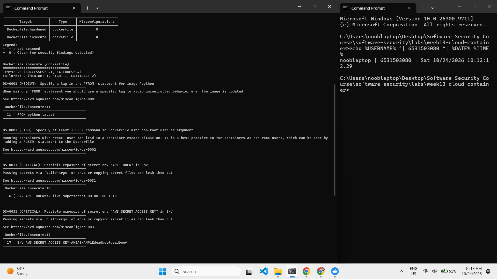
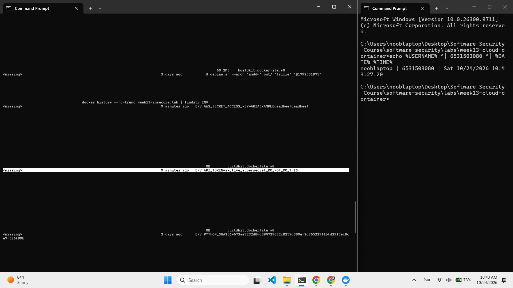

# Worksheet 13 — Cloud & Container Security (4 hrs)

> **Course:** Software Security (KOSEN69) · Week 13
> **Aligned to:** OWASP 2025 **A02 Security Misconfiguration** · **CWE-732** (incorrect permission assignment), **CWE-16** (configuration), plus CWE-798, CWE-250, CWE-538, CWE-269, CWE-1104
> **Signature game:** 🔍 *Misconfig Hunt* (CloudGoat-style) — each misconfig you find **and** fix = a flag.

> ⚠️ **Ethics note:** All artifacts here are deliberately broken for teaching and are marked *"Sandbox/teaching only; for authorized lab use."* Scan, exploit, and harden **only** these lab files (or systems you own / are authorized to test). Never point Trivy or these techniques at third-party cloud accounts or images without written permission.

---

## Part 1 — Student Information

| Name | Student ID | Date | Group |
|------|-----------|------|-------|
| SORRAWIT THANAKHWANG | 6531503080 | 2026-10-24 | 1234Later |

**AI-tool disclosure:** I used Claude (Claude Code) as a tutor to explain the concepts and help me draft parts of this worksheet. I ran all the commands and took all the screenshots myself.

---

## Part 2 — Lecture Questions

Answer in your own words (2–4 sentences each).

1. Explain the **shared-responsibility model**. In `harden.md` it says "the cloud provider secures *of* the cloud; you secure what you put *in* it." Give one concrete example of each side for an S3-backed app.

   **Answer:** Security in the cloud is split between two parties. The provider secures the cloud itself, and the customer secures what they build and configure on top of it. It's a bit like renting a condo. The building handles the structure and the guard at the front desk, but locking your own door is on you. For an S3-backed app, AWS handles the physical side: the data centres, the disks the objects are stored on, and the hardware and hypervisor underneath, so nobody walks out with a drive. Making sure the bucket is actually private (Block Public Access on, no public-read ACL or policy) is my job, and so is keeping the IAM role that reads it scoped down. Most cloud breaches come from the customer's side of that line, not from AWS.
2. `iam-policy-insecure.json` uses `"Action": "*"` and `"Resource": "*"`. Describe **why this violates least privilege** and map it to CWE-732 vs CWE-269 — what is the difference between the two CWEs here?

   **Answer:** Least privilege means a key gets only the actions it needs, on only the resources it needs. This policy fails both halves. `"Action": "*"` means the key can do anything, any API call in any service, when the app only needs `s3:GetObject`. That's **CWE-269 (improper privilege management)**, because the privileges themselves are wrong. `"Resource": "*"` means it can do that to anything, every bucket and instance in the account instead of just `lab-app-bucket/app/*`. That's **CWE-732 (incorrect permission assignment for a critical resource)**, because the permission is attached to the wrong set of resources. They're two separate findings because fixing one leaves the other open. Narrowing only the action to `s3:GetObject` still lets the key read every bucket, and narrowing only the resource still lets it delete that bucket. Together they add up to full admin, so a leaked key costs you the whole account.
3. The insecure Dockerfile bakes `ENV API_TOKEN=sk_live_...`. Explain how an attacker recovers that secret from a shipped image (name the `docker` commands) and why this is **CWE-798 / CWE-200**.

   **Answer:** The attacker doesn't need to break anything. Once they have the image (pulled from a registry, or handed over as a tarball), they run `docker history --no-trunc <image>`, which lists every Dockerfile instruction that built each layer, `ENV API_TOKEN=sk_live_...` included. `docker inspect <image>` shows the same values under `Config.Env`. I did exactly this in Task 3 and got both `API_TOKEN` and `AWS_SECRET_ACCESS_KEY` back. It's **CWE-798 (hard-coded credentials)** because the secret is written into the build instead of being supplied at runtime, and **CWE-200 (exposure of sensitive information)** because it ends up readable by everyone who can get the image, which is a lot more people than should ever see that key. Removing the line in a later layer doesn't help, since the old layer still ships.
4. Why is `FROM python:latest` (CWE-1104/CWE-16) a security and reproducibility problem, and how does pinning to an `@sha256:` digest fix it?

   **Answer:** `latest` is just a movable label. Whoever controls the repo can point it at a different image whenever they like, so every build gets "whatever latest means today". The image I built in Task 3 came with `PYTHON_VERSION=3.15.1`, and a teammate rebuilding next month could quietly get something else. That's the reproducibility problem: two builds of the same Dockerfile aren't the same image. It's also a security problem, which wasn't obvious to me at first. If the registry account or a mirror gets compromised, `latest` can be repointed at a backdoored image and we'd pull it without noticing, the same upstream-attack idea as Week 12. Even without an attacker, a scan that passed yesterday says nothing about the base we pull tomorrow, which might bring new CVEs. And after an incident we can't even say which image was running (CWE-1104 / CWE-16). A digest like `@sha256:cdbd05...` is a hash of the image content itself. If a single byte changes, the digest changes, so a pinned build always gets exactly the bytes we scanned and reviewed. If someone swaps the image, the pull fails instead of silently handing us something different.
5. What does a **distroless** base image remove (relative to `python:3.11-slim`), and how does that shrink the attack surface for an RCE or container-escape attacker?

   **Answer:** `python:3.11-slim` is still a small Debian, with `/bin/sh`, `apt`, coreutils and so on. Distroless strips all of that out and keeps only the Python runtime and the libraries it needs. That means an attacker who gets RCE in the app can't drop into a shell and run commands, and can't `apt install curl` or `nmap` to pull in tools and pivot to other machines. Most off-the-shelf exploit chains assume `sh` is there, so they just stop working. Fewer packages also means fewer CVEs to begin with. It isn't a complete fix, though. The Python interpreter is still in there, so someone running code inside the app process can still do damage with Python alone. That's why the hardened file pairs distroless with `USER 65532:65532` and the runtime flags (`--read-only`, `--cap-drop ALL`), so whatever they manage to run, they run unprivileged on a read-only filesystem.

---

## Part 3 — Hands-on Lab (180 min)

**Learning goals:** find cloud/container misconfigurations with Trivy, map each to a CWE, and rebuild the IAM policy + Dockerfile to least privilege / hardened so the findings drop.

**Prerequisites:** Docker installed and running; the `week13-cloud-container/` lab folder; internet access to pull `aquasec/trivy:latest`.

### Environment setup (real commands)

```bash
cd labs/week13-cloud-container

# Option A — the provided wrapper (trivy config over the Dockerfiles; IAM JSON is reviewed manually, see Task 2):
bash scan.sh

# Option B — run Trivy directly (MEDIUM is in the filter on purpose: one of the
# three rules Task 1 asks you to cite is rated MEDIUM, and HIGH,CRITICAL hides it):
docker run --rm -v "$PWD:/src" aquasec/trivy:latest config --severity MEDIUM,HIGH,CRITICAL /src

# (Optional) build + CVE-scan the hardened image:
docker build -f Dockerfile.hardened -t week13-hardened:lab .
docker run --rm -v /var/run/docker.sock:/var/run/docker.sock aquasec/trivy:latest image --severity HIGH,CRITICAL week13-hardened:lab
```

**What to submit per task:** the command(s) you ran + the relevant output (finding count or the specific finding line), a screenshot of the Trivy/terminal result, and a 2–3 sentence mitigation explaining *why* the fix reduces risk (cite the CWE).


### Tasks

- **Task 0 — Onboarding (15 min).** Confirm Docker works (`docker version`), run `bash scan.sh`, and record the **baseline finding count** against `Dockerfile.insecure` (Trivy's `config` scanner does not parse standalone IAM policy JSON, so `iam-policy-insecure.json` is reviewed manually instead — see Task 2). **Deliverable:** screenshot of the baseline scan.

  **Answer:**

  Docker was running (`docker version` showed both Client and Server, engine 27.2.0). I'm on cmd.exe and `scan.sh` has CRLF line endings on my machine, so instead of `bash scan.sh` I ran its first step directly (Option B), from the lab folder:
  ```
  docker run --rm -v "%cd%:/src" aquasec/trivy:latest config --severity MEDIUM,HIGH,CRITICAL /src
  ```

  | Target | Misconfigurations |
  |---|---|
  | `Dockerfile.insecure` | **4** (MEDIUM: 1, HIGH: 1, CRITICAL: 2) |
  | `Dockerfile.hardened` | 0 |

  The baseline is **4 findings**, but only 3 distinct rules fired: DS-0001 (`FROM python:latest`, line 11), DS-0002 (no non-root `USER`), and DS-0031, which fired twice, once for `API_TOKEN` on line 16 and once for `AWS_SECRET_ACCESS_KEY` on line 17. As expected, Trivy didn't scan the two IAM JSON files at all, since its config scanner doesn't parse standalone IAM policies. I'll review those by hand in Task 2.

  

- **Task 1 — Misconfig Hunt: container image (40 min).** *Goal:* find every defect in `Dockerfile.insecure`. *Steps:* read each `# DEFECT:` comment, then locate the matching Trivy finding where one exists — only 3 of the 6 (unpinned `:latest`, runs as root, secrets in `ENV`) map to a Trivy config rule (`DS-0001`, `DS-0002`, `DS-0031`); `COPY . .`, `chmod -R 777`, and unpinned `pip install` are instruction-level RUN/COPY semantics Trivy's Dockerfile scanner doesn't check, so identify those 3 by code review instead. Build a table: defect → CWE → Trivy rule/severity (write "manual review — no Trivy rule" where none exists). *Deliverable:* completed table (6 rows) using the IDs from `harden.md`.

  **Answer:**

  | # | Defect (line in `Dockerfile.insecure`) | CWE | Trivy rule / severity |
  |---|---|---|---|
  | 1 | `FROM python:latest` (line 11): mutable tag, so every build can pull a different base | CWE-1104 / CWE-16 | DS-0001 / MEDIUM |
  | 2 | `ENV API_TOKEN=...` and `ENV AWS_SECRET_ACCESS_KEY=...` (lines 16-17): secrets baked into an image layer | CWE-798 / CWE-200 | DS-0031 / CRITICAL (fired twice, once per secret) |
  | 3 | `COPY . .` (line 24): copies the whole build context, `.git` and `.env` included | CWE-538 | manual review, no Trivy rule |
  | 4 | `RUN chmod -R 777 /app` (line 31): app directory is world-writable | CWE-732 | manual review, no Trivy rule |
  | 5 | No `USER` line, so `CMD` (line 38) runs as root (uid 0) | CWE-250 | DS-0002 / HIGH |
  | 6 | `RUN pip install -r requirements.txt` (line 27): `requirements.txt` only says `Flask>=3.1.3`, no exact pin or hashes | CWE-1104 | manual review, no Trivy rule |

  Trivy only catches the three defects it can spot from whether a line exists or what a tag says (`:latest`, a missing `USER`, a secret-looking `ENV` name). It doesn't understand what a `COPY` or `RUN` actually does, so rows 3, 4 and 6 only turn up if someone reads the file. Rows 4 and 5 also depend on each other. Removing `chmod 777` alone isn't enough, because a process running as root can still rewrite `app.py`. Both have to be fixed together.

- **Task 2 — Misconfig Hunt: IAM (30 min).** *Goal:* document why `iam-policy-insecure.json` is full-admin. *Steps:* identify the `Action:*` / `Resource:*` / no-`Condition` problems; map to CWE-269 / CWE-732. *Deliverable:* 3-row table + one sentence on the blast radius if these creds leak.

  **Answer:**

  `iam-policy-insecure.json` has one statement (`"Sid": "AllowEverythingDoNotUse"`) with `"Effect": "Allow"`, `"Action": "*"`, `"Resource": "*"` and no `Condition` block. I reviewed it by hand because Trivy doesn't parse IAM JSON.

  | # | Problem | CWE | Why it's a problem |
  |---|---|---|---|
  | 7 | `"Action": "*"` | CWE-269 (improper privilege management) | Every API call is allowed, not just the one the app uses (`s3:GetObject`). That includes `iam:CreateUser`, `ec2:RunInstances` and `s3:DeleteBucket`. |
  | 8 | `"Resource": "*"` | CWE-732 (incorrect permission assignment) | Those actions apply to every resource in the account, every bucket, database and instance, not just `lab-app-bucket`. |
  | 9 | No `Condition` | CWE-732 | Nothing narrows it further, e.g. to the `app/` prefix, a source IP or MFA. |

  Rows 7 and 8 are separate findings even though they're in the same statement. Fixing one still leaves the other wide open. For example, `"Action": "s3:GetObject"` with `"Resource": "*"` can still read every bucket in the account.

  **Blast radius:** if these creds leak, the attacker gets full admin on the whole AWS account. My first thought was "they can read, delete or upload files in the bucket", but that's only a small part of it. They could read or wipe every bucket and backup, spin up instances for crypto-mining on our bill, and create their own IAM user so they keep access even after we rotate the leaked key.

- **Task 3 — Secrets & storage (25 min).** *Goal:* show secrets must not live in the image. *Steps:* explain how `ENV API_TOKEN` / `AWS_SECRET_ACCESS_KEY` are exposed via `docker history`; propose where they belong instead (secrets manager / mounted secret / orchestrator secret per `harden.md`). *Deliverable:* 2–3 sentence remediation + the `.dockerignore` entries you would add to stop `COPY . .` leaking `.git`/`.env` (CWE-538).

  **Answer:**

  I built the insecure image and read its layer history:
  ```
  docker build -f Dockerfile.insecure -t week13-insecure:lab .
  docker history --no-trunc week13-insecure:lab
  ```
  The history shows the secret in plain text, no access needed beyond having the image:
  ```
  <missing>   About a minute ago   ENV API_TOKEN=sk_live_supersecret_DO_NOT_DO_THIS
  ```
  (`docker inspect week13-insecure:lab` shows the same values under `"Env"`, `AWS_SECRET_ACCESS_KEY` included.) That's CWE-798 because the credential is hard-coded into the build, and CWE-200 because anyone who pulls the image can read it. Deleting the `ENV` line in a later layer wouldn't help either, since the old layer is still in the image.

  **Remediation:** the image shouldn't contain any secrets. They get injected at runtime from a secrets manager (AWS Secrets Manager, Vault) or mounted as a Docker/Kubernetes secret, so they never land in a layer. Any key that has already shipped in an image has to be treated as leaked and rotated straight away. Removing it from the Dockerfile doesn't un-leak the copies people already pulled.

  **`.dockerignore`** entries so `COPY . .` stops dragging sensitive files in (CWE-538). The real fix is still to copy only `app.py`, like the hardened file does:
  ```
  .git
  .env
  *.env
  *.pem
  *.key
  .aws/
  __pycache__/
  Dockerfile*
  ```

  

- **Task 4 — Hardened-Dockerfile + least-priv-IAM defense (50 min).** *Goal:* prove the "after" is clean. *Steps:* (a) re-run `bash scan.sh` (or `trivy config`) against `Dockerfile.hardened` and capture the **reduced** finding count (Trivy's config scanner does not parse standalone IAM JSON, so confirm the IAM fix manually per Task 2 by diffing `iam-policy-leastpriv.json` against the insecure policy); (b) for the Dockerfile, point to the fix for each Task-1 defect (digest pin, multi-stage venv, distroless runtime, `USER 65532:65532`, no secrets in `ENV`, copy only `app.py`); (c) for IAM, confirm the rewrite scopes `s3:GetObject` to `arn:aws:s3:::lab-app-bucket/app/*` and adds the `s3:prefix` `Condition`; (d) list the extra runtime flags from `harden.md` (`--read-only`, `--cap-drop ALL`, `--security-opt no-new-privileges`). *Deliverable:* before/after finding counts, the defect→fix mapping, and the diffed policy/Dockerfile with one sentence per fix.

  **Answer:**

  **(a) Before/after (container side).** The same `trivy config --severity MEDIUM,HIGH,CRITICAL` run from Task 0 scans both Dockerfiles, so the Task 0 screenshot shows the delta: `Dockerfile.insecure` **4** findings, `Dockerfile.hardened` **0**. Trivy has no IAM count to compare, so that half is checked by hand in (c).

  **(b) Dockerfile defect → fix** (line numbers from `Dockerfile.hardened`):

  | # | Defect | Fix in hardened file | Why it reduces risk |
  |---|---|---|---|
  | 1 | `FROM python:latest` | Line 15 `python:3.11-slim@sha256:cdbd05...` and line 42 `distroless/python3-debian12@sha256:2fdb05...` | A digest is the image's fingerprint and can't be repointed, so every build pulls the exact same bytes (CWE-1104). The insecure image I built pulled `PYTHON_VERSION=3.15.1`, and next month that could be something else. |
  | 2 | Secrets in `ENV` | Removed. The only `ENV` left (lines 54-55) is `PATH`/`PYTHONPATH`. | Nothing secret ends up in a layer, so `docker history` / `docker inspect` have nothing to leak (CWE-798/200). The token gets injected at runtime instead. |
  | 3 | `COPY . .` | Line 20 `COPY requirements.txt .`, line 28 `COPY app.py .`, and only `/venv` + `app.py` carried into the runtime stage (lines 47-48) | Only the files the app needs go in, so `.git` and `.env` can't sneak in (CWE-538). |
  | 4 | `chmod -R 777 /app` | Gone, files keep default permissions | The app directory isn't world-writable anymore (CWE-732). Together with #5, a compromised process can't rewrite `app.py`. |
  | 5 | Runs as root | Line 59 `USER 65532:65532` (distroless `nonroot`) | An RCE or escape lands as an unprivileged user, not uid 0 (CWE-250). |
  | 6 | Unpinned `pip install` | Lines 23-24 install into a venv with `--no-cache-dir` in a build stage that gets thrown away (multi-stage) | pip and its cache never reach the runtime image. **Only partly fixed, though.** The comment on line 22 says "pinned, reproducible install", but `requirements.txt` still says `Flask>=3.1.3`, so the Flask version still floats. A full fix is an exact pin plus hashes (`Flask==3.1.3 --hash=sha256:...`, then `pip install --require-hashes`), the same as Week 12 Task 4. |

  The runtime stage is distroless, so there's no shell and no package manager. Even if someone gets code execution there's no `sh`, `apt` or `curl` to keep working with.

  **(c) IAM diff** (`iam-policy-insecure.json` → `iam-policy-leastpriv.json`):
  ```diff
  - "Action": "*",
  - "Resource": "*"
  + Statement 1 "ReadAppObjectsOnly":
  +   "Action": ["s3:GetObject"],
  +   "Resource": "arn:aws:s3:::lab-app-bucket/app/*"
  + Statement 2 "ListOnlyAppPrefix":
  +   "Action": ["s3:ListBucket"],
  +   "Resource": "arn:aws:s3:::lab-app-bucket",
  +   "Condition": { "StringLike": { "s3:prefix": ["app/*"] } }
  ```
  - `Action: *` → only `s3:GetObject` and `s3:ListBucket`: the key can read, and nothing else (fixes #7, CWE-269).
  - `Resource: *` → one bucket, and only the `app/` objects in it (fixes #8, CWE-732).
  - No `Condition` → `s3:prefix = app/*` on the list call, so it can't enumerate anything outside `app/` (fixes #9).

  If this key leaks now, the blast radius shrinks from the whole AWS account to reading the app's own files.

  **(d) Extra runtime flags** from `harden.md`, applied at `docker run` and not in the Dockerfile:
  ```
  docker run --read-only --cap-drop ALL --security-opt no-new-privileges --memory 256m --pids-limit 100 week13-hardened:lab
  ```
  `--read-only` makes the container filesystem read-only, `--cap-drop ALL` drops every Linux kernel capability, `no-new-privileges` stops a process from raising its own privileges (via setuid binaries, for example), and the memory/pids limits blunt DoS. Never use `--privileged` and never mount the Docker socket.

- **Task 5 — Flag tally (20 min).** *Goal:* score the hunt. *Steps:* one flag per misconfig found **and** fixed (6 container + 3 IAM = 9). *Deliverable:* flag count + the single biggest-risk misconfig and why.

  **Answer:**

  | Area | Flags found + fixed |
  |---|---|
  | Container (`Dockerfile.insecure` → `Dockerfile.hardened`) | 6 / 6: `:latest`, root user, secret in `ENV`, `COPY . .`, `chmod -R 777`, unpinned `pip install` (fix only partial, see Task 4 row 6) |
  | IAM (`iam-policy-insecure.json` → `iam-policy-leastpriv.json`) | 3 / 3: `Action:"*"`, `Resource:"*"`, no `Condition` |
  | **Total** | **9 / 9** |

  **Biggest risk: the `"Action": "*"` / `"Resource": "*"` policy**, made worse by secret-in-`ENV`. My gut answer was "anything that hands the attacker access or privilege", since if the door isn't left open you're already most of the way to safe. The wildcard policy is the most open door in this lab. It's full admin on the whole AWS account, so whoever holds the key can read or wipe everything and create their own users. What makes it worse is how easy the key is to get. `AWS_SECRET_ACCESS_KEY` sits in an `ENV` layer, so anyone with the image can pull it out with one `docker inspect`, no exploit needed. The other defects (root, `777`, `COPY . .`) mostly matter after someone is already inside the container, and the damage stays inside it. This one needs no break-in and its blast radius is the entire account.

---

## Part 4 — Reflection

1. **Mapping.** For three findings, write the line of the artifact → CWE → OWASP 2025 A02, and the one-line fix.

   **Answer:** I picked the three I think matter most, two from the Dockerfile and one from the IAM policy:

   | Artifact line | CWE | OWASP 2025 | One-line fix |
   |---|---|---|---|
   | `Dockerfile.insecure:16` `ENV API_TOKEN=sk_live_supersecret_DO_NOT_DO_THIS` (and `:17` `AWS_SECRET_ACCESS_KEY`) | CWE-798 / CWE-200 | A02 Security Misconfiguration | Take secrets out of the image and inject them at runtime from a secrets manager, then rotate the leaked keys. |
   | `Dockerfile.insecure:38` `CMD ["python", "app.py"]` with no `USER` anywhere, so it runs as uid 0 | CWE-250 | A02 Security Misconfiguration | Add `USER 65532:65532` (distroless `nonroot`) before `CMD`. |
   | `iam-policy-insecure.json:8` `"Action": "*"` (with `:9` `"Resource": "*"`) | CWE-269 (and CWE-732 for the resource) | A02 Security Misconfiguration | List only the actions the app uses (`s3:GetObject`) on `arn:aws:s3:::lab-app-bucket/app/*`. |
2. **Real incident.** Briefly describe a real breach caused by a cloud/container misconfiguration (e.g., a public S3 bucket leak, or an over-permissive IAM role). What single control from this lab would have prevented it?

   **Answer:** I went with a Thai case, the **True / iTrueMart leak in April 2018**. iTrueMart, part of True Corp, kept scans of customers' national ID cards and passports, the ones collected when people bought TrueMove H SIMs, in an Amazon S3 bucket that was set to public. That came to about 32 GB, roughly 46,000 files, and anyone with the URL could download them. A security researcher, Niall Merrigan, found it with freely available tools and says he reported it in March, but it stayed open until 12 April. The interesting part is that True first called it a "hack" and talked about taking legal action against the researcher, while people in the industry pointed out it was just a bucket left public by mistake. Nobody broke into AWS. The provider's side was fine, and the failure was entirely on True's side of the shared-responsibility line. The NBTC told True to look at compensating affected customers.

   **The control that would have stopped it:** private by default, i.e. turning on S3 Block Public Access and only granting read through a tightly scoped IAM policy, like `iam-policy-leastpriv.json` limiting `s3:GetObject` to one bucket prefix. With that in place, the files are only reachable by the app's own role, and someone guessing the URL just gets `AccessDenied`. It's the same "deny by default, open deliberately" idea from the Storage & Network slide.

   *Sources: [Bangkok Post](https://www.bangkokpost.com/news/general/1447574/true-urged-to-compensate-data-breach-customers), [Khaosod English](https://www.khaosodenglish.com/net/2018/04/16/oops-true-posts-id-cards-passports-online-blames-hack/), [SiliconANGLE](https://siliconangle.com/2018/04/15/thailand-telco-exposes-tourist-passport-scans-latest-aws-misconfiguration-case/)*
3. **Best mitigation.** Of everything you did, which control gives the most risk reduction per unit of effort, and why? Argue for least-privilege IAM vs. distroless+non-root.

   **Answer:** I'd pick **least-privilege IAM**. It's what decides how far an attacker can go and what they can do once they're in: what they can touch, what they can do to it, and nothing beyond what the app needs. The effort side is lopsided too. The IAM fix is a few lines of JSON (`"*"` → `s3:GetObject` on `lab-app-bucket/app/*`, plus a `Condition`). No rebuild, and nothing in the app has to change. In return the blast radius of a leaked key drops from the entire AWS account to one folder of one bucket. Distroless + non-root means rewriting the Dockerfile as a multi-stage build and retesting, and it can break things. The hardened file even has to match Python 3.11 between stages just to get the venv working. It only protects that one container, and only after someone has already broken in. That said, they aren't really alternatives. Least privilege limits what a stolen key can do, and distroless + non-root limits what code execution inside the container can do, so in a real deployment you'd want both. If I had to do just one first, though, IAM gives the most risk reduction for the least work.

---

## Grading rubric (100)

| Component | Points | What earns full marks |
|-----------|:------:|-----------------------|
| Part 2 — Lecture questions | 20 | All 5 answered correctly with CWE/A02 reasoning |
| Part 3 — Tasks + evidence | 40 | Tasks 0–5 complete; commands, outputs, and screenshots present |
| Defense (Task 4 hardening) | 25 | Hardened Dockerfile + least-priv IAM shown to reduce findings; per-fix justification |
| Part 4 — Reflection | 15 | Accurate mapping, relevant incident, well-argued best mitigation |

---

## Evidence & Integrity (required)

- **Identity proof:** every screenshot/diagram must show a terminal running `printf '%s | %s | ' "$(whoami)" '<YOUR-STUDENT-ID>'; date '+%F %T %Z'` **in the
  same image as the evidence**. When the evidence is a browser page, a DevTools panel or a
  rendered response, put that terminal **beside the browser and capture the whole screen** — a
  cropped window carries nothing that identifies you, and the lab's own output is
  byte-identical for the whole cohort *by design*, so the stamp is the only thing that makes
  the shot yours. Generic or borrowed evidence is not accepted.
- **Personalized flag (if this lab issues one):** N/A, this lab doesn't issue one (no flag in the lab files; the "flags" in Misconfig Hunt are the 9 findings tallied in Task 5)
  *Flags are unique per student — submitting another student's flag is a violation. How to submit: **learn.zcr.ai/submit** (full guide: `SUBMISSION.md` in the repo root).*
- **Explain in your own words** *(graded on your reasoning, not copied text):*
  1. What did you do, and **why did the vulnerability work**?

     I built `Dockerfile.insecure` and ran `docker inspect` (and `docker history`) on the image, and the secrets were sitting right there in the env, `API_TOKEN` and `AWS_SECRET_ACCESS_KEY` both. No hacking needed. It works because `ENV` doesn't just set a variable during the build and then go away. Docker stores it as part of the image, in the config and in the layer history, so every copy of that image carries the secret and anyone who has the image can read it.
  2. **Why does your fix actually stop it** — and what could still break it?

     In `Dockerfile.hardened` there's no secret left in the image. The only `ENV` is `PATH`/`PYTHONPATH`, which aren't secret, so `docker inspect` and `docker history` on the new image have nothing to give away. The secret only shows up at runtime, from a secrets manager. What could still break it:
     - **Old copies.** Any image built from the insecure file (on a registry, or on a teammate's laptop) still shows the key in `docker history`. If the secret was ever committed, it's also still in git history (the Week 2 Gitleaks lesson). So the leaked keys have to be **rotated**, not just deleted from the Dockerfile.
     - **Injecting it the wrong way.** `docker run -e API_TOKEN=...` moves the leak from the image to the running container, since `docker inspect <container>` shows it again. Mounting it as a secret file is safer.
     - **`COPY . .` coming back** without a `.dockerignore`, which drags a local `.env` straight into the image.
     - **The secret store itself being misconfigured.** If the bucket or secrets manager holding the key has a wide-open policy, the secret leaks from there instead.

---

## 🤖 Audit the AI (required)

AI is a power tool you must **distrust** — you are graded on your *critique*, not the AI's answer.

1. Ask an AI assistant to exploit **or** fix this week's vulnerability. Paste its full answer.
2. **Find what's wrong or risky** in it — insecure code, a subtly incomplete fix, a hallucinated API/function/CVE, a missed edge case, or wrong reasoning. Quote the exact line(s).
3. Produce the **correct, verified** version yourself and explain in 2–3 sentences why the AI's output was insufficient.

> Disclose your AI use in the Part 1 table. This task counts toward your **Defense + Reflection** score.

**Answer:**

*Disclosure: this is a **representative** AI answer that Claude wrote during my tutoring session, in the shape AI assistants typically give for this prompt. It isn't an independent query to a fresh AI chat. The critique below is mine, and every claim in it was checked by actually running it.*

**1. Prompt + AI answer.** Prompt: *"Make this Dockerfile secure. The app needs API_TOKEN and AWS_SECRET_ACCESS_KEY at runtime."* + the contents of `Dockerfile.insecure`.

> Here's a more secure version:
> ```dockerfile
> FROM python:3.12-slim
> WORKDIR /app
> COPY requirements.txt .
> RUN pip install --no-cache-dir -r requirements.txt
> COPY . .
> RUN useradd -m appuser && chown -R appuser /app
> USER appuser
> ARG API_TOKEN
> ENV API_TOKEN=$API_TOKEN
> EXPOSE 5000
> CMD ["python", "app.py"]
> ```
> Changes: slim base image, non-root user, removed `chmod 777`, no hard-coded secrets. Build with `docker build --build-arg API_TOKEN=sk_live_... -t myapp .` and pass the AWS key at runtime with `docker run -e AWS_SECRET_ACCESS_KEY=... myapp`.

**2. What's wrong with it.**

- **The secret is still in the image** (the serious one). The AI claims *"no hard-coded secrets"*, but these two lines do exactly that:
  ```
  ARG API_TOKEN
  ENV API_TOKEN=$API_TOKEN
  ```
  `ENV` copies the build-arg into the image config permanently, so it's the same CWE-798/200 as the original, with an extra step. I tested it with a minimal image built using the AI's pattern and `--build-arg API_TOKEN=sk_live_FROM_BUILD_ARG`:
  ```
  docker inspect --format "{{json .Config.Env}}" argtest:lab
  ["PATH=...","API_TOKEN=sk_live_FROM_BUILD_ARG"]
  docker history --no-trunc --format "{{.CreatedBy}}" argtest:lab
  ENV API_TOKEN=sk_live_FROM_BUILD_ARG
  ARG API_TOKEN=sk_live_FROM_BUILD_ARG
  ```
  Even dropping the `ENV` line wouldn't save it, because the `ARG` value shows up in `docker history` by itself.
- **`docker run -e AWS_SECRET_ACCESS_KEY=...`** just moves the leak to `docker inspect <container>`. For AWS the app shouldn't hold a long-lived key at all. It should use an IAM role with a least-privilege policy.
- **`FROM python:3.12-slim`** is a tag, not a digest, so it can still be repointed (CWE-1104).
- **`COPY . .` is still there**, with no `.dockerignore` (CWE-538).
- **No mention of rotating** the two keys that were already baked into the original image. They have to be treated as leaked.
- **`requirements.txt` stays unpinned** (`Flask>=3.1.3`).

**3. Corrected, verified version.** The fix is `Dockerfile.hardened`: digest-pinned `python:3.11-slim` build stage → digest-pinned distroless runtime, `COPY` of only `requirements.txt` and `app.py`, `USER 65532:65532`, and **no `ARG`/`ENV` secrets at all**. My Task 0 scan shows it with 0 findings vs 4. Secrets are supplied only at runtime as a mounted secret file (e.g. Docker/Kubernetes secrets under `/run/secrets/`) or fetched from a secrets manager by an IAM role, and the old `sk_live_...` and AWS keys get rotated. The AI's answer wasn't good enough because it fixed the visible problems (root, `777`) and then put the main problem back in through a different instruction. It looked secure, but `docker inspect` still showed the token, just like in Task 3.

---

## 🧠 Comprehension & Prompt (required)

**A. Explain in Plain English (EiPE).** In 2–3 sentences, in your own words, describe what this week's vulnerable code/endpoint actually *does* and *why it is exploitable* — explain the mechanism, don't dump jargon.

**Answer:** The insecure Dockerfile writes the AWS key straight into the image, so anyone who gets a copy of the image can type `docker inspect` and read it, no hacking required. What makes that so bad is that the key is attached to a policy that allows every action on everything. It's like a hotel master keycard that opens every room, taped to the front door of the building. Keeping data from leaking matters just as much as locking things down, and the fix is to limit what any one key can do to only what the app actually needs.

**B. Prompt Problem.** Write a **single prompt** that makes an AI produce a *correct, secure* fix for one finding. Run it: does the exploit now fail? If not, refine the prompt and try again. Submit the **final prompt + the verified result**.

**Answer:**

I built the prompt out of the AI's own mistakes from Audit the AI. The vague "make this secure" prompt let it hide the token in `ARG`→`ENV`, so this time I spelled the rules out up front. I picked three of them myself (no secrets in `ARG`/`ENV`, pin by digest, no `COPY . .`). Claude suggested the non-root and no-`-e` rules, because the AI had slipped on those too.

**Final prompt:**
```
Rewrite this Dockerfile for a small Flask app (app.py + requirements.txt) so it is secure.
Hard rules:
1. No secrets anywhere in the image: never put API_TOKEN or AWS keys in ENV or ARG,
   and don't pass them with --build-arg. They must not appear in `docker inspect`
   or `docker history`.
2. Pin every FROM to an @sha256 digest, not a tag. Use a multi-stage build with a
   distroless Python runtime.
3. Never `COPY . .` - copy only requirements.txt and app.py, and give me a .dockerignore.
4. Run as a non-root user (no chmod 777).
5. Show how to supply API_TOKEN at runtime as a mounted secret file, not `docker run -e`.
[Dockerfile.insecure pasted here]
```

**Result.** The AI produced a two-stage Dockerfile: `python:3.11-slim@sha256:cdbd05...` build stage → `distroless/python3-debian12@sha256:2fdb05...` runtime, `COPY requirements.txt` / `COPY app.py` only, `USER 65532:65532`, no `ARG`/`ENV` secrets, plus a `.dockerignore` (`.git`, `.env`, `secrets/`, `*.pem`, `*.key`). The token goes in at runtime with `--mount type=bind,source=./secrets/api_token,target=/run/secrets/api_token,readonly`.

**Verification** (built and run as `prompt-fix:lab` with a dummy token `sk_live_RUNTIME_ONLY` in the mounted file):

| Check | Result |
|---|---|
| `docker inspect` image `Config.Env` | only `PATH`, `SSL_CERT_FILE`, `LANG`, `PYTHONPATH`, no token |
| `docker history --no-trunc` lines containing `sk_live` | **0** |
| `docker inspect` of the *running* container's Env | **0** hits for `sk_live` (the file mount doesn't show up in Env) |
| Image user | `65532:65532` |
| App works under `--read-only --cap-drop ALL --security-opt no-new-privileges` | `GET /health` → `{"status":"healthy"}` |
| `trivy config --severity MEDIUM,HIGH,CRITICAL` | **0** misconfigurations |

The Task 3 exploit (read the secret straight out of the image with `docker inspect` / `docker history`) doesn't work anymore, and the first prompt try already passed, so there was nothing to refine. The one weakness left is the same one as `Dockerfile.hardened`: `requirements.txt` still says `Flask>=3.1.3`, because my prompt never asked for hash-pinned deps. A rule 6 ("pin requirements with `==` and `--hash`") would close that too.

*Disclosure: Claude generated the Dockerfile from this prompt and ran the build and verification commands during the tutoring session. I wrote the rules and checked the results.*
*Graded on the prompt's precision and your verification — this trains problem decomposition and AI literacy (Denny et al. 2024).*
