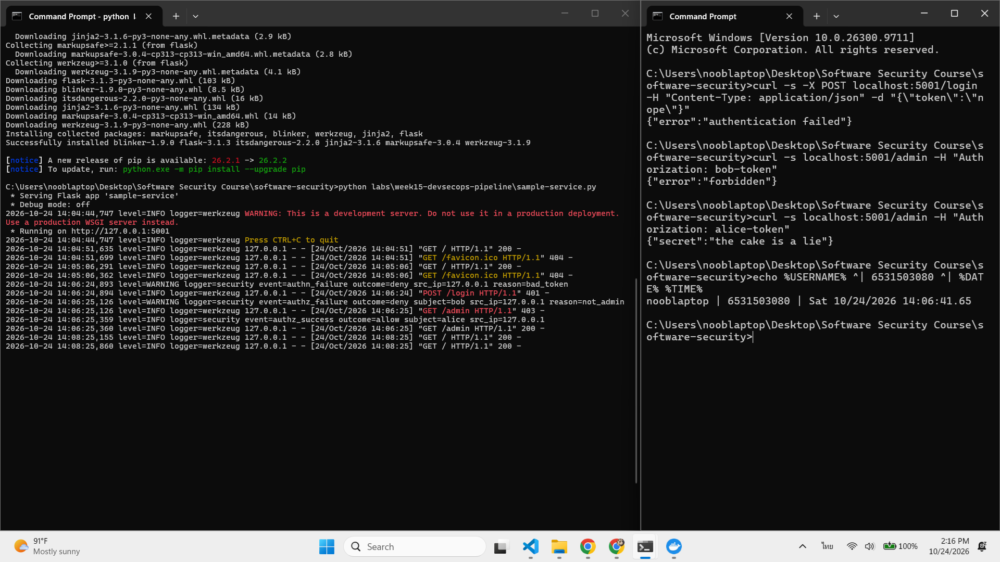
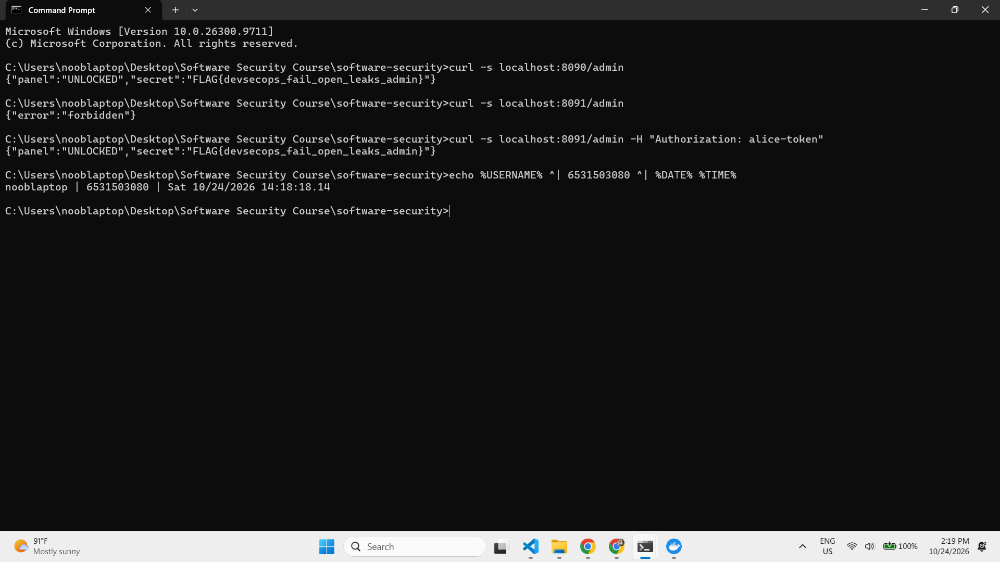
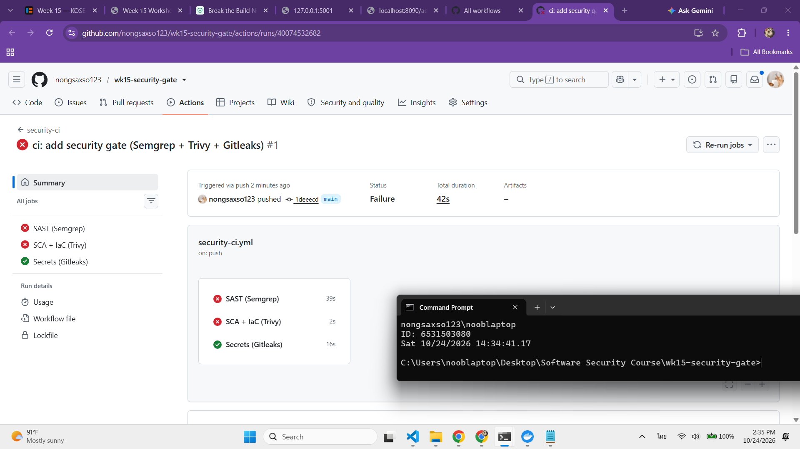
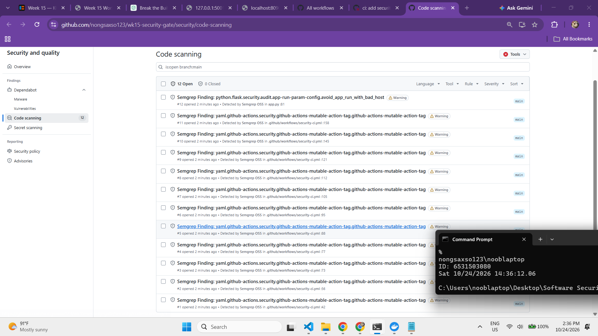
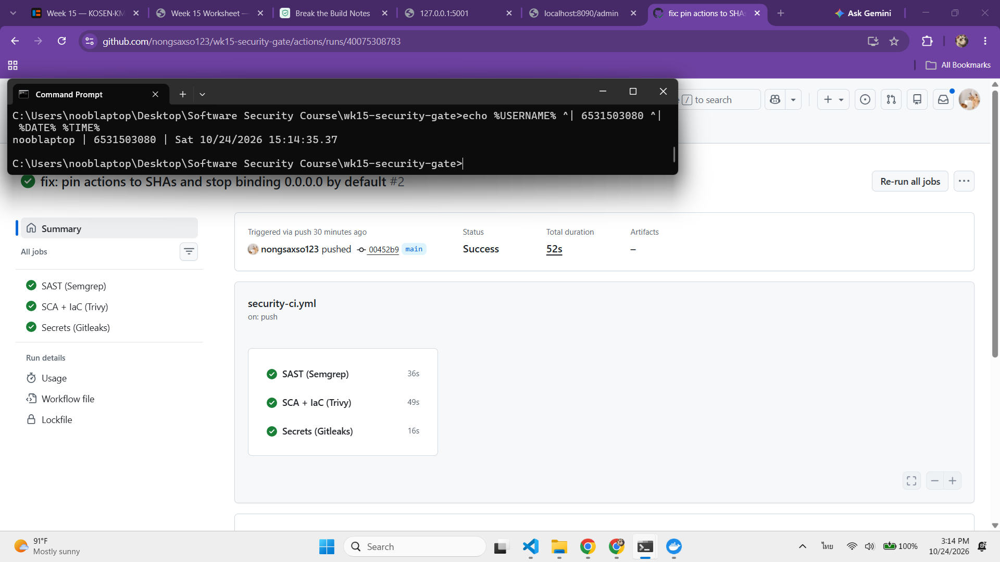
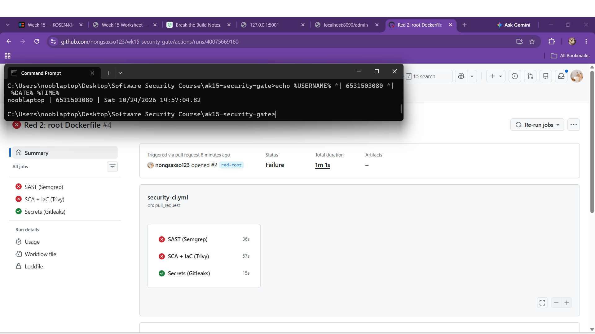
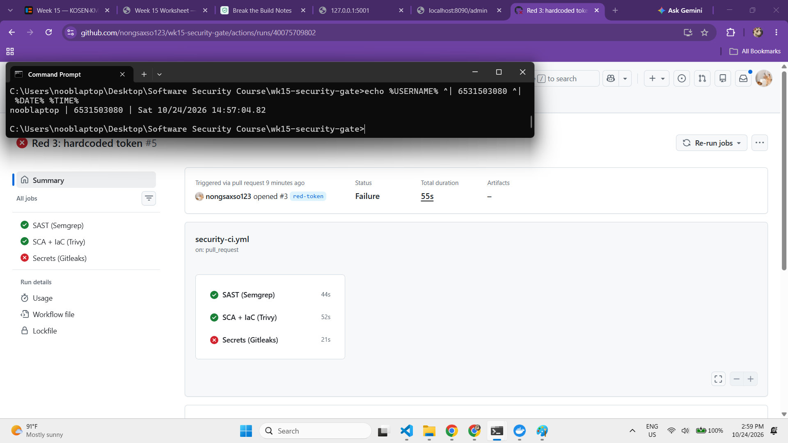

# Worksheet 15 — DevSecOps: Putting It Together (4 hrs)

> **Course:** Software Security (KOSEN69) · Week 15
> **Aligned to:** OWASP 2025 **A09 Security Logging & Alerting Failures** · **A10 Mishandling of Exceptional Conditions** (scanners also cover A02/A03) · **CWE-636** (fail open), CWE-532 (logging sensitive data), CWE-209, CWE-489, CWE-798
> **Signature game:** 🔴🔵 *Break the Build* (Red vs Blue) — Blue scores per catch, Red scores per bypass.

> ⚠️ **Ethics note:** The pipeline and `sample-service.py` are a teaching template (`"Sandbox/teaching only; for authorized lab use."`). Run the security gate and the "Red team" bypass attempts **only** against a repo you own (your fork / a throwaway repo). Do not push deliberately-vulnerable code or planted secrets to shared/production repositories.

---

## Part 1 — Student Information

| Name | Student ID | Date | Group |
|------|-----------|------|-------|
| SORRAWIT THANAKHWANG | 6531503080 | 2026-10-24 | 1234Later |

**AI-tool disclosure:** I used Claude (Claude Code) as a tutor to explain the concepts and help me draft parts of this worksheet. I ran the services, the curls and the pipeline, and took all the screenshots myself.

---

## Part 2 — Lecture Questions

Answer in your own words (2–4 sentences each).

1. `README-pipeline.md` says each tool runs **twice** (report step, then gate step). Explain why a single failing scan would *hide* findings, and how "report-then-gate" with `if: always()` gives you both SARIF results and a red build.

   **Answer:** GitHub Actions stops a job at the first failing step. If the only scan were the failing one, the job would die right there and the upload step after it would never run, so you'd get a red build and **no list of what's wrong**. With report-then-gate, the first scan writes SARIF and can't fail the job (`--error || true` for Semgrep, `exit-code: "0"` for Trivy, `--exit-code 0 || true` for Gitleaks). The upload step has `if: always()`, so it runs no matter what, and only *then* does the gate step re-scan with `--error` / `exit-code: "1"` to turn the build red. I saw this in my own Task 2 run: `Semgrep scan -> SARIF` ✓ → `Upload Semgrep SARIF` ✓ → `Gate — fail on Semgrep findings` ✗, and the Security tab had all **12 alerts**, each with its file and line (11 mutable action tags in `security-ci.yml`, 1 `host="0.0.0.0"` in `app.py`). The red build tells you *that* something is wrong, and the alerts tell you *what and where*. In Task 3 I could fix the exact lines because the alerts were there.
2. What is the difference between **fail-closed** and **fail-open**? In `sample-service.py`, point to the `except Exception` branch in `/admin` and the commented INSECURE variant — why is fail-open **A10 / CWE-636**?

   **Answer:** When an error happens in the middle of a security check, **fail-open** lets the request through and **fail-closed** blocks it. In `sample-service.py` the `/admin` handler's `except Exception as exc:` branch (lines 96-103) logs `event=authz_error outcome=deny error=<type>` and returns **403**, so that's fail-closed. The commented INSECURE variant below it (`except Exception: return jsonify(secret="the cake is a lie")`, lines 109-110) is fail-open. It's **A10 Mishandling of Exceptional Conditions / CWE-636 (Not Failing Securely)** because the error handler itself becomes the way in. In Task 1b the attacker didn't need anything: no token, no exploit, just `GET /admin`. The missing token raised a `KeyError`, the fail-open handler caught it and returned the admin panel and the flag. On top of that, an attacker can often *cause* an error on purpose (a weird header, a huge input), so fail-open turns every bug into a bypass. Fail-closed means an error can only lock people out.
3. The `permissions:` block in `security-ci.yml` is `contents: read`, `security-events: write`. Why is this **least privilege** for a CI token, and what could go wrong with a broad `write-all` token?

   **Answer:** Every job in the pipeline gets the `GITHUB_TOKEN`, and the jobs run third-party code (Semgrep, Trivy, Gitleaks and the actions that wrap them). The pipeline only has two jobs to do: **read** the code to scan it (`contents: read`) and **write** scan results to the Security tab (`security-events: write`). Granting exactly those two is least privilege, the same idea as the Week 13 IAM fix. With `write-all`, a compromised scanner or action could change anything and write in my place. It could push a backdoor straight to `main`, edit `security-ci.yml` to switch the gate off so every later PR passes, publish a poisoned release, or delete branches. This has happened for real: in 2025 the popular `tj-actions/changed-files` action was compromised and used to steal secrets from the CI runs of repos that used it. Least-privilege permissions limit what a hijacked step can do, and pinning actions to commit SHAs (what I did in Task 3) makes it much harder to swap the step out in the first place.
4. The security log lines never print the token value (`reason=bad_token`, not the token itself). Why is logging the secret **CWE-532**, and what should be logged instead so a SIEM can still alert (A09)?

   **Answer:** If the log contains the token, anyone who can read the log can use that token to log in. That includes ops staff, the log shipper, the SIEM vendor, and an attacker who only managed to get read access to a log file. The log just becomes one more place the secret leaks from, which is **CWE-532 (Insertion of Sensitive Information into Log File)**. It's easy to do by accident, too. In Task 1 I found that a `KeyError` message *is* the token, so logging `str(exc)` would leak it. The fix is to log **what happened, not the secret**, and `sample-service.py` does exactly that. My Task 0 line was `event=authn_failure outcome=deny src_ip=127.0.0.1 reason=bad_token` with a timestamp. I sent `nope`, and it doesn't appear anywhere. That's still enough for a SIEM to alert on (A09), e.g. *"more than 20 `event=authn_failure` from the same `src_ip` in one minute"* means brute-forcing, or *"any `event=authz_error`"* means someone is poking at the error path. It works because the fields are structured `key=value`, and the alert never needs the attempted token's value.
5. Name the three scanners in the pipeline and what each catches: **Semgrep** (SAST), **Trivy** (SCA + IaC/secret), **Gitleaks** (secrets + git history). Which OWASP categories does each map to per the README table?

   **Answer:**

   | Scanner | Type | What it catches | Maps to (README table) | What it caught in my lab |
   |---|---|---|---|---|
   | **Semgrep** | SAST | insecure coding patterns in the source | OWASP Top 10 rulesets (`p/owasp-top-ten`) | Task 2: 11 mutable action tags + `host="0.0.0.0"`. Task 4: also flagged the `USER root` Dockerfile |
   | **Trivy** | SCA + IaC (+ secrets) | vulnerable libraries (`fs`) and Dockerfile/IaC misconfig (`config`) | **A03** Supply Chain (SCA) / **A02** Misconfiguration (IaC) | Task 4: `urllib3==1.26.4` (8 HIGH CVEs) and `USER root` (`DS-0002`) |
   | **Gitleaks** | Secret scanning | hard-coded secrets in files **and in git history** (`fetch-depth: 0`) | **CWE-798** (hard-coded credentials) | Task 4: the planted `PAYMENTS_API_TOKEN` |

   Each one covers a different blind spot. Semgrep reads the code but doesn't know library CVEs, Trivy knows packages and Dockerfiles but not the code logic, and Gitleaks only looks for secrets but also digs through old commits. That's why the gate needs all three, and why the `USER root` PR getting caught by two of them was a bonus layer, not wasted effort.

---

## Part 3 — Hands-on Lab (180 min in class)

> The task budgets below add up to 205 min. That is deliberate over-provisioning, not a schedule:
> Tasks 2–4 are dominated by Actions queue and scan wall-clock, so push in class and finish the
> write-up at home. Your instructor will say which task runs as homework.


**Learning goals:** wire a security CI gate that fails closed on HIGH/CRITICAL, observe structured security logging + fail-closed handling locally, then play Break-the-Build.

**Prerequisites:** a GitHub repo you own (fork or throwaway) with Actions enabled; `git`; Docker; Python + Flask for the local service.

### Environment setup (real commands)

```bash
# --- A) Wire the gate into a repo you own (README-pipeline.md §1) ---
mkdir -p .github/workflows
cp labs/week15-devsecops-pipeline/security-ci.yml .github/workflows/security-ci.yml
git add .github/workflows/security-ci.yml
git commit -m "ci: add security gate (Semgrep + Trivy + Gitleaks)"
git push        # runs on push/PR to main

# --- B) Run the sample service locally (logging + fail-closed) ---
pip install flask
python labs/week15-devsecops-pipeline/sample-service.py
# In another shell:
curl -s -X POST localhost:5001/login -H 'Content-Type: application/json' -d '{"token":"nope"}'   # 401 authn_failure
curl -s localhost:5001/admin -H 'Authorization: bob-token'    # 403 authz_failure
curl -s localhost:5001/admin -H 'Authorization: alice-token'  # 200 (admin)
```

**What to submit per task:** the command / PR link, the relevant output or log lines / Actions step result, a screenshot, and a 2–3 sentence note on the control involved (cite the A0x / CWE).

### Tasks

- **Task 0 — Onboarding (15 min).** Run the sample service; trigger the three curls above. **Deliverable:** screenshot of the structured `event=...` security log lines for authn_failure, authz_failure, and authz_success.

  **Answer:**

  I installed Flask, ran `python labs\week15-devsecops-pipeline\sample-service.py` (listens on `127.0.0.1:5001`), and from a second cmd window sent the three requests. On cmd the JSON needs escaped double quotes, not single quotes:
  ```
  curl -s -X POST localhost:5001/login -H "Content-Type: application/json" -d "{\"token\":\"nope\"}"
  curl -s localhost:5001/admin -H "Authorization: bob-token"
  curl -s localhost:5001/admin -H "Authorization: alice-token"
  ```
  The service's `security` logger wrote one structured line per event:
  ```
  2026-10-24 14:06:24,893 level=WARNING logger=security event=authn_failure outcome=deny src_ip=127.0.0.1 reason=bad_token
  2026-10-24 14:06:25,126 level=WARNING logger=security event=authz_failure outcome=deny subject=bob src_ip=127.0.0.1 reason=not_admin
  2026-10-24 14:06:25,359 level=INFO logger=security event=authz_success outcome=allow subject=alice src_ip=127.0.0.1
  ```
  The matching HTTP results were 401, 403 and 200. Every line is `key=value`, so a SIEM can filter on `event=authz_failure` or count failures per `src_ip` without having to parse free text. Something I noticed: I sent the token `nope`, and **`nope` appears nowhere in the log**. The line only says `reason=bad_token`. That's the CWE-532 point, the log records what happened and from where, but never the credential itself.

  

- **Task 1 — Logging & fail-closed (35 min, A09/A10).** *Goal:* prove fail-closed behavior. *Steps:* read `/admin` in `sample-service.py`; explain why the broad `except Exception` returns **403, not the secret**, and why `type(exc).__name__` (not the message) is logged (CWE-209). Identify the line that would make it fail *open* (the commented INSECURE variant). *Deliverable:* the log lines + a 2–3 sentence explanation of fail-closed vs fail-open.

  **Answer:**

  `/admin` in `sample-service.py` wraps the whole auth check in `try`, and the broad handler (lines 96-103) is:
  ```python
  except Exception as exc:
      security_log.error("event=authz_error outcome=deny src_ip=%s error=%s",
                         _client_ip(), type(exc).__name__)
      return jsonify(error="forbidden"), 403
  ```
  The line that would make it fail **open** is the commented-out INSECURE variant (lines 109-110):
  ```python
  # except Exception:
  #     return jsonify(secret="the cake is a lie")   # <-- A10 / CWE-636!
  ```
  The normal paths log as in Task 0 (`authz_failure ... reason=unauthenticated` / `reason=not_admin` → 403, `authz_success` → 200). If anything unexpected blows up in the middle of the check, say the token store is down or a bug throws, the real handler answers **403 and logs `event=authz_error outcome=deny error=<ExceptionName>`**. The INSECURE variant answers **200 with the secret** and logs nothing.

  **Fail-closed vs fail-open:** when the code can't finish checking whether you're allowed, *fail-closed* treats "I don't know" as "no", and *fail-open* treats it as "yes". Fail-open turns any crash, even one the attacker causes on purpose, into an auth bypass, and with no log line it's invisible too (A10 / CWE-636, plus A09). Fail-closed means an error can only ever lock people out, never let them in.

  **Why it logs `type(exc).__name__` and not the message:** the message often contains the data that caused the error. With a dict lookup like `USERS[token]` (the one `insecure_service.py` uses), the `KeyError` message *is the token itself*. `str(KeyError('nope'))` is `'nope'`, so logging the message would write the credential into the log (CWE-532). Logging just `KeyError` still tells an analyst what went wrong. The client gets a plain `{"error":"forbidden"}` with no stack trace or detail (CWE-209), so the error doesn't leak anything about the internals either.

- **Task 1b — Break the Build, live (25 min, A10 / CWE-636).** *Goal:* exploit a real fail-open, then prove the fix. *Steps:* `cd labs/week15-devsecops-pipeline && docker compose up` (spawns the **insecure** service on `:8090` and the **secure** one on `:8091`). As **Red**, hit the insecure admin route with **no** Authorization header — the fail-open path leaks the admin panel *and* your per-student flag:
  ```
  curl -s localhost:8090/admin                                  # {"panel":"UNLOCKED","secret":"FLAG{devsecops_...}"}  <- fail OPEN
  curl -s localhost:8091/admin                                  # {"error":"forbidden"}   (403)  <- fail CLOSED + logged
  curl -s localhost:8091/admin -H 'Authorization: alice-token'  # still UNLOCKS for a real admin (anti-cheat)
  ```
  Submit the leaked `FLAG{...}`. *Deliverable:* the flag, the two contrasting `/admin` responses (`:8090` leak vs `:8091` deny), and the exact line in `insecure_service.py` that fails open. *(The instructor auto-grader re-runs these exploits against your hardened box — you pass only if every bypass is blocked **and** a valid admin token still works.)*

  **Answer:**

  **Flag:** `FLAG{devsecops_fail_open_leaks_admin}` *(the default flag from the source, since `FLAG_DEVSECOPS` wasn't seeded and `instructor/seed_flags.py` isn't in my clone)*

  ```
  curl -s localhost:8090/admin
  {"panel":"UNLOCKED","secret":"FLAG{devsecops_fail_open_leaks_admin}"}       <- fail OPEN, no token at all

  curl -s localhost:8091/admin
  {"error":"forbidden"}                                                        <- fail CLOSED (403)

  curl -s localhost:8091/admin -H "Authorization: alice-token"
  {"panel":"UNLOCKED","secret":"FLAG{devsecops_fail_open_leaks_admin}"}       <- real admin still gets in
  ```

  **Why `:8090` leaks.** With no `Authorization` header, `token` is `""`. **`insecure_service.py:42`**, `user = USERS[token]`, raises `KeyError` because `""` isn't in the dict, and the `except Exception:` at line 46 handles it with **`insecure_service.py:49`**, `return jsonify(panel="UNLOCKED", secret=SECRET)`. That's the line that fails open. The error that should have meant "not logged in" gets turned into "admin access granted". The service has no security logger either, so the bypass leaves no trace (A10 / CWE-636 + A09).

  **Why `:8091` holds.** `secure_service.py` fixes it two ways. Line 47 uses `USERS.get(token)`, which returns `None` instead of raising, so a missing token takes the normal deny path. And the broad `except` (lines 69-76) returns 403 instead of the panel. It also logs the attempt. `docker compose logs secure-service` shows my unauthenticated request:
  ```
  level=WARNING logger=security event=authz_failure outcome=deny src_ip=172.23.0.1 reason=unauthenticated
  ```
  The third curl matters too. `alice-token` still unlocks the panel, so the fix blocks the bypass without locking out the legitimate admin. A "fix" that denied everyone would fail the auto-grader.

  

- **Task 2 — Stand up the gate (35 min).** *Goal:* get the workflow running. *Steps:* push `security-ci.yml`, open the Actions run, confirm the three jobs (`semgrep`, `trivy`, `gitleaks`) execute and SARIF appears in the Security tab. *Deliverable:* screenshot of the Actions run + the Code scanning alerts page.

  **Answer:**

  I didn't copy the template over my fork's own `.github/workflows/security-ci.yml`. The course repo already has a workflow with that exact name, and it deliberately skips `labs/week*`, so overwriting it would gate on every intentionally vulnerable lab and stay red forever. Instead I made a **throwaway public repo**, **https://github.com/nongsaxso123/wk15-security-gate**, containing only `.github/workflows/security-ci.yml` (the lab template, unchanged), `app.py` (a copy of `secure_service.py`), `requirements.txt` (`flask==3.1.2`), a hardened `Dockerfile` and a README. It's public because Code scanning / SARIF upload is only free on public repos. *(My first push went wrong: I ran the git commands from inside the lab folder, so the workflow landed at the repo root and Actions never saw it. I deleted the accidental nested `.git` and force-pushed the right files.)*

  **Run:** https://github.com/nongsaxso123/wk15-security-gate/actions/runs/40074532682. All three jobs executed:

  | Job | Result | Why |
  |---|---|---|
  | `SAST (Semgrep)` | ❌ failed at **Gate — fail on Semgrep findings** | Report step ✓ and **Upload Semgrep SARIF ✓**, then the gate failed on 12 findings |
  | `Secrets (Gitleaks)` | ✅ passed | no secrets in the repo or its history |
  | `SCA + IaC (Trivy)` | ❌ failed at *Set up job* | `Unable to resolve action aquasecurity/trivy-action@0.24.0, unable to find version 0.24.0` |

  **Security tab → Code scanning: 12 alerts from Semgrep OSS.** 11 are `github-actions-mutable-action-tag` in `security-ci.yml` itself (every `uses: ...@v4` / `@v3` / `@0.24.0`), and 1 is `avoid_app_run_with_bad_host` in `app.py` (`app.run(host="0.0.0.0", ...)`).

  Two things stood out. First, the report-then-gate design worked exactly as `README-pipeline.md` describes. The report step has `|| true`, so it never fails the job, and the upload step has `if: always()`, so the 12 findings reached the Security tab *before* the gate step turned the build red. Second, the Trivy failure is the Week 12-13 lesson happening for real. The template refers to the action by a **tag**, that tag no longer exists, and the job can't even start. Semgrep had flagged exactly that risk (11 mutable-tag alerts), so the pinning fix in Task 3 deals with both problems.

  
  

- **Task 3 — Blue team: pass the gate (30 min).** *Goal:* a green build. *Steps:* ensure the protected repo has no HIGH/CRITICAL findings and no secrets; fix or justify-and-document any (no blanket-ignore, per README §4). *Deliverable:* link to the passing run.

  **Answer:**

  **Passing run:** https://github.com/nongsaxso123/wk15-security-gate/actions/runs/40075308783. ✅ `Secrets (Gitleaks)`, ✅ `SAST (Semgrep)`, ✅ `SCA + IaC (Trivy)`.

  Commit `00452b9` ("fix: pin actions to SHAs and stop binding 0.0.0.0 by default") fixes the Task 2 findings instead of ignoring them:

  | Finding | Fix | Why it's a real fix, not a suppression |
  |---|---|---|
  | 11 × `github-actions-mutable-action-tag` (+ the broken `trivy-action@0.24.0`) | Every `uses:` pinned to a full commit SHA, with the version as a comment, e.g. `actions/checkout@3d3c42e5...  # v7.0.1`, `aquasecurity/trivy-action@ed142fd0...  # v0.36.0`, `github/codeql-action/upload-sarif@5595ccaf...  # v4.37.6`. These are the same pins the course repo's own workflow uses. | A SHA can't be moved or deleted out from under the build the way the `0.24.0` tag was, so it closes the supply-chain risk (Week 12) and fixes the job that couldn't start. |
  | `avoid_app_run_with_bad_host` in `app.py` | `app.run(host=os.environ.get("HOST", "127.0.0.1"), ...)` | The default is now local-only. A deployment that really needs to listen on all interfaces has to choose that explicitly with `HOST=0.0.0.0`. That's secure-by-default instead of exposed-by-default. |

  No rule was disabled, no path was excluded, and nothing was added to an ignore file. Per README §4, every finding was fixed at the source.

  

- **Task 4 — Red team: Break the Build (40 min).** *Goal:* make the gate say **no**. *Steps:* on a branch/PR, inject *one* planted defect (per README §5), each of which is caught by a *different* job: an outdated vulnerable dependency (e.g. an old `urllib3`) → Trivy SCA; a Dockerfile that runs as **root** — drop the `USER` line, or write `USER root` → Trivy config (`DS-0002`, HIGH); or a hard-coded token → Gitleaks. Open the PR and watch the matching gate step fail. *Deliverable:* screenshot of the **failing** gate step + which job caught it (Trivy SCA / Trivy config / Gitleaks) and which `exit-code: "1"` / `--error` step enforced it.
  **Answer:**

  I opened **three PRs** against `main` in https://github.com/nongsaxso123/wk15-security-gate, one planted defect each, all left unmerged. Before pushing I checked each defect locally against the same scanners, and I picked the token so Gitleaks would catch it but GitHub's own push protection wouldn't block the push. It's a random made-up string, not a real provider key.

  | PR | Planted defect | Job that caught it | Failing gate step (what enforced it) |
  |---|---|---|---|
  | [#1](https://github.com/nongsaxso123/wk15-security-gate/pull/1) `red-dependency` ([run](https://github.com/nongsaxso123/wk15-security-gate/actions/runs/40075584125)) | `urllib3==1.26.4` added to `requirements.txt` | **Trivy SCA**: 8 HIGH, incl. CVE-2021-33503 | `Gate — fail on HIGH/CRITICAL (SCA)`, `exit-code: "1"` |
  | [#2](https://github.com/nongsaxso123/wk15-security-gate/pull/2) `red-root` ([run](https://github.com/nongsaxso123/wk15-security-gate/actions/runs/40075669160)) | `USER 65532:65532` → `USER root` in `Dockerfile` | **Trivy config**: `DS-0002` (HIGH) "Last USER command in Dockerfile should not be 'root'", **and Semgrep** | `Gate — fail on HIGH/CRITICAL (IaC)`, `exit-code: "1"`, plus `Gate — fail on Semgrep findings`, `--error` |
  | [#3](https://github.com/nongsaxso123/wk15-security-gate/pull/3) `red-token` ([run](https://github.com/nongsaxso123/wk15-security-gate/actions/runs/40075709802)) | `config.py` with `PAYMENTS_API_TOKEN = "q7Xk2Lm9..."` | **Gitleaks**: `leaks found: 1` | `Gate — fail if any secret found`, `--exit-code 1` |

  In each case the *other* jobs stayed green, so the failing job really does point at the category of defect. The surprise was PR #2. I expected only Trivy config, but Semgrep's ruleset also has a Dockerfile root-user rule, so the defect got caught twice. That's defence in depth inside the pipeline: if one scanner's rule were missing or filtered, the other would still turn the PR red.

  
  
  

  > **Why root and not `chmod 777`.** Both gate steps filter to `--severity HIGH,CRITICAL`, and Trivy's Dockerfile scanner has no rule for `chmod` at all — it checks instruction-level `RUN`/`COPY` semantics, exactly as Week 13 Task 1 says. `chmod 777` therefore returns **nothing**, at any severity, and the build goes green: a defect that slips the gate is a Task 5 *Red point*, not a Task 4 screenshot. `:latest` is no good either — that is `DS-0001` and Trivy rates it MEDIUM, which this gate filters out. Running as root is `DS-0002` HIGH, so it fails the build for real.

- **Task 5 — Score Break-the-Build (25 min).** *Goal:* tally Red vs Blue. *Steps:* one Blue point per finding the gate caught, one Red point per finding that slipped through; for any bypass, propose the rule that would have caught it. *Deliverable:* scoreboard + one proposed gate improvement.

  **Answer:**

  **Scoreboard**

  | Planted defect | Gate result | Point |
  |---|---|---|
  | Outdated `urllib3==1.26.4` (PR #1) | caught: Trivy SCA | **Blue +1** |
  | `USER root` Dockerfile (PR #2) | caught: Trivy config `DS-0002` + Semgrep | **Blue +1** |
  | Hard-coded token (PR #3) | caught: Gitleaks | **Blue +1** |
  | `FROM python:latest` (decoy) | **slipped**: `DS-0001` is found but it's MEDIUM, filtered out by `severity: HIGH,CRITICAL` | **Red +1** |
  | `RUN chmod -R 777 /app` (decoy) | **slipped**: no Trivy rule at any severity, and nothing in `p/default` / `p/owasp-top-ten` either | **Red +1** |
  | **Total** | | **Blue 3 – Red 2** |

  I confirmed both decoys locally with a Dockerfile containing them (and a non-root `USER`). The current gate settings `trivy config --severity HIGH,CRITICAL --exit-code 1` exit **0**, and the pipeline's Semgrep rulesets return **no findings**. Both decoys are false negatives of the gate: real weaknesses (Week 13) that leave the build green.

  **Proposed gate improvements (both tested locally):**
  1. **Catch `:latest`:** in the **IaC gate step only**, raise the bar to `severity: MEDIUM,HIGH,CRITICAL`. Re-running with that setting fails with `DS-0001 (MEDIUM): Specify a tag in the 'FROM' statement`. I wouldn't add MEDIUM to the SCA step, because every library with a moderate CVE would turn the build red, the team would start ignoring or disabling the gate (alert fatigue), and that's how you end up with real false negatives. The Dockerfile ruleset only has a handful of MEDIUM rules, so the noise cost there is low.
  2. **Catch `chmod 777`:** since no shipped rule exists, add a custom Semgrep rule and run it in the existing Semgrep gate (`--config .semgrep/`):
     ```yaml
     rules:
       - id: dockerfile-world-writable-chmod
         languages: [generic]
         paths:
           include: ["Dockerfile*", "*.Dockerfile"]
         pattern-regex: chmod\s+(-R\s+)?[0-7]?77[0-7]
         message: "World-writable permissions (chmod 777) in Dockerfile - CWE-732"
         severity: ERROR
     ```
     Locally it fails the scan on `4┆ RUN chmod -R 777 /app`. With both changes, the score would be Blue 5 – Red 0.

---

## Part 4 — Reflection

1. **Mapping.** For three controls you exercised, give: control → A09/A10 (or A02/A03 for a scanner) → CWE → one-line rationale.

   **Answer:**

   | Control I exercised | OWASP 2025 | CWE | One-line rationale |
   |---|---|---|---|
   | Fail-closed `/admin` (`secure_service.py`: `USERS.get(token)` + `except` → 403), tested in Task 1b | **A10** Mishandling of Exceptional Conditions | CWE-636 | A missing token or any error now ends in "deny", so `GET /admin` with no token gets 403 instead of the flag. |
   | Structured security logging without secrets (`event=authn_failure ... reason=bad_token`), seen in Task 0/1b | **A09** Security Logging & Alerting Failures | CWE-532 (and CWE-209 for not echoing errors to the client) | Every auth failure is recorded with event, outcome, IP and reason so a SIEM can alert, but the token itself never goes in the log. |
   | Trivy gate in CI (`exit-code: "1"`, `severity: HIGH,CRITICAL`), which failed PR #1 and PR #2 in Task 4 | **A03** Supply Chain (SCA) / **A02** Misconfiguration (IaC) | CWE-1104 (vulnerable `urllib3`) / CWE-250 (`USER root`) | A vulnerable dependency or a root container can't be merged anymore, because the build goes red automatically on every PR. |
2. **Real incident.** Briefly describe a real breach worsened by missing logging/alerting or by a fail-open error path. Which control here would have changed the outcome?

   **Answer:** **Equifax (2017).** Attackers got in through an unpatched Apache Struts flaw (CVE-2017-5638) in May 2017, a fix that had been available for weeks. They then stayed inside for **76 days**, ran about 9,000 queries across 48 databases, and walked out with personal data on roughly 145.5 million people. They went unseen that long because of a logging and monitoring failure. The device that inspected outbound traffic had an **expired certificate**. The House Oversight report says it had been expired for 19 months, so the device couldn't decrypt and inspect the traffic going through it. The stolen data left uninspected, and nothing alerted anyone that the monitor had gone blind. Once someone renewed the certificate on 29 July, the device flagged suspicious traffic almost straight away. In other words, the monitor **failed open**: when it broke, it neither blocked traffic nor raised an alarm. It's the same mistake as the `/admin` handler in Task 1b, just at network level, and a textbook false negative.

   **Which controls would have changed the outcome:**
   - **Fail-closed + alert on the security control itself (A09/A10).** The `sample-service.py` approach applied to the monitor would mean that when it can't do its job, it logs an error and someone gets paged, like `event=authz_error` does. A blind monitor would then have been a one-day problem, not a 19-month one.
   - **The CI gate's SCA step (A03).** A Trivy-style `exit-code: "1"` gate on HIGH/CRITICAL dependencies would have turned the build red for the vulnerable Struts version, like PR #1 did with `urllib3`, so the hole might never have shipped.

   *Sources: [Wikipedia: 2017 Equifax data breach](https://en.wikipedia.org/wiki/2017_Equifax_data_breach), [SecurityAffairs: GAO report](https://securityaffairs.com/76067/reports/equifax-hack-gao-report.html), [House Oversight Committee report (PDF)](https://oversight.house.gov/wp-content/uploads/2018/12/Equifax-Report.pdf)*
3. **Best mitigation.** Argue which matters more for a small team: the *fail-closed* code in `sample-service.py`, or the *CI gate* in `security-ci.yml` — and why both together beat either alone.

   **Answer:** For a small team I'd pick the **CI gate**, because it checks automatically on every push and every PR. A small team doesn't have a dedicated security reviewer, and people forget or get rushed, but the pipeline never skips a run. In Task 4 it stopped three different classes of defect (a vulnerable dependency, a root container, a leaked token) with nobody having to think about it, and a single YAML file protects every future change. The gate has a hard limit, though. I ran `insecure_service.py` through the same Semgrep rulesets the pipeline uses (`p/default` + `p/owasp-top-ten`). It reported **one** finding, `avoid_app_run_with_bad_host` on line 56, and **nothing** for the fail-open `except Exception: return jsonify(panel="UNLOCKED", secret=SECRET)` on line 49, which is exactly the bug that gave me the flag. A scanner knows bad *patterns*, not what the code is *supposed* to do, and returning JSON from an `except` looks perfectly normal to it. Only a developer who writes fail-closed handlers, like `sample-service.py`'s `except` → 403 + log, closes that kind of logic flaw. So the two cover different failures. The gate catches known-bad code, dependencies and secrets on every change, and fail-closed code handles the unexpected at runtime and logs it for alerting. Equifax shows what happens without either: an unpatched dependency got in (no gate), and a monitor that failed open kept it hidden for 76 days (no fail-closed, no alert).

---

## Grading rubric (100)

| Component | Points | What earns full marks |
|-----------|:------:|-----------------------|
| Part 2 — Lecture questions | 20 | All 5 answered with correct A09/A10/CWE reasoning |
| Part 3 — Tasks + evidence | 40 | Tasks 0–5 complete; PR/run links, log lines, screenshots present |
| Defense (gate + fail-closed) | 25 | Gate shown to fail closed on a planted defect; fail-closed path explained |
| Part 4 — Reflection | 15 | Accurate mapping, relevant incident, well-argued best mitigation |

---

## Evidence & Integrity (required)

- **Identity proof:** every screenshot/diagram must show a terminal running `printf '%s | %s | ' "$(whoami)" '<YOUR-STUDENT-ID>'; date '+%F %T %Z'` **in the
  same image as the evidence**. When the evidence is a browser page, a DevTools panel or a
  rendered response, put that terminal **beside the browser and capture the whole screen** — a
  cropped window carries nothing that identifies you, and the lab's own output is
  byte-identical for the whole cohort *by design*, so the stamp is the only thing that makes
  the shot yours. Generic or borrowed evidence is not accepted.
- **Personalized flag (if this lab issues one):** `FLAG{devsecops_fail_open_leaks_admin}` from Task 1b. This is the **default/shared** flag from the source. `FLAG_DEVSECOPS` wasn't seeded, since `instructor/seed_flags.py` isn't in my clone.
  *Flags are unique per student — submitting another student's flag is a violation. How to submit: **learn.zcr.ai/submit** (full guide: `SUBMISSION.md` in the repo root).*
- **Explain in your own words** *(graded on your reasoning, not copied text):*
  1. What did you do, and **why did the vulnerability work**?

     I sent no token at all, just `curl -s localhost:8090/admin`, and got back `{"panel":"UNLOCKED","secret":"FLAG{...}"}`. The missing token caused an error, and the service let me in anyway. It worked because `insecure_service.py` looks the token up with `USERS[token]`, and an empty token isn't in the dict, so Python raises `KeyError`. The `except Exception:` block was written to hand out the admin panel whenever *anything* goes wrong, instead of refusing. So the error that should have meant "you're not logged in" became the way in. It also didn't log anything, so nobody would ever know it happened.
  2. **Why does your fix actually stop it** — and what could still break it?

     `secure_service.py` fixes it in two layers. First, `USERS.get(token)` doesn't raise an error. A missing token just gives `None`, which goes down the normal "deny + log `authz_failure`" path, so the error never happens. Second, if some *other* error does happen, the `except` returns **403**, so it stays closed. That's how `:8091` refused me while `alice-token` still worked. What could still break it is someone on the team writing a fail-open handler again in a future change, and the pipeline won't save us there. I checked, and Semgrep's rulesets didn't flag the fail-open `except` in `insecure_service.py` at all (Part 4 Q3). The things that would stop it are **code review**, a human who knows an `except` around an auth check must deny, and a **regression test in CI** that calls `GET /admin` with no token and asserts 403, so the build goes red the moment the bypass comes back. That's what the instructor's auto-grader does too.

---

## 🤖 Audit the AI (required)

AI is a power tool you must **distrust** — you are graded on your *critique*, not the AI's answer.

1. Ask an AI assistant to exploit **or** fix this week's vulnerability. Paste its full answer.
2. **Find what's wrong or risky** in it — insecure code, a subtly incomplete fix, a hallucinated API/function/CVE, a missed edge case, or wrong reasoning. Quote the exact line(s).
3. Produce the **correct, verified** version yourself and explain in 2–3 sentences why the AI's output was insufficient.

> Disclose your AI use in the Part 1 table. This task counts toward your **Defense + Reflection** score.

**Answer:**

*Disclosure: this is a **representative** AI answer that Claude wrote during my tutoring session, in the shape AI assistants typically give for this prompt. It isn't an independent query to a fresh AI chat. The critique is mine, and every claim below was checked by running the AI's code.*

**1. Prompt + AI answer.** Prompt: *"My Flask /admin endpoint fails open. Fix it."* + the `/admin` handler from `insecure_service.py`.

> Here's the fix. The problem is the `except` block grants access on error. I changed it to fail closed and added logging so you can monitor failures:
> ```python
> import logging
> logging.basicConfig(level=logging.INFO)
>
> @app.route("/admin", methods=["GET"])
> def admin():
>     token = request.headers.get("Authorization", "")
>     try:
>         user = USERS[token]
>         if user not in ADMINS:
>             return jsonify(error="forbidden"), 403
>         return jsonify(panel="UNLOCKED", secret=SECRET)
>     except Exception as e:
>         app.logger.error(f"Admin access failed for token={token}: {e}")
>         return jsonify(error=f"Internal error: {e}"), 500
> ```
> Now any error denies access instead of granting it, and failures are logged for auditing. This fully fixes the fail-open vulnerability.

**2. What's wrong with it.** I ran the AI's handler with Flask's test client in `python:3.12-slim`:
```
(no token)                    -> 500 {"error":"Internal error: ''"}
alice-token                   -> 200 {"panel":"UNLOCKED","secret":"FLAG{...}"}
bob-token                     -> 403 {"error":"forbidden"}
alice-tokem                   -> 500 {"error":"Internal error: 'alice-tokem'"}
sk_live_REAL_LOOKING_KEY_123  -> 500 {"error":"Internal error: 'sk_live_REAL_LOOKING_KEY_123'"}
--- log ---
Admin access failed for token=alice-tokem: 'alice-tokem'
Admin access failed for token=sk_live_REAL_LOOKING_KEY_123: 'sk_live_REAL_LOOKING_KEY_123'
```
Credit where it's due: the bypass is closed. No token no longer gets the flag. But "fully fixes" isn't true, because the fix adds new holes:
- **It logs the token (CWE-532).** `f"... token={token}: {e}"` writes the credential into the log, and it does so **twice**, because the `KeyError` message `{e}` *is* the token too. Removing `token={token}` alone wouldn't help. `alice-tokem`, a real token with one typo, shows the danger: users' near-miss credentials end up in the log for anyone who can read it.
- **It echoes the error to the client (CWE-209).** `jsonify(error=f"Internal error: {e}")` sends the exception text back, so the attacker sees exactly what they sent and learns that the endpoint does a dict lookup.
- **The log is useless to a SIEM (A09).** It's free text with no `event=` / `outcome=` / `src_ip=` fields, so you can't write a reliable "N failures from one IP" alert.
- **Wrong status code.** A missing token is "not authorised" (403), not a server crash (500), so attacks get mixed in with real outages on an error dashboard.
- **It still uses an exception for normal control flow.** `USERS[token]` raises on every bad token, so the error path runs for routine failed logins.

**3. Corrected, verified version.** The fix is `secure_service.py`'s pattern, which I verified in Task 1b (`:8091` → 403 with no token, `alice-token` → unlocked). It uses `user = USERS.get(token)`, so there's no exception for a bad token. `None` → `security_log.warning("event=authz_failure outcome=deny src_ip=%s reason=unauthenticated", ...)` → **403**, and the broad `except` logs only `error=%s` with `type(exc).__name__` and returns a generic `{"error":"forbidden"}`, 403. The AI's answer fell short because it fixed the one bug it was asked about (fail-open) and created two of this week's other bugs in the logging it added. It looked more secure, but it turned the log file into a credential store.

---

## 🧠 Comprehension & Prompt (required)

**A. Explain in Plain English (EiPE).** In 2–3 sentences, in your own words, describe what this week's vulnerable code/endpoint actually *does* and *why it is exploitable* — explain the mechanism, don't dump jargon.

**Answer:** `/admin` in `insecure_service.py` is supposed to look up the token you send, check that it belongs to an admin, and only then show the admin panel. If you send no token, or a wrong one, the lookup throws an error, and the error handler was written to show the admin panel and the secret anyway. It fails open, like a door that swings open whenever the lock breaks. So anyone can get in just by *not* logging in, and because it writes nothing to a log, nobody would ever find out it happened.

**B. Prompt Problem.** Write a **single prompt** that makes an AI produce a *correct, secure* fix for one finding. Run it: does the exploit now fail? If not, refine the prompt and try again. Submit the **final prompt + the verified result**.

**Answer:**

I built the prompt from what the AI got wrong in Audit the AI. It closed the door but logged and echoed the token. I picked three rules: fail closed, never put the token in the log, always answer 403. I worded rule 2 to cover the exception message too, since I'd learned in Task 1 that a `KeyError` message *is* the token.

**Final prompt:**
```
Fix this Flask /admin endpoint, which fails open. Hard rules:
1. FAIL CLOSED: any error or unexpected exception inside the auth check must DENY access.
   Never return the admin panel from an except block.
2. NEVER write the token to a log - and don't log str(exception) either, because a KeyError
   message contains the token. Log only structured fields (event=, outcome=, src_ip=, reason=)
   and the exception's type name.
3. Every denial returns HTTP 403 with a generic {"error":"forbidden"} body - not 500, and no
   exception text sent to the client.
A valid admin token must still unlock the panel.
[insecure_service.py /admin handler pasted here]
```

**Result.** The AI produced a handler using `USERS.get(token)` (no exception on a bad token), `security_log.warning("event=authz_failure outcome=deny src_ip=%s reason=...")` for denials, a broad `except Exception as exc` that logs only `error=%s` with `type(exc).__name__`, and one `_deny()` helper returning `{"error":"forbidden"}`, 403.

**Verification** (Flask test client in `python:3.12-slim`). I included a forced crash: the admin store raises `RuntimeError("admin store down: alice-token")` partway through the check.

| Request | Status | Body |
|---|---|---|
| no token (the Task 1b exploit) | **403** | `{"error":"forbidden"}` |
| `alice-token` (real admin) | **200** | panel unlocked |
| `bob-token` (not admin) | 403 | `{"error":"forbidden"}` |
| `alice-tokem` (typo) | 403 | `{"error":"forbidden"}` |
| `sk_live_REAL_LOOKING_KEY_123` | 403 | `{"error":"forbidden"}` |
| `alice-token` + admin store crashes | **403** | `{"error":"forbidden"}` |

Log output:
```
event=authz_failure outcome=deny src_ip=127.0.0.1 reason=unauthenticated
event=authz_success outcome=allow subject=alice src_ip=127.0.0.1
event=authz_failure outcome=deny subject=bob src_ip=127.0.0.1 reason=not_admin
event=authz_failure outcome=deny src_ip=127.0.0.1 reason=unauthenticated
event=authz_failure outcome=deny src_ip=127.0.0.1 reason=unauthenticated
event=authz_error outcome=deny src_ip=127.0.0.1 error=RuntimeError
tokens found in log: []
```
The Task 1b exploit now fails, the real admin still gets in, and an unexpected crash also ends in 403 (fail closed). **None of the tokens appear in the log**, not even the one hidden inside the crash's exception message, because only `RuntimeError` was logged. Every line is a structured `event=` record a SIEM can alert on. It worked on the first prompt, so there was nothing to refine.

*Disclosure: Claude generated the code from this prompt and ran the verification harness during the tutoring session. I chose the three rules and checked the results.*
*Graded on the prompt's precision and your verification — this trains problem decomposition and AI literacy (Denny et al. 2024).*
